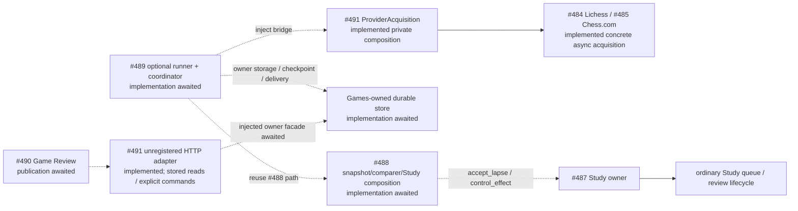

# Continuous game feedback — #491 preparation checkpoint

This is unmerged source preparation under [#491](https://github.com/aaweaver-actuary/tempo/issues/491)
and the pinned [SPEC v0.2](https://github.com/aaweaver-actuary/tempo/blob/6885b9420320517ac74df47e631ed796da96c94a/SPEC.md).
The complete A03/A04 product workflow is **pending**, not installed or deployed.
#488 retains the entire first shared-root editing window and does not depend on
this checkpoint. No root, Settings, Compose or central registration is changed.

## Usable private interfaces

[`ProviderAcquisition`](../../../backend/app/product_composition/game_sync.py)
adapts the concrete async #484/#485 operations to the frozen synchronous
`GameAcquisitionPort.fetch_page(account, window, continuation)` seam. Async worker
callers can use `fetch_page_async`. It returns the actual `GamePage` subtype,
including Chess.com's original metadata; no projection discards provenance.
It does not persist, retry, advance a checkpoint, choose a window/account/filter,
or assign a durable source revision. #489 owns those decisions and state.

`AcquisitionPolicy(provider, speeds, rated, source_revision)` requires explicit
filters. `rated=None` means both; `True` means rated-only. Lichess additionally
supports `False` for casual-only; Chess.com rejects that unsupported choice
instead of widening it. The default resource bounds are 100 Lichess rows,
8 MiB response, 10-second socket budget and 30-second total I/O budget. Hard
caps are 1000 Lichess rows, 8 MiB Lichess / 32 MiB Chess.com, 15-second socket
and 30-second total I/O. Each call owns a credential-free client with one
connection, redirects and ambient environment configuration disabled. Errors
retain provider Retry-After/checkpoint facts; `AcquisitionDeadline` retains the
input continuation. The caller supplies cancellation. No retry or sleep occurs.

[`create_game_review_router(operations)`](../../../backend/app/games/feedback/http.py)
constructs an **unregistered** FastAPI router. `GameReviewOperations` lists the
minimal synchronous consumer capability for an injected owner facade:

| Method | HTTP route | Effect |
| --- | --- | --- |
| `recent_games` | GET `/api/product/game-review/games` | Stored `RecentGames` only |
| `game_detail` | GET `/api/product/game-review/games/{provider}/{game_id}?repertoire_id=...` | Stored `GameDetail` only |
| `sync` | POST `/api/product/game-review/sync` | Enqueue configured provider job with explicit operation ID |
| `retry_feedback` | POST `/api/product/game-review/feedback/retry` | Resolve current stored Finding and replay its logical command |

The two POST request envelopes use the shared provider/Finding values, not a new
game or learning DTO. Extra account/filter fields are rejected. The concrete
owner must validate current stored evidence and durable operation replay; a
well-formed client Finding is never authority. Responses preserve exact owner
`LearningReceipt` values: `applied` is not changed to `available`. Router reads
never call acquisition, comparison, admission or retry. Missing/unavailable
projection handling belongs to the injected owner; no fallback fabricates data.
The facade is not wired until that implementation exists.

## Actual dependency and failure boundary



Solid links are implemented here or supplied owner operations; dotted links are
pending integration. No producer is added to Study's startup, readiness or save
path. This source checkpoint alone does **not** prove process/host/database
resource isolation. No Study database connection is acquired by either new file.
Existing legacy background entry points remain unchanged. The current Compose
`background-worker` uses Celery `app.celery_app`, queue `background`, concurrency
1, 0.35 CPU and 448 MiB; that is a legacy launch fact, not proof of the new worker's
independence. A separate optional process must use #489's public run-once/stop
interface without importing the HTTP application root or Study lifecycle.

## Exact later shared changes — proposed, not reserved or edited

After #488 releases its window, publish a short #481 reservation before editing:

- `backend/app/main.py`: register the factory-created router using the concrete
  Games facade; no optional job starts or blocks readiness there.
- `app/types.ts`, `app/components/navbar.tsx`,
  `app/lib/study-workspace-policy.ts`, `app/lib/workspace-data.ts`, and
  `app/views/legacy-workspace.tsx`: add the Game Review view and lazy #490 mount
  in the retained optional shell. Preserve the existing Home/Study controller
  instance and active attempt; selecting Game Review cannot issue Study commands.
- `backend/app/contracts/transport/settings.py`,
  `backend/app/settings_commands.py`, `app/views/settings_view.tsx`,
  `app/utils/settings.ts`: inspect the current owner contract before adding any
  field. Existing provider usernames and `auto_sync_minutes` are reusable; do not
  overwrite an account or infer window/speed/rated filters. Games-owned persistent
  window/filter/checkpoint settings require #489's store contract first.
- Central dependency/test/Compose registration only for the concrete new worker
  and exact three #491 suites. Add a central diagram-index link to this canonical
  drawing, rather than copying it. #488 owns its own dependency registrations.

Existing coverage settings reject updates while their analysis owner is held.
D04 population/time controls remain unset, and repertoire weight storage remains
with its Study introduction owner. Neither is silently chosen or made a game
feedback prerequisite. No schema or migration is allocated here.

Proposed new worker bounds are one job at a time, 0.25 CPU, 256 MiB, and existing
background transaction/lock caps of 250/25 ms. They require concrete launcher and
disposable lifecycle proof before becoming implemented claims. No connection or
Study lock may span HTTP or chess work. Host-specific latency remains unmeasured.

## Evidence and remaining acceptance

Named owning command:

```sh
TEMPO_PYTHON=/Users/andy/Documents/Codex/2026-10-26/task-14/python-491 \
  make python-file FILE=backend/tests/test_product_game_sync_integration.py
```

The wrapper uses already-installed Python dependencies plus this checkout's
source paths; no install. At the initial private checkpoint, **6 cases pass**
using actual provider implementations with `httpx.MockTransport`, shared immutable
DTOs, and a disposable in-memory FastAPI app with a fake projection/command owner.
Exact 205 Lichess IDs span three pages; Chess.com spans two months. Every page
recreates the outer adapter. HTTP checks prove inert GETs, explicit command IDs,
unchanged receipts, validation and local unavailable projection handling. A
blocked transport closes on its total budget. This proves neither persisted
checkpoints nor actual Study processing. Existing advisory validation lock was
opened nontruncating, held for the command and released.

Reused owner evidence (unchanged implementation inputs; not rerun wholesale):
#482 `e269421b` 29 Python / 27 TypeScript; #483 `7b16e25e` 11 index / 12 snapshot;
#486 `49995ad2` 30 adapter / 19 pure policy. Provider source checkpoints
#484 `ae9179eb` and #485 `52e671e4` had not yet claimed runtime completion when
consumed. #487 `16446623` supplies the receiver interface, with its native proof
still pending at that published checkpoint. #488 `91b9b2e7` contains preparation
and early dependencies, not its completed feedback implementation.

Next ready work: inject these acquisitions into #489's published coordinator,
consume #488's actual feedback path and #490's published mount/API adapter, then
reserve the exact shared window. Required later checks remain:
`make ui-file FILE=product-game-sync.spec.ts` and
`node --test tests/runner/product-game-worker.test.mjs`, plus changed coordinator
and real disposable storage boundaries. Those suites are not yet authored or
passed: real import → finding → card → ordinary Study settlement and stopped/killed
optional-process independence require the missing implementations. No hollow
browser or lifecycle success is substituted for that proof.

No live account, database, settings, service, software installation, deployment,
GitHub merge or graph migration is touched. Safe current fallback is the retained
Study/Tactics and #488's independent first-milestone path.
