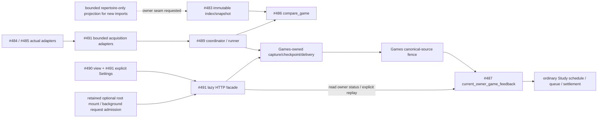

# Continuous game feedback — #491

Source integration under [#491](https://github.com/aaweaver-actuary/tempo/issues/491),
[SPEC v0.2](../../../SPEC.md) and #481. Draft PR #519 is unmerged. The first
installation candidate remains separate: this branch does not deploy, restart
Study, modify live data or resume the held graph migration.

## Implemented private interfaces

| Source | Public seam | Ownership |
| --- | --- | --- |
| [game_sync.py](../../../backend/app/product_composition/game_sync.py) | AcquisitionPolicy, ProviderAcquisition, WorkflowAcquisition, WorkflowNormalizer, WorkflowComparer, sync_job, create_game_sync | Outer wiring only; provider clients are call-owned, Games owns persisted workflow state. |
| [review.py](../../../backend/app/games/feedback/review.py) | SyncConfiguration, GameReview, ReviewStore | Games settings, stored reads and explicit configured commands. |
| [http.py](../../../backend/app/games/feedback/http.py) | create_game_review_router | GET projections; explicit POST sync/retry/configure. No import on reads. |
| [game_review.py](../../../backend/app/product_composition/game_review.py) | create_game_review, CurrentStudyFeedback, current_game_review_router | Lazy API assembly and #487 public factory; no connection or worker at construction. |
| [game_worker.py](../../../backend/app/product_composition/game_worker.py) | run_optional_worker | Separate-process loop, bounded units, signal/cancellation ownership. |
| [game-review.ts](../../../app/product-composition/game-review.ts) | createProductGameReviewApi | #490 endpoint map using the configured legacy API origin, independently of a connected Study origin. |
| [GameSyncSettings.tsx](../../../app/product-composition/GameSyncSettings.tsx) | CurrentGameSyncSettings / GameSyncSettings | Explicit account, UTC window, repertoire, speed/rated choices and opt-in fixed-window recurrence. |

Shared CanonicalGame, GamePage, Finding and LearningReceipt are reused. There is
no competing game DTO, second learning writer, Study controller copy or engine
requirement. `compare_game` consumes the actual normalized history and supplied
provider precision; no PGN reconstruction or repeated normalization is needed.
A canonical identity resolver can be injected into WorkflowNormalizer. The
existing-library adapter resolves the actual stored game ID, including the
retained Chess.com provider alias; it never guesses an ID or manufactures a row.

Provider policies require explicit filters. Chess.com casual-only is rejected
rather than widened. Default bounds are 100 Lichess rows, 8 MiB response,
10-second socket and 30-second total I/O budgets. Hard caps are 1000 Lichess rows,
8 MiB Lichess / 32 MiB Chess.com, 15-second socket / 30-second total I/O. One
adapter page runs at a time. Each call closes its credential-free client with
one connection, redirects and ambient environment configuration disabled.
Retry-After numeric/HTTP-date headers become numeric workflow delays. Stop owns
only the current acquisition task and Games runner; it does not close borrowed
Study/database resources. Task cancellation interrupts blocked I/O.

## HTTP and state semantics

All routes start at `/api/product/game-review`:

- GET `/games` and `/games/{provider}/{game_id}?repertoire_id=...` read stored
  original history/findings and actual receiving-owner status.
- GET `/configuration/{provider}` reads explicit configuration or null.
- POST `/configuration` requires configuration plus expected_revision. A stale
  revision cannot overwrite an account; active imports prevent changing a cursor's
  bound policy.
- POST `/sync` requires provider and operation_id. It enqueues the saved request,
  not client-supplied account/filter overrides. Retry preserves the original job.
- POST `/feedback/retry` requires a current stored eligible Finding and operation_id.
  Games durably binds it to the existing command. A forged, changed, quarantined,
  superseded or failed command cannot create a replacement lapse.

Acquisition completeness and learning admission are separate facts. A captured
window can be complete with an owner receipt still pending. Read status renders
pending/held/applied/settled verbatim. An exact retry can return the owner's
`duplicate` outcome while preserving its receipt identity and original deadline.
Reads do not acquire an attempt, compare a game, import, retry or apply a lapse.
Changed evidence stays quarantined under D08; original captures are retained and
new findings are not drawn over old original moves. Other games remain usable.

[Games storage ownership and transaction details](../../../database/tempo_legacy_database/adapters/games/product_review/README.md)
and the [complete source ER/dictionary](../../../database/tempo_legacy_database/schema/product-game-sync/README.md)
cover the actual tables. Migration **052** follows #487's 051. The standalone
five-file schema checkpoint is `f137d970ac4b36b36d9d644e2c71e22e7d34e845`; it is
published for #503's independent following 053. Readiness editing is released;
this branch must not overwrite a later owner's readiness increment back to 52.
No migration has been applied to live infrastructure.

The optional connection factory owns one connection, 250 ms acquisition wait,
2 s connect timeout and PostgreSQL 250 ms transaction/statement plus 100 ms lock
limits. No foreground Study pool is borrowed. The retained backend capture uses
its existing bounded background reader before opening the receiving writer;
that legacy read dependency is disclosed. Games fences the actual canonical
import plus committed provider source in the receiver transaction, then #487's
public factory validates actual repertoire/card authority and applies Study.
No HTTP/chess work is held inside a Games commit. Process CPU/memory deployment
bounds and host latency remain unmeasured; there is no deployment claim.

## Actual dependency and failure view



Solid arrows are source implementations or published owner seams. Dashed arrows
are pending integration. Study imports/calls/waits for no optional producer.
`current_game_review_router()` starts neither a worker nor a database connection;
missing Games configuration fails its own request and leaves the serving app's
health path usable. The worker has no HTTP-root import and owns its own process,
signals, I/O cancellation and runner only.

## Exact root window

The released mount window is limited to `backend/app/main.py`,
`app/components/Navbar.tsx`, `app/views/legacy-workspace.tsx`,
`app/views/settings_view.tsx`, plus the exact `tests/REGRESSIONS.md` and central
architecture-index appends. Reuse the existing Games view enum with the Game
Review label and remove only that view's obsolete redirect. Home/Study remains
mounted. No ViewEnum/types/workspace-preload/Study navigation-policy change is
needed. The published C Repertoire wrapper is preserved. Game Review is lazy in
the legacy workspace; the independent Study workspace still excludes it. The
explicit Games Settings panel is loaded only when that tab is opened. API reads
and the three exact command paths use background admission, and router
construction starts no provider, capture, connection or worker.

Legacy `useGameSync` has no current consumer; no duplicate active producer is
removed speculatively. D04 likelihood population/time settings remain unset and
the Study introduction owner retains repertoire weight storage. Neither blocks
Game Review or feedback. A separate optional worker launcher/profile still needs
actual resource/registration wiring; the function and process fixture are not an
installed command or a claim that the old Celery background runtime was revived.

## Evidence

Using existing dependencies and task source paths under the nontruncating shared
advisory validation lock:

```sh
TEMPO_PYTHON="$TEMPO_TASK_PYTHON" \
  PYTEST_ADDOPTS='-k "not native_optional_worker_http_stop"' \
  make python-file FILE=backend/tests/test_product_game_sync_integration.py
TEMPO_PYTHON="$TEMPO_TASK_PYTHON" \
  node --test tests/runner/product-game-worker.test.mjs
npm run test:unit -- tests/unit/product-game-sync-settings.test.tsx --configLoader runner --no-cache
node node_modules/typescript/bin/tsc --project app/product-composition/tsconfig.json
```

- Backend: 12 selected cases pass; the two unchanged native process cases are
  owned by the passing named Node runner. Changed canonical-ID/cold-router cases
  are checked separately after the last source-fence refinement.
- Worker runner: 1 Node test invokes **2 native cases**, with zero skips. A real
  child process blocks in local provider HTTP while actual ordinary Study
  issuance/save commits, then graceful stop or forced kill is followed by another
  ordinary Study issuance/save without a Study restart. The earlier passing
  process evidence is retained, not rerun for later read/UI work.
- Settings: **3 cases pass**, including no inferred filters, explicit UTC inputs,
  off-by-default recurrence and revision-safe concurrent account changes. The
  cache-free config loader avoids writes through the shared dependency symlink;
  no dependency installation or assertion bypass occurs.
- Scoped TypeScript compilation includes the new endpoint/settings code and the
  prepared browser fixture/spec. Diff/conflict and scoped product boundary checks
  are retained. Owner native/provider/UI receipts are reused, not rerun wholesale.

The backend suite uses actual provider/workflow/index/comparison/Study scheduling
code with fake HTTP/semantic stores for pure source cases, plus actual disposable
PostgreSQL for new facade/configuration/current-authority boundaries. Migration
registry/readiness through 52 is actually applied. Every native fixture is capped,
unique and removed; its nonsecret cleanup report is retained. No live account,
PGN, review, setting, service or software installation is touched.

## Browser fixture and remaining source seam

The prepared named `product-game-sync.spec.ts` uses only a verified disposable
PostgreSQL runner. Its helper is a one-off source-mounted container in that exact
Compose project; health, Docker ownership and DB identity are verified first.
It seeds synthetic existing canonical library records/current card authority,
then drives 205 Lichess records across three pages and two Chess.com months via
actual adapters with fake HTTP. Two genuine synthetic misses cross the actual
Study factory. The browser chooses explicit settings, preserves an unrelated
issued attempt while Game Review fails/loads, reviews at the actual original ply,
completes normal Study and reloads owner settlement. It fabricates no API save
response. This browser source is **prepared/typechecked, not executed**; root
registration alone is not browser acceptance.

That bounded fixture's sole complete approved route is shared by all its games,
with exact UTC introduction. It does not certify generic snapshot coverage for
arbitrary brand-new imports. A new provider game cannot be used for a retained
*game-specific* capture before its canonical row/page commit. #483's requested
bounded repertoire-only snapshot can drive pre-commit comparison; canonical
library mirror plus source/checkpoint/delivery must then commit atomically before
#487 performs fresh game-specific capture/fencing at admission. No synthetic
capture or pre-checkpoint library write is used to bypass this ordering seam.
Full A03/A04 acceptance and worker activation remain open until that source seam
and the actual browser run are complete.
