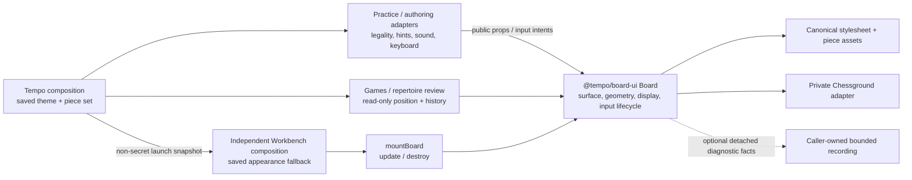

# @tempo/board-ui

The shared presentation-only chessboard for Tempo practice, authoring, review,
previews and independent Workbench. React is a peer; Chessground 10.1.1 is the
private rendering implementation. No application store, service, chess rules,
Rust/WASM or backend is a build/runtime dependency.

Source adoption and package/build/browser qualification are separate from
installation and actual-device acceptance. This change does not deploy a client.

## Install and render

```sh
npm install @tempo/board-ui react@19.2.6 react-dom@19.2.6
```

The package is not published by this task; install the locally qualified npm
tarball until the parent coordinates publication. A bundler must process the
exported CSS and its relative SVG assets. No application public directory or
network image host is needed.

```tsx
import { Board, type BoardProps } from "@tempo/board-ui";
import "@tempo/board-ui/styles.css";

const position: BoardProps = {
  fen: "8/8/8/8/8/8/4P3/4K2k w - - 0 1",
  positionIdentity: "example-position", positionRevision: 0,
  orientation: "white", turn: "white", check: false, mode: "legal",
  destinations: new Map([["e2", ["e3", "e4"]]]),
  onMove: event => console.log(event.from, event.to, event.positionIdentity),
};

export function Example() { return <Board {...position} />; }
```

The public root exports `Board`, `fitBoardSize`, and all public data/event types
listed in `src/index.ts`. Styles, Merida SVGs, and notices have explicit
`styles.css`, `assets/*`, and `notices/*` subpath exports. Internal controllers
and source files are not public import paths. Source is shipped for the GPL;
consumers compile against `dist` declarations and import the built renderer.

## Input ownership

The caller supplies FEN, a required stable `positionIdentity`, a required
`positionRevision`, orientation, turn, check, and mode. It computes legal
destinations, validates moves, handles promotions/en passant and resulting FEN,
and owns application keyboard bindings, preferences/help, hints, sound, Study
priority, stores, and diagnostic policy. A `move` is an input intent, not a
validated or persisted result. Chessground's normal castling display is enabled.

Modes are `legal` (supplied destinations for the supplied turn), `free` (either
color can move), and `select` (selection only). A missing/empty destinations map
allows no legal moves. `locked` and `readOnly` disable piece, selection, and
drawing input while preserving focus. `drawingEnabled` defaults to true.

`onMove` and `onFreeMove` receive `{from, to, positionIdentity, positionRevision}`;
`onSelect` receives the same identity and a square in free/select modes;
`onDrawingChange` receives a detached shape snapshot and identity. The narrow
`onInteraction` event reports focus/blur only. There is no telemetry side effect.

Equivalent FEN/identity/revision/mode/permissions/orientation/destinations and
fresh callback functions do not reset Chessground. Annotation, theme, piece-set,
check, highlight, and destination-visibility updates preserve held piece input.
Equivalent destination ordering and duplicate targets are normalized.

Identity or revision replacement, FEN, orientation, turn, mode, lock/read-only,
drawing permission, or actual destination changes cancel current input, restore
the supplied position, and replace callback generations. Both lock and unlock
fence queued callbacks. Same-FEN replacement must change identity or revision.
When rejecting a move at the same FEN, increment revision or call `clearInput()`.
Unchanged props intentionally leave Chessground's just-moved piece in place
until the caller accepts/rejects it. A live callback invokes the latest committed
handler once per Chessground event. Obsolete move/select/drawing callbacks are
ignored, including after Strict Mode cleanup/remount.

Shapes and nested label/modifier/piece values, last-move arrays, and destinations
are detached before entering Chessground. Drawing event data is detached before
delivery. Only declared shape fields cross the boundary; undeclared `customSvg`
and nested extra properties are omitted. Labels are literal strings, escaped
for the pinned renderer's markup sink and restored in drawing event snapshots.
Canonical comparison snapshots keep the original text. Annotation updates
invalidate only SVG annotation children, including fill-only label changes.
A live drawing is explicitly cancelled on invalidation: Chessground
10.1.1 `cancelMove()` alone only cancels piece input.

## Focus and geometry

The named board group is focusable, exposes `ariaDescribedBy`, `aria-disabled`,
`tabIndex`, and a scoped `onKeyDown` seam. `BoardHandle` exposes `focus()`,
`selectSquare()`, `clearInput()`, and `clearInputBounds()`. Selection honors mode,
permissions, and supplied destinations; no global hotkeys are installed. The
consumer owns keyboard navigation and any square-by-square screen reader UI.
This seam is not a claim of complete nonvisual chess interaction.

The board fits its parent width, capped by `maxSize` (760 CSS px by default).
Square sizes are integral CSS pixels. Package CSS overrides Chessground's
device-pixel container rounding to keep its board and surface aligned at
fractional zoom. Resize listeners and an optional `layoutAnchor` observer clear
hit-test bounds. Captured mouse/touch starts and movements also clear bounds
before Chessground reads them; translation does not redraw or cancel a drag.
Mode changes clear cached geometry without rebuilding the board. A package-owned
construction adapter uses Chessground's pinned rendering/input modules and owns
one surface observer, board/document listeners, and cancelable redraw scheduling.
Orientation changes reuse that observer. A hidden ghost and context-menu
suppression exist from construction even when input starts disabled. Cleanup
cancels piece/drawing input before teardown and fences queued resize/redraw work.
The adapter changes no global browser APIs; wrapper effects also fence retained
observer notifications after cleanup.

## Package-local checks

The root workspace and Workbench depend on the public built package. Root
`build:packages` builds it before application development, type checks and tests;
there is no source-only import alias. The standalone qualifier below verifies
installed declarations, public exports, styles/assets and source absence.

```sh
cd packages/board-ui
npm ci --ignore-scripts --workspaces=false
npm run typecheck
npm test
npm run build
npm run qualify -- /absolute/task-owned/new-evidence-directory
```

`npm test` discovers five local files serially (one worker, no file parallelism).
The [local inventory](REGRESSIONS.md) owns their named identities; no legacy
regression or root registration is removed. `qualify` runs package tests,
typecheck/build/pack in disposable package-only staging, installs the tarball
into a fresh consumer, removes source **only in that staging**, then typechecks,
imports public exports/assets/notices, and builds a small production consumer.
The application/services/root build configuration are never present. It checks
one React copy, exactly twelve emitted SVG assets, and no private import path.
Installs are offline and require the declared dependencies already cached by
the initial narrow install; supply `npm_config_cache` when using a task cache.
Offline consumer installation also needs cached resolution metadata for its
declared dependencies and Chessground; prime those in a task-owned directory
when absent.
Each subprocess has a 120-second bound. Successful staging is removed after
retaining tarball, input/artifact hashes, logs, unit JSON, lock, and consumer build.
Failed staging is retained for diagnosis with its path in the receipt.

The qualifier does not run a browser. See [browser proof instructions](browser/README.md)
and [recorded evidence](VALIDATION.md). Unit adapter/DOM tests do not establish
real held drag, pixel placement, focus traversal, or responsive rendering.

## Appearance and adopted consumers

`BoardAppearance` contains `theme` (`brown`, `blue`, `green`) and `pieceSet`
(`cburnett`, `merida`). `DEFAULT_BOARD_APPEARANCE` is brown/CBurnett;
`resolveBoardAppearance` validates each supplied field against a caller-supplied
validated fallback or that default. The pure `@tempo/board-ui/appearance` entry
exports these values/types without importing React or the renderer.

The package stylesheet is the only owner of board colors, coordinates, highlights,
check cue, piece shadow and piece images. Consumers import `@tempo/board-ui/styles.css`;
layout, frame allocation and available actions stay with each consumer. Existing
`tempo-board-theme` and `tempo-piece-set` browser settings remain intact.

| Production entry | Adapter / use |
| --- | --- |
| `app/components/board/persistent-board-shell.tsx` | One mounted board shared by practice and authored Studies publications |
| `app/views/training_view.tsx` | Embedded opening practice fallback |
| `app/views/defense_training_view.tsx` | Embedded defense/recognition fallback |
| `app/views/study_exercise_runner.tsx` | Embedded exercise fallback |
| `app/views/tactics_view.tsx` | Embedded tactic solving |
| `app/views/endgames_view.tsx` | Saved material-only endgame preview |
| `app/components/position-solution-editor.tsx` | Card editor and tactic capture: setup and solution |
| `app/views/tree_browser.tsx` | Repertoire-tree dialog |
| `app/components/canonical-prefix-dialog.tsx` | Canonical-prefix preview |
| `app/components/opening-segmentation.tsx` | Both endpoints of each segment |
| `app/components/repertoire-integrity-dialog.tsx` | Response-repair preview |
| `app/features/game-review/GameReviewView.tsx` | Exact original game replay |
| `app/features/repertoire-review/PositionViewer.tsx` | Conflicts, proposals, findings and lines/history |
| `apps/workbench-web/src/game-browser.ts` | Selected games, including Games-only composition |
| `apps/workbench-web/src/workbench.ts` | Analysis finding detail |

The first eleven entries use the application `Chessboard` interaction adapter;
review views inject appearance directly. Workbench's `mountBoard` is a small
React root with `update`/`destroy`; it owns no chess effects or persistence.
No production consumer constructs Chessground directly.

### Presentation ownership



Canonical source: `src/Board.tsx`, `src/controller.ts`, `styles/board.css`.
Application policy remains in `app/components/board/chessboard.tsx`; review and
Workbench keep their own position/navigation state. Each application shares its
browser process; source separation does not prove deployed resource isolation.
Study has no Workbench/Games service or lifecycle prerequisite.

### Optional diagnostics

`BoardHandle.getInteractionSnapshot(refreshBounds = true)` returns detached
orientation, board bounds, animation and active-drag facts, never a renderer API,
DOM node or mutable state. Caller-owned capture passes `false` during a hold to
reuse initial geometry; scroll/resize ends its measurement. The optional
`onRendererEvent` callback reports ready/reset/update/annotation/resize facts.
Recording, storage and diagnostic opt-in remain entirely with callers. Mode
transitions clear cached hit testing instead of rebuilding the board; owning
regressions retain the geometry invariant.

License/asset attribution: [third-party notices](notices/THIRD-PARTY.md).

The component registry now declares the implemented package, peer dependency and
public style/appearance/asset subpaths. The existing scoped component guard checks
those declarations while continuing to reject private paths; JSX/peer handling
and exported CSS file resolution are necessary for these concrete consumers.
The offline shell owns generated SVG caching (cache v8); it no longer requires
retired public-directory piece copies. Saved Study data is unaffected.
