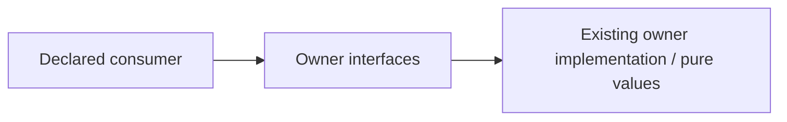

# Neutral TypeScript chess lines interface

Restructuring owner: #497 (allocation revision 2). Existing functional ownership
and algorithms are unchanged. Explicit named exports preserve object identities.

Operations: canonicalFenKey; canonicalizeMoves; sanForUci; type LineDiagnostic.

Dependencies: The same ../index operations and existing chess.js. No board controller, engine, network or runtime state.

Effects/transactions: none on import. This surface grants no learning/content
mutation authority; caller-owned capabilities retain their existing lifetime.

Implemented source seam only; consumer adoption and deployed independence are
not established by the directory. Existing package root exports/consumers remain compatibility edges. #501 owns package export maps and caller routing. Runtime identity and neutral replay are checked with existing TypeScript transpilation; no browser build.

Focused proof: `backend/tests/test_public_surface_chess.py` covers identity, cold import and the changed neutral
semantic boundary. #501 owns central registration/root routing and #482 owns
whole-declared-graph cycle/private-import/export-bypass negative controls.
