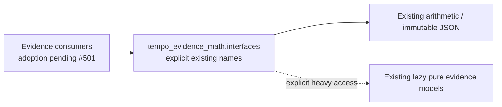

# Evidence mathematics interface — #503 allocation

`tempo_evidence_math.interfaces` explicitly names the existing package public API
and preserves every original value/function identity. Arithmetic and immutable
JSON values load eagerly as before. Chess/Pydantic-backed identity, graph,
probability, reach, readiness, ranking and valuation exports keep the original
lazy resolution; importing the arithmetic surface still needs only the standard
library. Type-checking imports describe those same existing owner exports.
There is no wildcard barrel, copied model or arbitrary attribute forwarding.

The [library](../../../README.md) computes from supplied immutable evidence.
It neither captures evidence nor estimates hidden scheduling state, selects
admission, mutates learning/content state or starts a provider/engine/connection.
Results retain their existing policy, uncertainty, version and provenance fields.
Callers own data acquisition, clocks, effects and transaction/resource lifetimes.

The existing package-root API and all implementations remain unchanged. #501
owns cross-owner/root imports and packaging; #482 owns the graph/private-import/
export-bypass checker and negative controls. Migrate callers under their exact
leases, then retire compatibility paths once the declared graph passes. This
surface is not proof of complete caller adoption or component independence.

`tests/test_interfaces.py` checks all declared export identities, rejects
undeclared export access and verifies the standard-library-only cold arithmetic
closure. Existing arithmetic semantic checks remain the behavior proof. No
artifact install, native database or browser run is required for these new exports.
