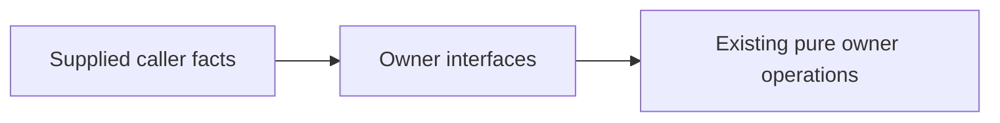

# Game action placeholder public interface

Restructuring owner #497, allocation revision 2; functional ownership and
behavior are unchanged. Explicit named exports preserve existing identities.

Operations: UnimplementedActions. Legacy placeholder remains explicitly unavailable. It is not a Study/content mutation capability, and no new action implementation is exposed.

Dependencies: existing same-owner policy/traversal and canonical game-review
wire values. No database, provider, engine, connection or app startup on import.
The caller owns supplied values and invocation lifetime; this seam has no
transaction, queue, scheduling or publication authority.

Existing root/private implementation import paths remain compatibility edges.
#501 must route cross-owner callers and packaging in its reserved window; #482
owns full-graph private-import/cycle/export-bypass negatives before aliases
retire. No consumer migration, whole-component independence or live adoption is
claimed here. Existing backend Games comparison adaptation remains Games-owned,
and is not hidden behind the neutral chess surface.

Focused check: `backend/tests/test_public_surface_comparison.py` plus existing
classification policy tests; cold imports and identity/pure semantics only.
