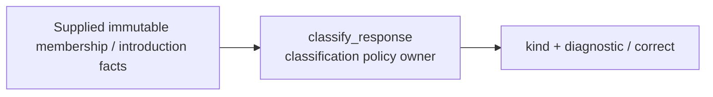

# Game classification policy

`classify_response` consumes supplied membership, mapping, availability and
introduction facts. It returns `(kind, diagnostic)`, or `None` for a correct move.
It has no provider, database, engine, scheduling or Study dependency. The transport
adapter owns conversion from the shared product contracts and supplied index.
Only a unique response with one available mapping, exact occurrence chronology,
and introduction of unchanged content before the game can be a confirmed miss.
Different own responses are a conflict even if the played move is one of them.

This source implements policy only. Product normalization/traversal adapters are
being added against #482/#483's public contracts; no product wiring is activated.

## Retained legacy scaffold

`tempo_game_classification.UnimplementedClassification.classify` returns an explicit
`not_implemented` value. It does not classify games, contact another component,
open storage, enqueue work or mutate Study/Content. No action can succeed through
this stub. It depends only on the shared [game review values](../game-review-contracts/README.md).

This is an injectable placeholder, not a server and not an activated feature.
The implemented ingestion and comparison components do not call or import it.
Future implementation must retain separate ownership and qualification.

Owning check: `uv sync --locked --no-editable && uv run --locked --no-editable python -m pytest tests -q`.
