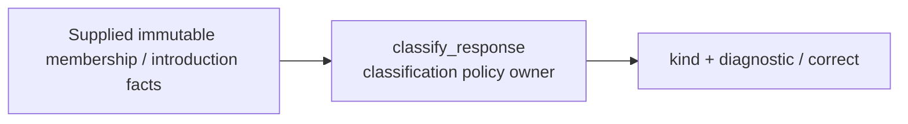
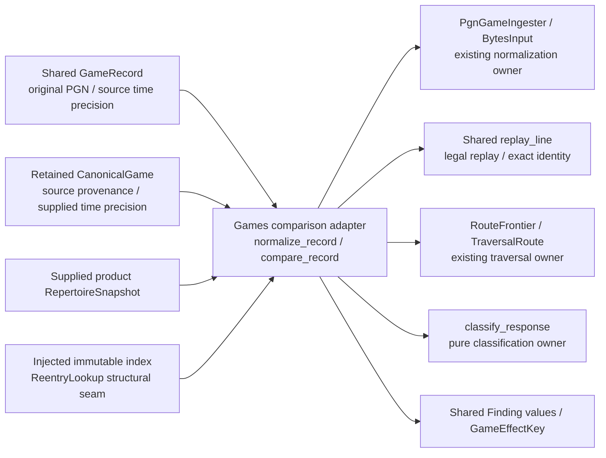

# Game classification policy

`classify_response` consumes supplied membership, mapping, availability and
introduction facts. It returns `(kind, diagnostic)`, or `None` for a correct move.
It has no provider, database, engine, scheduling or Study dependency. The transport
adapter owns conversion from the shared product contracts and supplied index.
Only a unique response with one available mapping, exact occurrence chronology,
and introduction of unchanged content before the game can be a confirmed miss.
Different own responses are a conflict even if the played move is one of them.



## Product adapter (unmerged source)

[`backend/app/games/feedback/comparison.py`](../../backend/app/games/feedback/comparison.py)
exposes four transport-free entries:

- `normalize_record(GameRecord, provider, account, workspace_id, game_id?)`
  returns the existing `CanonicalGame`. It reuses `PgnGameIngester`/`BytesInput`,
  rejects illegal/unsupported PGNs and digest mismatches, preserves supplied
  identity/revision/time, and leaves original PGN plus time precision in the
  caller's immutable `GameRecord`. An unknown source time is never upgraded from
  a PGN header.
- `compare_record(record, provider, account, workspace_id, snapshot,
  reentry_lookup?, game_id?) -> tuple[Finding, ...]` normalizes then classifies.
  `snapshot` is #482's shared product snapshot. Optional `reentry_lookup` is the
  structural read seam implemented by #483's immutable `PositionIndex`:
  `snapshot_id`, `source_revision`, `revision`, `digest`, and `reentry_candidate(repertoire_id, fen,
  variant)`. The adapter imports no concrete Repertoire implementation.
- `compare_game(CanonicalGame, provider, snapshot, time_precision='unknown',
  reentry_lookup?) -> tuple[Finding, ...]` uses that same traversal for retained
  imported history whose original PGN is unavailable. `compare_record` normalizes
  once and delegates here. Source identity, revisions and digest are retained
  exactly; legal replay validates the supplied history without reconstructing PGN
  or claiming to authenticate unavailable original bytes. The caller supplies
  retained occurrence precision; a timestamp alone never upgrades the default
  unknown precision into lapse eligibility.
- `effect_key(finding, workspace_id) -> GameEffectKey` reuses #482's logical key,
  which excludes comparison/source revisions and detection/retry clocks. It also
  supports a mapped non-miss after reclassification. A finding without a proved
  decision cannot manufacture an effect key; the coordinator retains old keys
  when holding/withdrawing obsolete evidence.



This is implemented, unmerged source; application wiring and real game-to-Study
proof belong to #488. There are no storage writes, owner commands, queues,
background processes, provider requests, engine calls or Study imports here.
The caller owns the captured values and invocation resources. Classification
failure returns to that caller and has no Study effect. Host/process deployment
and optional-worker resource isolation are unverified.

Ordered traversal reuses `RouteFrontier` without changing its existing public
behavior. Own-response policy checks all same-position authored occurrences in
one repertoire; it does not adopt the older raw comparer's accepted alternatives
as R06 policy. A meaningful departure suppresses later findings until an index
candidate proves the exact authored position, route/ply, source revision,
explicit anchor and current decision/presentation revision. A deliberate route
end is coverage end. Recognizing a legal later transposition preserves the
earlier gap/miss; mere FEN coincidence cannot restart coverage.

Current card existence, a matching FEN and introduction time alone are insufficient
historical authority. Availability and unchanged introduced-content proof must
be explicit; missing proof produces `known_unavailable`. A route-local binding
applies only to its paired route ID / zero-based authored ply. It never covers
an unbound transposed occurrence or selects one of several active routes. Paired
nulls preserve an explicitly global owner binding.

An explicit Study `introduced_before_game` assertion can preserve chronology when
the introduction timestamp is unavailable, only if its provider, game ID, source
revision and digest all match the compared canonical source. Mismatched assertions
remain unknown; no timestamp is invented. This assertion still requires unchanged
content and current availability. Only second/millisecond game occurrence
precision can qualify; an unknown game timestamp/precision is never upgraded.
Contradictory positive assertion/timestamp evidence cannot produce a lapse. The
receiving Study owner still revalidates authority before mutation; these findings
are evidence, not a scheduling effect.

## Focused verification

The package's ordinary installed-environment command is below. Where dependency
installation is prohibited, use an existing compatible Python environment with
the task's package source roots on `PYTHONPATH`:

```sh
PYTHONPATH=packages/game-classification/src:packages/game-review-contracts/src:packages/chess-core/src \
  python -m pytest packages/game-classification/tests -q --rootdir=.
make python-file FILE=backend/tests/test_product_game_findings.py
```

The product command needs source/installed imports for this package, game-ingestion,
game-review-contracts, chess-core, repertoire-comparison and game-evidence contracts.
Root registration/dependency wiring belongs to #488. No comparer source changed,
so its unchanged suite is not rerun. Product fixtures are synthetic; no live game,
database, provider or engine is used. The advisory host validation lock is opened
nontruncating, acquired for each check and released immediately afterward.

## Retained legacy scaffold

`tempo_game_classification.UnimplementedClassification.classify` returns an explicit
`not_implemented` value. It does not classify games, contact another component,
open storage, enqueue work or mutate Study/Content. No action can succeed through
this stub. It depends only on the shared [game review values](../game-review-contracts/README.md).

This is an injectable placeholder, not a server and not an activated feature.
The implemented ingestion and comparison components do not call or import it.
Future implementation must retain separate ownership and qualification.

Owning check: `uv sync --locked --no-editable && uv run --locked --no-editable python -m pytest tests -q`.
