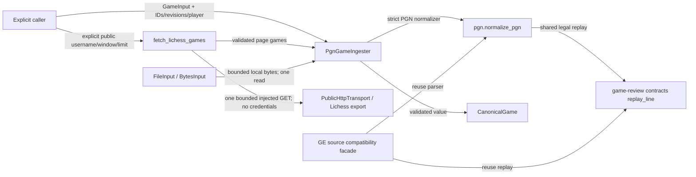

# Independent game ingestion 0.1

Implemented source on `codex/public-game-ingestion`; unmerged, no deployment
claim. This package accepts one completed PGN through an injected `GameInput` and
returns the shared `CanonicalGame` value. It has no comparer, repertoire reader,
classifier, action, database, queue or Study dependency. Public Lichess transport
is a separate explicit adapter in this package; file ingestion never invokes it.

## Public entry

```python
from tempo_game_ingestion import BytesInput, PgnGameIngester

game = PgnGameIngester().ingest(
    BytesInput(pgn_bytes), workspace_id="workspace-a", game_id="explicit-game-id",
    game_revision=1, source_id="explicit-source-id", source_revision=1,
    player="Learner", played_at=None,
)
```

`FileInput(Path(...))` is the explicit local file adapter. It reads at most 8 MiB
plus one sentinel byte; normalization rejects larger sources. Other injected
readers own bounded byte acquisition. Each call reads its input once, preserving
its exact SHA-256 digest. Caller-supplied identities/revisions are validated by
the shared contract and are never inferred from provider URLs or PGN headers.

The strict PGN normalizer was extracted from Game Evidence's `source.py`, keeping
its one-game, completed-result, observed-player, legal mainline, standard/from-
position, timezone and 1000-ply safeguards. It reuses shared `replay_line` for
canonical legal replay rather than implementing a second replay algorithm.
Comments/variations do not replace the played mainline. A date without a time
remains unknown; explicit timezone-bearing time takes precedence over PGN UTC time.
No claim is made that PGN headers or supplied IDs authenticate a game.

The existing Game Evidence `source.py` is a compatibility facade: it reexports
`normalize_pgn`/`MAX_SOURCE_BYTES`, retains its existing identity/clock helpers,
and delegates `replay_positions` to shared replay. Dependency metadata for that
consumer is included in this PR. The ingester does
not import Game Evidence or its store/worker.

## File CLI and local checks

```sh
uv sync --project packages/game-ingestion --locked
uv run --project packages/game-ingestion tempo-game-ingest one-game.pgn \
  --workspace-id WORKSPACE --game-id GAME --game-revision 1 \
  --source-id SOURCE --source-revision 1 --player Learner
uv run --project packages/game-ingestion pytest packages/game-ingestion/tests
```

The CLI emits one canonical JSON object to stdout. Invalid input exits nonzero
with a diagnostic on stderr. It does not write the source or enqueue downstream
work. Other providers, durable storage and automatic jobs are outside
this slice; they need separate explicit adapters rather than the old GE worker.

`tests/test_independence.py` invokes the installed package from a temporary cwd
with `python -I`, verifies downstream implementations are not installed, rejects
attempts to import them, and ingests a game successfully. The installed file CLI
is also exercised without creating any extra files. See [REGRESSIONS](REGRESSIONS.md).

## Architecture impact

This is the canonical ingester dependency drawing. Implemented source is unmerged;
installation/owning checks do not certify deployment or resource isolation.



[`PgnGameIngester`, inputs](src/tempo_game_ingestion/__init__.py),
[parser](src/tempo_game_ingestion/pgn.py), [public adapter](src/tempo_game_ingestion/lichess.py), [CLI](src/tempo_game_ingestion/cli.py),
[shared values/port](../game-review-contracts/README.md) and
[GE facade](../../services/game-evidence/src/tempo_game_evidence/source.py) own the
shown edges. Input failure returns an exception/nonzero CLI result; it cannot
trigger comparison, reconciliation, delivery or a Learning/Content command.

## Public Lichess API slice

The file-only checkpoint was extended with a bounded, caller-driven public API
adapter. [`fetch_lichess_games`](src/tempo_game_ingestion/lichess.py) adapts the
existing Game Evidence Lichess request/window validation without its database,
worker, import checkpoints, reconciliation or comparison. It accepts an injected
`PublicHttpTransport` and explicit workspace, username, timezone-aware window,
limit and revisions. It returns canonical games through the same ingester.

```sh
uv run --project packages/game-ingestion tempo-lichess-ingest \
  --workspace-id WORKSPACE --username PUBLIC_USERNAME \
  --since 2026-10-01T00:00:00Z --until 2026-10-02T00:00:00Z \
  --limit 10 --game-revision 1 --source-revision 1
```

This command is an explicit network action against the public Lichess game export
endpoint; it does not accept or load credentials. The default stdlib transport
restricts I/O to the exact HTTPS Lichess game-export authority/path, sends public
Accept/User-Agent headers, disables ambient proxies, rejects redirects, and reads
at most 8 MiB plus a sentinel in bounded chunks. Its explicit per-socket timeout
defaults to 10 seconds (maximum 15). Monotonic elapsed-budget checks stop further
reads after that budget; a blocked read can outlast it, so this is not a hard
real-time total deadline.
It makes one request, with no automatic retry, pagination, sleep or scheduling.
HTTP/rate-limit/timeout failures are reported, including supplied Retry-After.

Windows are `[since, until)` and at most 366 days; limits are 1–100. Returned
records must have explicit IDs, ascending in-window millisecond timestamps and
valid completed PGNs for the named player. Duplicate IDs and malformed pages
fail the whole batch rather than emitting partial success. Deterministic game IDs
bind workspace/provider/game/username; raw PGN bytes retain their own digest.
`limit_reached=true` explicitly means the result may be truncated; it does not
claim that the requested window is exhausted. The caller chooses any subsequent
window/request. Neither source nor game revisions are inferred automatically.

Owning tests use injected HTTP fixtures and a fake stdlib opener, so they exercise
request construction, strict scope, canonical output, bounds, redirects, status/
rate-limit errors and CLI output without contacting Lichess. The isolated installed
proof also fetches a synthetic page with all downstream components absent. No real
account or external provider request was made for qualification.
