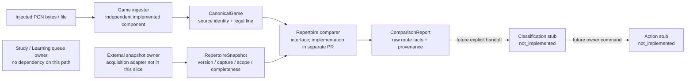

# Game review boundary contracts 0.1

This shared pure package contains values, capability protocols and legal replay.
It imports no ingester, comparer, provider, database, Study, Content or action
implementation. Independent components may share it without requiring one
another installed or running. Legal replay is extracted from the existing Game
Evidence function; compatibility adapters must reuse this owner rather than fork it.

## Frozen initial interface

- `GameIngester.ingest(GameInput, explicit source/game scope...) -> CanonicalGame`.
  The injected input reads bytes; ingestion validates one complete PGN, player,
  legal moves and source identity. It must not import or enqueue comparison,
  classification, reconciliation, delivery or actions. Local file CLI is sufficient
  for this slice. Provider/account transport and durable ingestion storage are
  future adapters behind its I/O port, not automatic imports of GE's worker.
- `RepertoireComparer.compare(CanonicalGame, RepertoireSnapshot) -> ComparisonReport`.
  It consumes values offline and has no provider, ingester implementation,
  database connection, Study or action dependency. Snapshot acquisition lives
  outside this package. Current means the explicitly supplied owner snapshot at
  its captured time/version, never an implicit claim about today's live state.
- Classification and actions are nonexecuting stubs returning `Unavailable`.
  No report implies personal memory, historical eligibility or permission to
  mutate Learning/Content. Owner commands belong to a later explicit action adapter.

Raw comparison facts retain played prefix, side/ply/FEN, actual/expected moves,
route/policy context, earliest supported divergence and explicit unknown reasons.
Ended routes, missing evidence and ambiguity must not become uncovered moves.
After a departure, FEN coincidence alone must not establish route re-entry;
only supplied explicit re-entry authority may do so. New snapshot inputs yield
new report identity; existing frozen reports are never modified.

The supplied digest is an owner identity claim, not authentication or a freshness
oracle. The comparer must also bind report identity to the canonical supplied
input bytes so altered content cannot silently reuse an old report identity.

Nonexamples: `EvidenceStore._import` enqueues comparison, `_compare` finalizes
and requests reconciliation, and the all-in-one worker may deliver to Learning.
None is the independent ingester/comparer entry point. Likewise remediation's
historical introduction guard is not authored repertoire membership; preserve
its existing behavior rather than weakening it for current comparison.

## Four independent responsibilities (implemented source / scaffold)

The ingester and comparer depend only on this shared value/replay package and
pure chess primitives. Neither imports the other's implementation. The arrows
between them describe compatible values, not an automatic pipeline or shared
process. Their file CLIs and owning tests work independently. Classification and
actions return explicit unavailable values and are not called automatically.
No component here owns a database, migration, worker, server, queue or lifecycle
shared with Study. A parser/comparison failure returns to its caller, with no
Study effect. CPU/memory for supplied files belongs to the invoking process;
production scheduling/resource isolation and live acquisition remain unverified.

### Interpretation and ownership

- `ReentryAuthority.ply` names an authored route ply, strictly before that route's
  end, with explicit supplier authority. Coincidental board equality is not authority.
- The comparer validates matching workspace, route membership in the declared
  scope and legal route contents. Incomplete, unavailable, ended or ambiguous
  evidence cannot prove a missing authored move.
- Reports copy source identity/revision, snapshot capture/revision/digest and
  declared scope/completeness/availability. Their identity also binds actual
  canonical input content; an unchanged claimed digest cannot hide changed routes.
- `frozen=True` prevents field reassignment, not mutation of list contents.
  Components do not mutate caller-owned containers or alias them into results.
  Persisted reports must be saved as independent serialized value snapshots;
  this milestone has no report store and never updates an existing report.
- A raw learner divergence means the played move differs from the supplied
  authored alternatives. It does not imply prior study, forgetting or historical
  repertoire availability. A raw opponent divergence is not automatic permission
  to add Content. Those decisions remain outside the comparer.

## Delivery boundary

This ingester PR implements game ingestion. The independent comparer and executable
classification/action stubs are a separate PR; this library defines their interfaces. It does not acquire today's live repertoire, add provider account sync,
connect the Games viewer, classify findings, execute practice commands or expand
repertoire. Existing Game Evidence remediation consumers retain their historical
eligibility guards through compatibility adapters; current authored membership
must not weaken them. Frozen accepted reports and live Study remain untouched.
