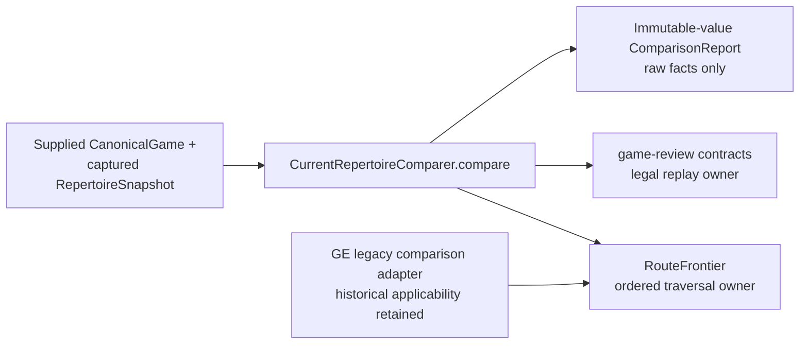

# Repertoire membership: first departure

The smallest entry is `first_departure_ply(game, supplied_snapshot)` returning the integer/null; unsupported evidence raises an explicit ValueError. Optional `first_departure(game, supplied_snapshot)` adds side/status details: it returns a
**one-based** move ply and `learner`/`opponent`, or `ply: null` when the whole
game is covered. Invalid or insufficient evidence is explicitly `unsupported`;
it never silently means no departure. Any supplied authored alternative counts
as membership, without granting policy, learning or action authority.

```python
from tempo_repertoire_comparison import first_departure
result = first_departure(game, snapshot)
# {"status": "compared", "ply": 2, "side": "opponent", "reason": None}
```

`tempo-first-departure --game game.json --snapshot repertoire.json` prints the integer or `null` (unsupported evidence is explicit and exits nonzero). It has no provider, database or Study dependency. The existing
Game Evidence route traversal is reused. Rich raw reports below remain optional;
none of their future consumers is required to use this minimal entry.

# Independent repertoire comparison 0.1

`tempo_repertoire_comparison.compare(CanonicalGame, RepertoireSnapshot)` returns
raw authored membership facts for both sides, expected alternatives, route/policy
context, matched prefix and the earliest supported difference. It consumes only
supplied values. No ingester, provider, database, Study, Content or action
implementation is installed or called. Introduction dates, physical cards and
remediation eligibility are not authored membership requirements.

The snapshot names one captured owner version and scope. It is not a live
freshness check. Report identity hashes the actual complete canonical game and
snapshot documents, including their claimed identities, so changing moves or
routes while reusing a claimed digest cannot reuse a report ID. Reports expose
source identity/revision and snapshot scope/completeness/availability explicitly.
A report does not infer memory or authorize a Learning/Content effect.
Contract fields are frozen, but nested lists remain caller-mutable; comparer
results do not alias supplied input containers. Serialize a report when retaining
a frozen record rather than assuming deep Python immutability.

## Ownership and reuse



[`frontier.py`](src/tempo_repertoire_comparison/frontier.py) extracts Game Evidence's existing active-route traversal rather
than copying it into a second comparer. [`Game Evidence comparison.py`](../../services/game-evidence/src/tempo_game_evidence/comparison.py)
borrows that public pure owner and retains its own definition projection,
physical mapping, introduction/historical guards and remediation semantics.
The independent comparer supplies slim authored routes instead.

Only exact ordered moves advance an active route. Matching FEN after departure
cannot restart it; an explicit supplied re-entry authority at an authored route
ply is required. Ended routes, absent context, conflicting policies and
incomplete/unavailable evidence stay unknown. Alternatives within one repertoire
policy combine; incompatible policy contexts remain ambiguous. A route ending at
a position cannot prove an uncovered continuation. Illegal routes, mismatched
workspace/scope and duplicate/invalid authority identities are rejected.

## Offline file CLI

```sh
uv sync --project packages/repertoire-comparison --locked --no-editable
packages/repertoire-comparison/.venv/bin/tempo-repertoire-compare \
  --game canonical-game.json --snapshot repertoire-snapshot.json --output new-report.json
packages/repertoire-comparison/.venv/bin/python -m pytest packages/repertoire-comparison/tests
```

Inputs are explicit local JSON files bounded at 8 MiB each. The CLI creates a new
output exclusively and refuses overwrite. It never acquires a snapshot, imports
a game from a provider, starts a worker or invokes downstream actions. Persisting
and presenting reports remain caller responsibilities. Canonical values are
shared through [game-review contracts](../game-review-contracts/README.md); snapshot acquisition is a separate owner.

This source boundary is an implemented package increment, not deployment or
resource-isolation qualification. Consumer migration and installed wheel evidence
are reported separately. See [REGRESSIONS.md](REGRESSIONS.md).
