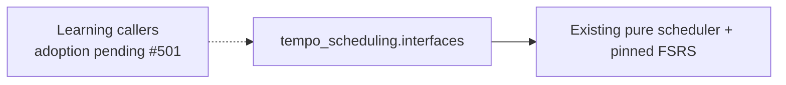

# Scheduling interface — #503 allocation

`tempo_scheduling.interfaces` explicitly exports the existing `Schedule`,
`schedule_review` and `unlock_ready` objects. The [scheduling package](../../../README.md)
remains their semantic owner; FSRS stays pinned and no behavior, defaults or
serialized state changes. This first-wave allocation gives #503 only these new
interface/test files, without changing existing scheduling implementation leases.

Supply the complete serialized FSRS card, aware review instant and independent
calendar review day to `schedule_review`. It returns an immutable schedule;
`unlock_ready` evaluates explicit supplied history. These operations neither read
a clock nor persist, admit, queue, commit or register work. Learning owns actual
review/queue state and its transaction. Importing the surface starts no runtime.

Existing package-root imports and the backend scheduling adapter remain unchanged.
#501 owns cross-owner adoption/packaging, and #482 owns DAG/private-import/export
bypass negative controls. Retire old compatibility paths only after released
callers migrate and those checks pass. An interface directory alone does not
establish runtime independence.

`tests/test_interfaces.py` checks exact export identity and a cold import without
backend/database/runtime dependencies. The existing scheduler's golden/baseline
semantic cases remain the behavior proof; no native or browser rerun is needed
for this import-only surface.
