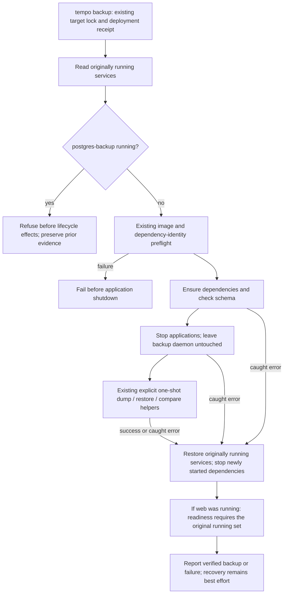

# Repository scripts

These Node and Python scripts support local builds, static verification, the
full test pipeline, Docker integration, visual checks, and tactics catalog
generation.

Scripts should be orchestration and verification entry points, not a second
application layer. If a script gains product logic, move that logic into a
tested backend or frontend module and keep the script thin.

## One-shot backup pruning boundary

**PROPOSED / deployment unverified:** [`tempo-runtime.mjs`](tempo-runtime.mjs)
owns the existing one-shot lifecycle. `backupOnly()` refuses an already running
`postgres-backup` before image preparation, dependency startup, application
shutdown or backup commands. Its recurring entrypoint prunes old archives, so
stopping and restarting that service is not a safe one-shot restoration policy.
The refusal preserves the prior journal and service state; it is not an
instruction to stop or reconfigure the daemon.

An inactive backup daemon remains untouched, including when it was paused.
One-shot helper commands still belong to
[`database/tooling/cli/backup.mjs`](../database/tooling/cli/backup.mjs), using the
caller's Compose capability and explicit entrypoint overrides. Application and
deployment lifecycle defaults are unchanged. The named fake-command regressions
live in [`tests/runner/tempo-cli.test.mjs`](../tests/runner/tempo-cli.test.mjs),
collected by the regular CLI suite.

This narrow guard does not certify a rehearsal. Frozen helper/source
compatibility, adequate physical backing-filesystem capacity (VM free space is
insufficient evidence), enforced archive and child/container time limits,
coordinator signal recovery, exact container-state recovery and temporary-DB
cleanup after failed or uncertain creation remain separate safety prerequisites.
A failed local Compose client does not prove its container or database work has
stopped. The interruption regression terminates only a synthetic child and proves
caught-error restoration by the surviving coordinator; it does not establish
recovery after coordinator termination. Do not resolve capacity by deleting
existing backups. Do not use this guard as permission to run an otherwise blocked
rehearsal.
