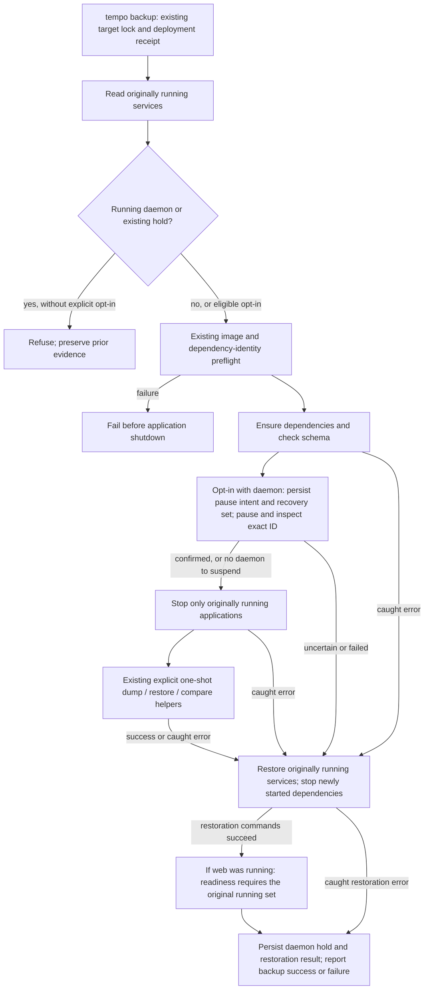

# Repository scripts

These Node and Python scripts support local builds, static verification, the
full test pipeline, Docker integration, visual checks, and tactics catalog
generation.

Scripts should be orchestration and verification entry points, not a second
application layer. If a script gains product logic, move that logic into a
tested backend or frontend module and keep the script thin.

## One-shot backup pruning boundary

**PROPOSED / deployment unverified:** [`tempo-runtime.mjs`](tempo-runtime.mjs)
owns the existing one-shot lifecycle. By default `backupOnly()` refuses an
already running `postgres-backup` before lifecycle effects, preserving PR #436's
safe behavior. Its recurring entrypoint prunes old archives, so stopping and
restarting that service is not a safe one-shot restoration policy.

The explicit `tempo backup --leave-backups-paused` policy permits suspending the
existing daemon and leaving it suspended after the attempt. Before issuing
`docker pause` for its exact container ID, the runtime durably records the ID,
immutable image, original running application/dependency set and pending recovery
in the target's `backup-daemon.json`. Inspection must positively confirm that
same container is running and paused before application shutdown or capture.
It never starts, stops or unpauses that daemon. It restores only the original
application/PostgreSQL/Redis set, leaves originally paused applications alone,
and confirms invocation-started dependencies are stopped afterward.

The durable hold survives operation-journal replacement. `status` and `doctor`
report it outside verbose output, before Docker inspection, explicitly identifying
it as recorded state whose actual container state still needs inspection. Normal
`start`/`restart`/`migrate` refuse before source or Docker effects while the hold
exists; `stop` leaves the held daemon untouched. Resumption is a separate explicit
operator action, not a new automatic CLI behavior. Malformed/uncertain holds and
incomplete writer restoration require inspection; a new backup cannot overwrite
their saved recovery set with the currently running subset. A confirmed paused
hold with completed service restoration can be reused only with the same opt-in
and positively revalidated identity.

An inactive backup daemon remains untouched, including when it was already paused.
One-shot helper commands still belong to
[`database/tooling/cli/backup.mjs`](../database/tooling/cli/backup.mjs), using the
caller's Compose capability and explicit entrypoint overrides. Application and
deployment lifecycle defaults without a hold are unchanged. The named fake-command regressions
live in [`tests/runner/tempo-cli.test.mjs`](../tests/runner/tempo-cli.test.mjs),
collected by the regular CLI suite.

This narrow guard does not certify a rehearsal. Frozen helper/source
compatibility, adequate physical backing-filesystem capacity (VM free space is
insufficient evidence), enforced archive and child/container time limits,
coordinator signal recovery, fencing of unrelated external writers and temporary-DB
cleanup after failed or uncertain creation remain separate safety prerequisites.
A failed local Compose client does not prove its container or database work has
stopped. The interruption regression terminates only a synthetic child and proves
caught-error restoration by the surviving coordinator; it does not establish
recovery after coordinator termination. Do not resolve capacity by deleting
existing backups. Do not use this guard as permission to run an otherwise blocked
rehearsal. The flag is a daemon lifecycle policy, not a capacity or deadline
override. A staged capture needs a measured, bounded archive plan and a separate
restore admission decision using completed archive size/checksum; do not call an
archive restore-verified before comparison succeeds. No universal free-space
number is imposed here, and polling free space alone is not a hard write bound.
