# Repository scripts

These Node and Python scripts support local builds, static verification, the
full test pipeline, Docker integration, visual checks, and tactics catalog
generation.

Scripts should be orchestration and verification entry points, not a second
application layer. If a script gains product logic, move that logic into a
tested backend or frontend module and keep the script thin.

## Normal launcher Study boundary

Source preparation for [#359](https://github.com/aaweaver-actuary/tempo/issues/359):
the existing [CLI](tempo-cli.mjs) selects a version-2 registration before loading
the legacy runtime or database probes. Version-1 behavior remains unchanged.
[tempo-study-launcher.mjs](tempo-study-launcher.mjs) owns only public command
routing and the bounded installed-provider factory. It is not another launcher,
an importer, or a cutover/admission producer.

```mermaid
flowchart LR
    CLI[Existing tempo / tempo-cli main] --> Version{Registered version}
    Version -->|v1 only| Legacy[Existing legacy runtime and probes]
    Version -->|v2| Assembly[Fixed default Study assembly]
    Inputs[Pinned private installedStudy inputs] --> Assembly
    Assembly --> Authority[Owning installed-authority reader]
    Assembly --> Route[Study public command routing]
    Authority -->|Observed exact publication and completed authority| Route
    Route -->|status / doctor / logs / plan| Inspect[Read-only public inspection]
    Route -->|mutating command| Lock[Original transition maintenance lock]
    Lock --> Check[Reinspect exact authority and pinned serving configuration]
    Check -->|start / restart only| Database[Verify existing cluster; start pinned PostgreSQL; read-only DB proof]
    Database --> Services[Learning and Study web start / restart]
    Check -->|stop only| Stop[Stop Learning and Study web; retain database]
    Check --> Backup[Optional Learning-owned backup capability]
    Services --> Outcome[Required read-only runtime outcome verifier]
    Stop --> Outcome
    Missing[Missing / failed / synthetic provider] --> Block[Explicit blocker; no legacy fallback]
    Route -. fail closed .-> Block
```

The existing CLI selects [tempo-study-assembly.mjs](tempo-study-assembly.mjs) by
default for v2 registrations. Its literal public imports compose the
[authority reader](tempo-study-authority/README.md), serving-configuration reader,
runtime adapter and installed-admission verifier. The `studyLauncher` option
remains an explicit embedding/test port. No provider code is loaded from a
registration path, environment variable, graph artifact, bootstrap receipt or
fixture. `createInstalledStudyLauncher` prepares concrete
pinned Compose command choreography using the existing `commandExecutor` port
and the existing `{lockIdentity, withLock}` interface;
it does not read that state's private journal or infer completed admission from
its synthetic transition evidence.

Required public inputs are:

- `readAuthority(request)`: read-only owning capability returning an observed,
  verified v2 receipt, independently approved exact serving configuration and
  completed authority, bound to the entire registration/command/configuration
  path/flags/services request. It owns actual current daemon/server/target
  identity observation, not an inference from matching names or receipt labels.
  Graph and fresh-init receipts remain opaque exact
  references. It must verify actual graph/readback, original-writer fencing and
  admission through their owners; this adapter cannot manufacture those facts.
- The original transition `state` lock, not a new lock derived from the fresh
  target. Mutations reinspect authority under that lock. A no-op, duplicate,
  premature-return or late lock callback cannot report success.
- `run(command,args,settings)`: the existing explicit command-executor capability.
  The factory reads and compares the approved configuration, then addresses only
  named `learning`/`study-web` services with no build, pull or dependency start.
  It rejects extra/bootstrap/legacy services, image or volume mismatches and
  unregistered/public host ports. It never starts PostgreSQL, provisions, grants,
  imports, updates source, publishes registration, enables admission or restores.
  The default assembly's separate runtime capability prepares only the already
  registered PostgreSQL target before this application-service operation.
- `verifyRuntimeOutcome`: independent read-only current-target verification after
  a service effect, returning observed exact completion; no queue endpoint smoke
  test is implied. Missing capability prevents the service effect.
- Optional `backupTarget`: the Learning owner's snapshot plus restore-verification
  capability for the currently registered target. Its absence blocks `backup`
  alone. Legacy backup internals are not imported. Future schema/release updates
  require their own public contract; `migrate` currently blocks explicitly.

### Selected installed inputs

The original proposed registration must include `installedStudy` before public
planning and publication. The existing planner preserves the complete object;
the finalizer cannot append or change it afterward. Version 1 has exactly:

- `originalRegistrationPath`, `receiptPath`, `admissionPath`,
  `persistentIntentPath` and `persistentReceiptPath`: explicit absolute paths to
  selected private JSON inputs. Admission uses the producer-owned public
  `{plan,evidence,facts}` packet, not the private transition journal. Confirmation
  alone is not completed admission.
- `stateDirectory` and `lockIdentity`: the existing original-target state and
  maintenance lock. The fresh target key cannot replace them.
- `runtime`: the runtime owner's explicit version-1 descriptor for the existing
  PostgreSQL volume, mount/data directory, major and system identifier, plus
  `credentialDigests`. The latter contains only `studyTokenSha256` and
  `runtimePassfileSha256`; secret values never belong in registration records.
- `version: 1`.

The default file adapter requires owned private files/directories outside the
source checkout. Inputs and current publication are reread for every inspection,
including the fresh inspection under the original lock. Code is always selected
from fixed repository modules; these paths select data only. Docker/Compose
environment overrides cannot silently change the registered target.

For `start` and `restart`, all required configuration, preparation and outcome
capabilities must exist before the first service effect. Under the original
lock, the runtime owner proves the existing cluster before starting PostgreSQL,
then obtains read-only live database/schema proof before Learning and web start.
`stop`, `status`, `doctor` and planning never prepare or start PostgreSQL. Status
and doctor report observed service state explicitly: cold metadata does not
claim current schema or live health verification. Public runtime readback uses
only the owner's non-mutating endpoints and database verifier, never queue GETs.

These are **implemented source boundaries**, not accepted real target values.
Actual graph/default/name acceptance, original-authority fencing, producer-owned
completed admission and exact target/image/credential lineage remain required
inputs. The quarantine-only persistent composition is not a serving file and
the disposable composition/receipt cannot be promoted. No old history,
background obligations or old backups are fresh-start prerequisites. Ordinary
Study has no Content, Games, Redis, engine or producer-process dependency.

The owning [routing suite](../tests/runner/tempo-cli-study-routing.test.mjs)
uses injected fakes and a physical source-omission fixture: both legacy runtime
and all database probe sources are absent while the actual normal CLI imports
and handles the v2 boundary. These tests do not qualify Docker, PostgreSQL,
installed runtime, real graph acceptance or live deployment.

The [assembly suite](../tests/runner/tempo-study-assembly.test.mjs) additionally
proves fixed default selection, pinned private inputs, original-lock cold-start
ordering, truthful cold/running status and command-local unsupported backup or
schema updates through injected capabilities. Those commands remain explicitly
unsupported for this minimal start/stop/status milestone. Source/release/schema
updates and backup require their own owning capabilities. Actual PostgreSQL,
runtime, graph import, admission and deployment qualification remain separate;
this source does not execute or authorize a one-time cutover.
