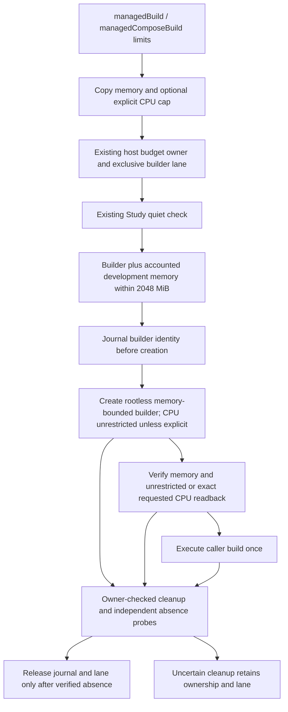
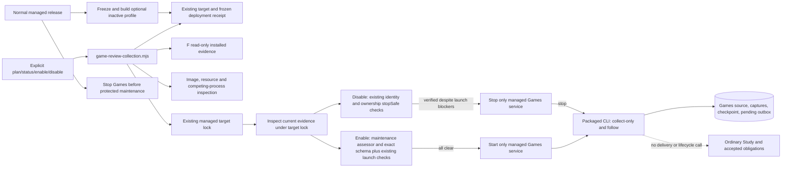

# Repository scripts

These Node and Python scripts support local builds, static verification, the
full test pipeline, Docker integration, visual checks, and tactics catalog
generation.

Scripts should be orchestration and verification entry points, not a second
application layer. If a script gains product logic, move that logic into a
tested backend or frontend module and keep the script thin.

## Normal launcher Study boundary

Source preparation for [#359](https://github.com/aaweaver-actuary/tempo/issues/359):
the existing [CLI](tempo-cli.mjs) selects a version-2 registration before loading
the legacy runtime or database probes. Version-1 behavior remains unchanged.
[tempo-study-launcher.mjs](tempo-study-launcher.mjs) owns only public command
routing and the bounded installed-provider factory. It is not another launcher,
an importer, or a cutover/admission producer.

```mermaid
flowchart LR
    CLI[Existing tempo / tempo-cli main] --> Version{Registered version}
    Version -->|v1 only| Legacy[Existing legacy runtime and probes]
    Version -->|v2| Assembly[Fixed default Study assembly]
    Inputs[Pinned private installedStudy inputs] --> Assembly
    Assembly --> Authority[Owning installed-authority reader]
    Assembly --> Route[Study public command routing]
    Authority -->|Observed exact publication and completed authority| Route
    Route -->|status / doctor / logs / plan| Inspect[Read-only public inspection]
    Route -->|mutating command| Lock[Original transition maintenance lock]
    Lock --> Check[Reinspect exact authority and pinned serving configuration]
    Check -->|start / restart only| Database[Verify existing cluster; start pinned PostgreSQL; read-only DB proof]
    Database --> Services[Learning and Study web start / restart]
    Check -->|stop only| Stop[Stop Learning and Study web; retain database]
    Check --> Backup[Optional Learning-owned backup capability]
    Services --> Outcome[Required read-only runtime outcome verifier]
    Stop --> Outcome
    Missing[Missing / failed / synthetic provider] --> Block[Explicit blocker; no legacy fallback]
    Route -. fail closed .-> Block
```



The existing CLI selects [tempo-study-assembly.mjs](tempo-study-assembly.mjs) by
default for v2 registrations. Its literal public imports compose the
[authority reader](tempo-study-authority/README.md), serving-configuration reader,
runtime adapter and installed-admission verifier. The `studyLauncher` option
remains an explicit embedding/test port. No provider code is loaded from a
registration path, environment variable, graph artifact, bootstrap receipt or
fixture. `createInstalledStudyLauncher` prepares concrete
pinned Compose command choreography using the existing `commandExecutor` port
and the existing `{lockIdentity, withLock}` interface;
it does not read that state's private journal or infer completed admission from
its synthetic transition evidence.

Required public inputs are:

- `readAuthority(request)`: read-only owning capability returning an observed,
  verified v2 receipt, independently approved exact serving configuration and
  completed authority, bound to the entire registration/command/configuration
  path/flags/services request. It owns actual current daemon/server/target
  identity observation, not an inference from matching names or receipt labels.
  Graph and fresh-init receipts remain opaque exact
  references. It must verify actual graph/readback, original-writer fencing and
  admission through their owners; this adapter cannot manufacture those facts.
- The original transition `state` lock, not a new lock derived from the fresh
  target. Mutations reinspect authority under that lock. A no-op, duplicate,
  premature-return or late lock callback cannot report success.
- `run(command,args,settings)`: the existing explicit command-executor capability.
  The factory reads and compares the approved configuration, then addresses only
  named `learning`/`study-web` services with no build, pull or dependency start.
  It rejects extra/bootstrap/legacy services, image or volume mismatches and
  unregistered/public host ports. It never starts PostgreSQL, provisions, grants,
  imports, updates source, publishes registration, enables admission or restores.
  The default assembly's separate runtime capability prepares only the already
  registered PostgreSQL target before this application-service operation.
- `verifyRuntimeOutcome`: independent read-only current-target verification after
  a service effect, returning observed exact completion; no queue endpoint smoke
  test is implied. Missing capability prevents the service effect.
- Optional `backupTarget`: the Learning owner's snapshot plus restore-verification
  capability for the currently registered target. Its absence blocks `backup`
  alone. Legacy backup internals are not imported. Future schema/release updates
  require their own public contract; `migrate` currently blocks explicitly.

### Selected installed inputs

The original proposed registration must include `installedStudy` before public
planning and publication. The existing planner preserves the complete object;
the finalizer cannot append or change it afterward. Version 1 has exactly:

- `originalRegistrationPath`, `receiptPath`, `admissionPath`,
  `persistentIntentPath` and `persistentReceiptPath`: explicit absolute paths to
  selected private JSON inputs. Admission uses the producer-owned public
  `{plan,evidence,facts}` packet, not the private transition journal. Confirmation
  alone is not completed admission.
- `stateDirectory` and `lockIdentity`: the existing original-target state and
  maintenance lock. The fresh target key cannot replace them.
- `runtime`: the runtime owner's explicit version-1 descriptor for the existing
  PostgreSQL volume, mount/data directory, major and system identifier, plus
  `credentialDigests`. The latter contains only `studyTokenSha256` and
  `runtimePassfileSha256`; secret values never belong in registration records.
- `version: 1`.

The default file adapter requires owned private files/directories outside the
source checkout. Inputs and current publication are reread for every inspection,
including the fresh inspection under the original lock. Code is always selected
from fixed repository modules; these paths select data only. Docker/Compose
environment overrides cannot silently change the registered target.

For `start` and `restart`, all required configuration, preparation and outcome
capabilities must exist before the first service effect. Under the original
lock, the runtime owner proves the existing cluster before starting PostgreSQL,
then obtains read-only live database/schema proof before Learning and web start.
`stop`, `status`, `doctor` and planning never prepare or start PostgreSQL. Status
and doctor report observed service state explicitly: cold metadata does not
claim current schema or live health verification. Public runtime readback uses
only the owner's non-mutating endpoints and database verifier, never queue GETs.

These are **implemented source boundaries**, not accepted real target values.
Actual graph/default/name acceptance, original-authority fencing, producer-owned
completed admission and exact target/image/credential lineage remain required
inputs. The quarantine-only persistent composition is not a serving file and
the disposable composition/receipt cannot be promoted. No old history,
background obligations or old backups are fresh-start prerequisites. Ordinary
Study has no Content, Games, Redis, engine or producer-process dependency.

The owning [routing suite](../tests/runner/tempo-cli-study-routing.test.mjs)
uses injected fakes and a physical source-omission fixture: both legacy runtime
and all database probe sources are absent while the actual normal CLI imports
and handles the v2 boundary. These tests do not qualify Docker, PostgreSQL,
installed runtime, real graph acceptance or live deployment.

The [assembly suite](../tests/runner/tempo-study-assembly.test.mjs) additionally
proves fixed default selection, pinned private inputs, original-lock cold-start
ordering, truthful cold/running status and command-local unsupported backup or
schema updates through injected capabilities. Those commands remain explicitly
unsupported for this minimal start/stop/status milestone. Source/release/schema
updates and backup require their own owning capabilities. Actual PostgreSQL,
runtime, graph import, admission and deployment qualification remain separate;
this source does not execute or authorize a one-time cutover.

## Managed builder allocation

`config/resource-budgets.json` lists service allocations. An omitted `cpus`
means CPU-unrestricted execution; it is not zero available CPU. Memory remains
mandatory. Games is listed in the optional and development inventories with its
existing 256 MiB memory and 96 PID limits. Existing service memory allocations
are unchanged. An inventory is not a promise that every listed service can run
together: the expanded optional and development inventories each total 2304 MiB,
and requested development combinations must still fit the **2048 MiB** ceiling.

[`managedBuild`](development-budget.mjs) and `managedComposeBuild` accept
`limits: {memoryMiB, cpus?}`. Omission of the complete option uses unrestricted
CPU and 2048 MiB memory. A smaller memory allocation can likewise omit CPU:

```js
await managedBuild(buildWithNamedBuilder, {limits: {memoryMiB: 1536}});
// A deliberate constrained test can still supply an exact CPU cap:
await managedBuild(buildWithNamedBuilder, {limits: {cpus: 0.5, memoryMiB: 1536}});
```

Explicit CPU caps must be positive finite numbers whose 100000-microsecond
quota is an exact integer. Explicit memory is positive integer MiB. The request
is copied before ownership acquisition or asynchronous hooks. Builders omit
CPU driver options by default and verify unrestricted Docker readback; explicit
requests retain exact quota/period readback. Memory readback, rootless execution,
exclusive builder lane, Study quiet checks, startup admission, resource journals,
foreign-owner preservation and verified cleanup remain authoritative. No failed
request is retried with larger resources.

The [managed Docker adapter](development-docker.mjs) likewise adds no `--cpus`
unless supplied explicitly. It retains bounded memory defaults and owner labels.
Generated Compose overrides omit ordinary CPU quotas and retain memory, optional
PID limits and ownership. Active product/compatibility/test Compose definitions,
pgAdmin and independent database launchers use the same unrestricted policy.
Deliberately constrained Study-priority, saturation, inference-preemption and
backup-shutdown fixtures keep their explicit CPU caps separately from ordinary
service defaults.

Internal worker fanout is separate from resource admission. The development
wrapper preserves caller `CARGO_BUILD_JOBS`, `CMAKE_BUILD_PARALLEL_LEVEL`,
`RAYON_NUM_THREADS` and `UV_CONCURRENT_BUILDS` settings and otherwise leaves them
unset. BuildKit and the web image retain standard compiler defaults. This does
not change Celery, provider, writer or production inference concurrency.

Finite-only consumers can retain
`readDevelopmentCpuAllocation({cpus, docker})`: it validates an explicit number,
or reads the selected daemon's CPU capacity when omitted. Ordinary launchers do
not call it to manufacture a quota. Neither this read nor unrestricted CPU is a
reservation or a guarantee of available host capacity or Study responsiveness.

Memory discovery uses `tempo.resource-class=development`. Known retained peers
without that label must still be accounted for before a runtime action; empty
discovery is not free capacity. Two retained 512 MiB peers plus a 1536 MiB builder
still exceed the unchanged memory policy. Removing CPU quotas grants no memory
exception, live-service shutdown or Docker Desktop configuration authority.



This is source behavior. The owning
[`development-budget` regressions](../tests/runner/development-budget.test.mjs)
use injected Docker capabilities. Their scope is resource policy and lifecycle;
they do not establish a successful real build or installed Study responsiveness.
Existing installed containers retain their old settings until an authorized
owner recreates and inspects them.

## General qualification CPU allocation

The [qualification window](qualification-window.mjs) composes the existing
Study-aware budget and admitted managed Docker `run` lifecycle for Maia and
frozen-order qualification:

```sh
node scripts/qualification-window.mjs maia /path/to/existing/python --source /task/checkout --evidence /task/evidence
node scripts/qualification-window.mjs frozen /path/to/existing/python
```

Omitted CPU selection is unrestricted and performs no daemon CPU-capacity query.
The caller may deliberately set `TEMPO_QUALIFICATION_CPUS`, or pass the existing
qualification `--cpus` option. Legacy bridge/backend windows partition only an
explicit total among their existing roles; they do not divide a daemon-derived
default into fractional service quotas. `--describe` remains resource-free.
Receipts represent unrestricted CPU as `null`, preserve requested explicit caps,
and record observed kernel limits without claiming CPU reservation.

The small [Python allocation adapter](qualification_cpu.py) owns CPU argument,
environment and cgroup translation. Existing qualification owners retain memory,
swap, PID/tmpfs limits, finite deadlines, source staging, permissions, image
identity and cleanup. Maia's qualification-owner label remains distinct from
the central resource-owner label. This source change does not qualify model
inference, artifact installation, provider connectivity or installed services.

Root and lane Vitest configurations and the generic Node test runner use
[`unitWorkerAllocation`](unit-worker-allocation.mjs). An omitted
`TEMPO_QUALIFICATION_CPUS` uses the current process's available parallelism,
including when the managed launcher supplies a budget owner token. Explicit
positive CPU selections are validated by the canonical CPU reader and bounded
by available parallelism; a fractional selection below one uses one worker.
Each worker passes at most one CPU (or its smaller fractional share) to nested
supported pools. No Docker capacity query or fixed root worker ceiling is used.
This selects test concurrency only: existing budget ownership, Study admission,
memory limits, serial shared-state suites and controlled-browser isolation remain
with their existing owners.


## Games collection operator

`scripts/game-review-collection.mjs` is the thin operator for the explicitly
optional Games service in an existing frozen managed release. It reuses Tempo's
registration, deployment receipt, target validation and maintenance lock. It does
not install a release, change saved settings, start dependencies or migrate data.
New managed releases automatically freeze the available Games overlay and build
its image, while leaving the profile inactive. Old frozen receipts remain exact.
The managed release must already contain the labeled collection-only service and
immutable candidate image before enabling. Missing overlap/cadence are packaged
as empty arguments and block enable; no setting is guessed. Ordinary `tempo start` does not start this profile. Managed maintenance stops an
enabled collector before its protected transition and leaves it inactive afterward.

```sh
node /absolute/qualified/source/scripts/game-review-collection.mjs plan --candidate <40-character-commit>
node /absolute/qualified/source/scripts/game-review-collection.mjs status --candidate <40-character-commit>
node /absolute/qualified/source/scripts/game-review-collection.mjs enable --candidate <40-character-commit> --apply
node /absolute/qualified/source/scripts/game-review-collection.mjs disable --candidate <40-character-commit> --apply
```

Plan/status read the actual installed F reader through the API's reader profile;
a successful JSON read does not imply launch readiness. Missing fields, truncated
or unavailable repertoire evidence, unknown process inventory, frozen/image
mismatch and competing collectors block enable. Unused providers may remain
unconfigured. Configured providers need explicit recurrence, a 60-second to one-day
seed, smaller explicit overlap and explicit reconciliation cadence. The prepared
overlay preserves 256 MiB/96 PIDs and leaves CPU unrestricted under Task A policy.
Effective limits are checked on existing collectors. Host processes and containers
with a competing runner prevent activation; unrelated legacy workers are reported
and preserved. Existing accepted Study obligations keep their own lifecycle.

Enable rereads persisted maintenance evidence under the existing target lock.
The existing runtime recovery assessor remains authoritative: pending or invalid
guards, missing required guards, and unreadable evidence block enable. The observed
database schema (`identity.schema_version`, not the report format version) must
be a positive safe integer exactly matching the installed release schema. Safe,
identity-verified disable remains available despite these launch blockers. The
operator never clears recovery evidence or runs migrations.

Enable uses the frozen Compose graph with `--no-build --no-deps --pull never` and
starts only `game-feedback-worker`. Its real `--follow` scheduler enqueues initial
forward/reconciliation work. Disable stops only an identity-verified collector. An owned, stopped collection-only
container from the previous release may be recreated for the verified new image;
a stopped delivery-capable peer still blocks enable. Source bind mounts, foreign
working directories and durable worker volumes are refused. Disable preserves
checkpoint, source, capture and pending-command tables. Neither
operation drains Study delivery. Concurrent managed maintenance shares the target
lock. Independent unmanaged launchers must respect that ownership; this wrapper
cannot fence an arbitrary external process created after its inspection.

Implemented source, proposed/unmerged integration; installed isolation remains
unverified until the exact release is inspected and accepted.



Canonical behavioral/store boundaries remain in the
[provider-worker README](../docs/product-v02/game-sync/provider-worker/README.md),
[Games feedback README](../backend/app/games/feedback/README.md) and
[read projection README](../database/tempo_legacy_database/adapters/games/product_review/README.md).
The regular runner suite owns switch refusal/idempotency/locking proof. The
`games-collection-release` shared suite runs the pinned packaged candidate against
the existing disposable PostgreSQL fixture, controlled real HTTP, original role
provisioning and ordinary Study owner. Supply `TEMPO_COLLECTION_TEST_IMAGE` as the
immutable image ID with this source commit's OCI revision label. To reuse the
recorded runtime image across operator/documentation-only changes, also set
`TEMPO_COLLECTION_TEST_REVISION` to its original exact source commit; the suite
verifies every Dockerfile COPY input and rejects untracked runtime additions. No production
source is mounted into that image; only synthetic qualification inputs are mounted.
