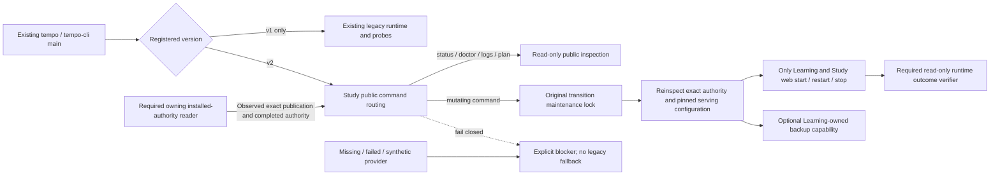

# Repository scripts

These Node and Python scripts support local builds, static verification, the
full test pipeline, Docker integration, visual checks, and tactics catalog
generation.

Scripts should be orchestration and verification entry points, not a second
application layer. If a script gains product logic, move that logic into a
tested backend or frontend module and keep the script thin.

## Normal launcher Study boundary

Source preparation for [#359](https://github.com/aaweaver-actuary/tempo/issues/359):
the existing [CLI](tempo-cli.mjs) selects a version-2 registration before loading
the legacy runtime or database probes. Version-1 behavior remains unchanged.
[tempo-study-launcher.mjs](tempo-study-launcher.mjs) owns only public command
routing and the bounded installed-provider factory. It is not another launcher,
an importer, or a cutover/admission producer.

The outer composition supplies an installed provider to `main` through its
`studyLauncher` option. No provider or code is loaded from a registration path,
environment variable, graph artifact, bootstrap receipt, or fixture. No installed
provider is selected by default. `createInstalledStudyLauncher` prepares concrete
pinned Compose command choreography using the existing `commandExecutor` port
and the existing `createCutoverState` public `{lockIdentity, withLock}` interface;
it does not read that state's private journal or infer completed admission from
its synthetic transition evidence.

Required public inputs are:

- `readAuthority(request)`: read-only owning capability returning an observed,
  verified v2 receipt, independently approved exact serving configuration and
  completed authority, bound to the entire registration/command/configuration
  path/flags/services request. It owns actual current daemon/server/target
  identity observation, not an inference from matching names or receipt labels.
  Graph and fresh-init receipts remain opaque exact
  references. It must verify actual graph/readback, original-writer fencing and
  admission through their owners; this adapter cannot manufacture those facts.
- The original transition `state` lock, not a new lock derived from the fresh
  target. Mutations reinspect authority under that lock. A no-op, duplicate,
  premature-return or late lock callback cannot report success.
- `run(command,args,settings)`: the existing explicit command-executor capability.
  The factory reads and compares the approved configuration, then addresses only
  named `learning`/`study-web` services with no build, pull or dependency start.
  It rejects extra/bootstrap/legacy services, image or volume mismatches and
  unregistered/public host ports. It never starts PostgreSQL, provisions, grants,
  imports, updates source, publishes registration, enables admission or restores.
- `verifyRuntimeOutcome`: independent read-only current-target verification after
  a service effect, returning observed exact completion; no queue endpoint smoke
  test is implied. Missing capability prevents the service effect.
- Optional `backupTarget`: the Learning owner's snapshot plus restore-verification
  capability for the currently registered target. Its absence blocks `backup`
  alone. Legacy backup internals are not imported. Future schema/release updates
  require their own public contract; `migrate` currently blocks explicitly.

All of these are **source contracts**, not accepted real target values. The
owning installed-authority reader, persistent serving configuration, actual
graph/default/name readback, runtime outcome implementation and exact cutover
confirmation remain required before a legitimate assembly can supply the
provider. The quarantine-only persistent composition is not a serving file and
the disposable composition/receipt cannot be promoted. No old history,
background obligations or old backups are prerequisites for the graph-preserving
fresh-start choice.

The owning [routing suite](../tests/runner/tempo-cli-study-routing.test.mjs)
uses injected fakes and a physical source-omission fixture: both legacy runtime
and all database probe sources are absent while the actual normal CLI imports
and handles the v2 boundary. These tests do not qualify Docker, PostgreSQL,
installed runtime, real graph acceptance or live deployment.

This packet does not complete normal-launcher replacement: cold-starting or
restarting PostgreSQL, source/release/schema updates and installed authority,
configuration, runtime-readback and backup provider implementations/qualification
remain separate gaps. The factory addresses only an already admitted target
whose database is available. The existing legacy default stays preserved until
the separately admitted Study assembly supplies its genuine public capabilities.
