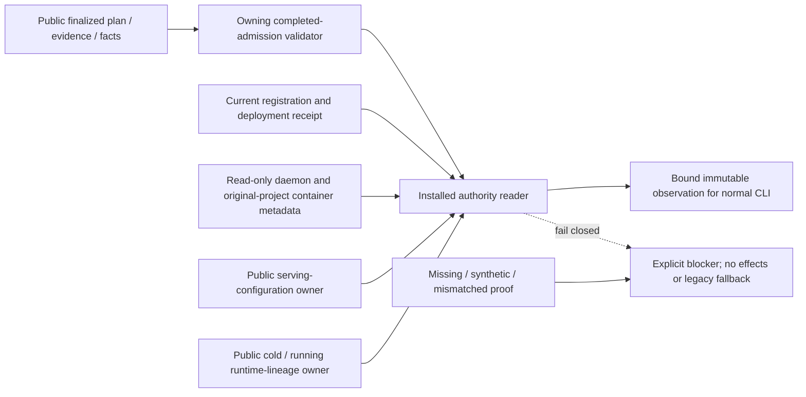

# Installed Study authority reader

[tempo-study-authority.mjs](../tempo-study-authority.mjs) is source preparation
for the existing normal launcher. It observes an already admitted, explicitly
selected fresh target. It cannot produce admission, fence a writer, import data,
start a service, issue a queue item, or change registration.

`createInstalledAuthorityReader` accepts explicit `originalRegistration`, the
public readiness packet `{plan,evidence,facts}`, and injected public capabilities:

- `validateAdmission(packet)` is the admission owner's public semantic validator.
  Its result must be observed, verified and complete, carry a nonblank evidence
  reference, and match the existing `readinessBinding` of the finalized plan at
  `before-admission`. This binds the entire plan, including graph/init references,
  schema, images, original authority and installed private input paths. User
  confirmation alone and a matching quarantine publication are insufficient.
- `readPublication(request)` returns current parsed `{registration,receipt}`.
  Both must exactly match the pinned public plan; the carrier is not stripped.
- `inspectConfiguration(request)` returns the serving-configuration owner's
  validated rendered configuration. This reader does not duplicate its checks.
- `inspectRuntime(request)` returns the runtime owner's observed bound verdict,
  exact pinned runtime descriptor and honest `cold` or `running` state.
- `run(command,args,settings)` is the existing command-executor capability.
  This reader uses only Docker `info`, original-project `ps --all` and `inspect`.
  Every observation is fresh for the caller; no recovery journal is read.

The original and fresh volume sets must be disjoint, and the original lock must
remain the source target's public identity. The reader checks both current daemon
IDs, rather than assuming a context name still denotes the same daemon. All
original-project application containers must be stopped and not restarting.
Stopped containers with `always` or unknown restart policy are refused. `no` and
stopped `unless-stopped` are accepted, following Docker's
[documented restart-policy behavior](https://docs.docker.com/engine/containers/start-containers-automatically/).
The only running-container exception is the original PostgreSQL service mounted
to its exact registered source volume. Its server readiness is not a Study
dependency. An absent original project needs no container restart or repair.

A cold observation is metadata, not current PostgreSQL control, schema or health
proof. The returned `runtimeInspection` retains the runtime owner's flags. The
runtime owner must establish physical cluster identity under the original lock
before cold PostgreSQL startup, then verify the live outcome. The reader never
manufactures those flags from a bootstrap receipt or configuration equality.

The admission producer owns graph/recovery-copy acceptance, fresh initialization,
old-authority isolation and exact user confirmation. The reader consumes only its
public completed result, not a private lifecycle journal. No actual completed
record, target identity or approval value is supplied by this source PR. Missing
producer or observation capabilities block explicitly.

The owning [tests](../../tests/runner/tempo-study-authority.test.mjs) use injected
fakes for the observed protocol. Their results do not qualify any real daemon,
graph import, database, credential lineage, deployment or live cutover. No old
history, background obligations or old backups are added as gates.
