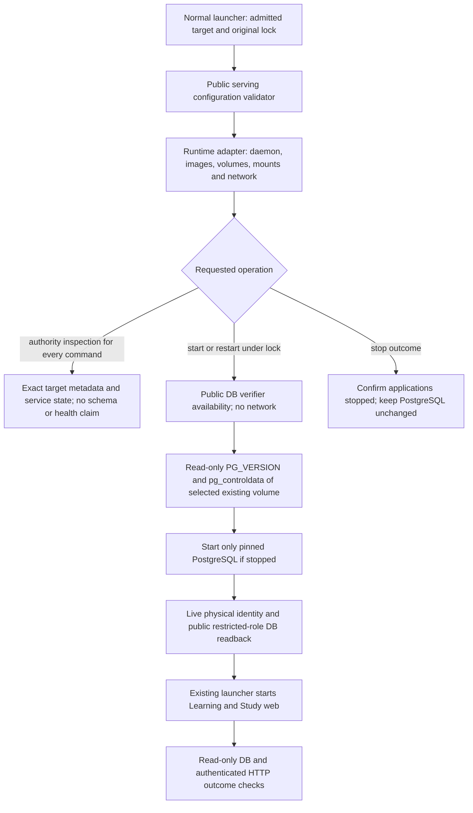

# Installed Study runtime readback

**Implemented source adapter; actual installed execution and admission remain
unqualified.** [tempo-study-runtime.mjs](../tempo-study-runtime.mjs) supplies
`createInstalledStudyRuntime({run, inspectConfiguration, persistentReceipt,
fetcher})`. It returns `inspectRuntime`, `prepareDatabase` and
`verifyRuntimeOutcome`; it does not choose, admit or initialize a target.

The outer normal launcher owns the original maintenance lock and actual
admission. The concrete serving-configuration owner validates the selected
configuration and existing persistent-bootstrap receipt. This adapter consumes
that public configuration, preserves its keyword DSNs, and leaves Psycopg/SQL
interpretation to the installed database owner. It imports no Learning,
Content, converter, legacy runtime or database implementation.

## Cold start and verification



The exact inline `registration.installedStudy.runtime` input is:

```text
version: 1
postgres: {volumeKey, volumeName, mountDestination, dataDirectory, major,
           systemIdentifier}
credentialDigests: {studyTokenSha256, runtimePassfileSha256}
```

These are selected inputs, not values inferred from a name. They must match the
public persistent receipt and independently validated configuration. Both data
and runtime-secret volumes must be external, separately owned persistent
resources. The data path is explicit; no PostgreSQL image/layout default is
guessed. Source-volume disjointness and completed admission belong to the
authority/configuration owners.

`inspectRuntime(request, observation?)` uses only read-only Docker metadata for
every command. It validates the selected daemon, images, persistent ownership,
mounts, runtime configuration, network and actual ingress. All three containers
running returns `state: running`; a stopped or incomplete service set returns
`state: cold`. Both retain `clusterIdentityVerified`, `schemaVerified` and
`healthVerified` false. Running process state is not proof of application health.
Inspection creates no helper container and performs no physical, DB or HTTP
probe. Thus an unhealthy but correctly identified target can still be stopped,
have its logs read or enter restart preparation. Identity mismatches still block
all commands. Normal status/doctor report schema and health as unverified.

The stricter live checks below belong to start/restart preparation and post-start
outcome verification. A restart still fails if its selected database cannot pass
preparation or its application remains unhealthy after startup; inspection does
not turn that failure into success.

Only `prepareDatabase(request, observation)` for start/restart may create bounded
disposable inspection containers or start PostgreSQL. Its caller must already
hold the original lock and have verified admission, configuration and required
outcome capabilities. Inspection containers have explicit owner, invocation,
purpose and disposable labels and `--rm`; they use pinned images, read-only
mounts and `volume-nocopy`, and never build or pull. Physical reads have no
network. Missing/empty data, a different major/system identifier, old images
without the public verifier, wrong ownership or ambiguous mounts stop before
PostgreSQL startup. There is no `initdb`, adoption, schema/grant change or retry.

The post-start database check is the installed public module introduced by
[PR #471](https://github.com/aaweaver-actuary/tempo/pull/471), invoked as
`python -I -m tempo_learning_database.runtime_readback`. Its `--help` availability
is checked before PostgreSQL startup. Both selected restricted roles connect
with the actual inspected PostgreSQL container address, private passfile and
read-only transactions. The module verifies database, schema checksum identity,
workspace, timezone and roles. PostgreSQL system identity is explicitly
caller-bound: this adapter owns the before/after `pg_controldata` proof; the
restricted database verifier does not claim privileged SQL observation.

`prepareDatabase` returns an observed, request-bound verified verdict with
`state: database-ready`, physical/schema flags true and health false. It does
not start Learning/web or create admission. A failure retains the selected
target state for inspection; it does not drop, restore or start the old target.

## Read-only running and stopped outcomes

Running verification binds actual container images, mounts, private runtime
environment, network and host ports to the selected target. Both configured
and actual Study bindings must use the exact registered loopback ingress;
Learning/PostgreSQL cannot expose host ports. An unrelated HTTP 200 cannot
substitute for the selected web container's actual port mapping.

The runtime uses only Learning's public `GET /health/ready` and authenticated
`GET /api/study/bootstrap`, plus Study's registered root page. It never reads a
queue endpoint or manufactures an attempt/review. Private token and passfile
bytes stay inside the selected Learning container. File ownership/mode and
digests are checked; outputs whitelist health/workspace metadata. The schema
claim comes from the public database verifier, not an invented HTTP field.

A stopped outcome checks Learning/web are actually stopped, leaves PostgreSQL
unchanged and keeps live schema/health flags false. The adapter has no backup,
release update, migration, credentials/grants, provisioning, import, publication,
restore, deletion or cutover capability.

## Owning proof

[The registered runner](../../tests/runner/tempo-study-runtime.test.mjs) uses
semantic command doubles and temporary private-file HTTP fixtures. It executes
no Docker, PostgreSQL or real HTTP target. The regular unit wrapper and component
inventory select it explicitly. Run the bounded selection with the existing
nontruncating advisory validation lock:

```sh
node tools/component-build/test-lane.mjs runners tempo-study-runtime
```

Actual source/image pins, persistent ownership, cold startup, database/runtime
readback, authority fencing and admission still need independent installed
qualification and specific execution authorization. Synthetic protocol fixtures
are not actual-target acceptance. The blocked graph rehearsal is unrelated and
is not retried by this source work.
