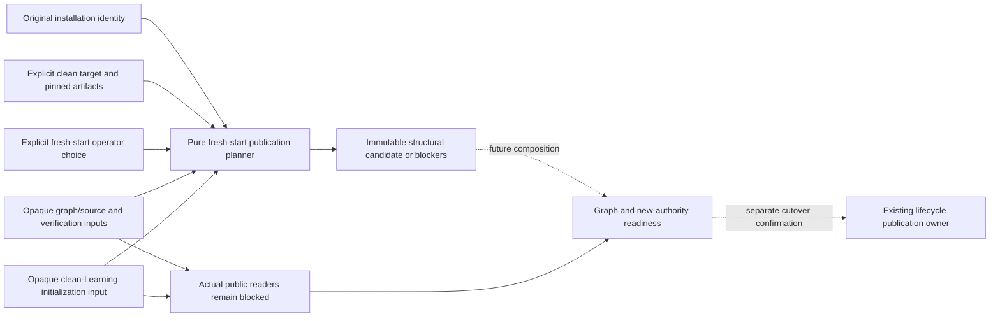

# Graph-preserving fresh-start planner fixtures

These synthetic, credential-free examples qualify only the pure
[`planLauncherFreshStart`](../../../tempo-cutover-plan.mjs) source contract.
The operator must explicitly select `graph-preserving-fresh-start`: preserve the
opening graph/repertoires while initializing an independent clean Learning
target. Old reviews, schedules, background/server/browser pending work and old
backups are not prerequisites for this workflow. The original live database is
untouched until graph/new-target verification and separate cutover confirmation.

This replaces the previous preparation in these same files. The old preservation
planner remains retained on branch `codex/359-launcher-plan-prep`, PR #443, commit
`60bca3b84e934ac0ffb9ab6edb6f2edaf9f6bfd1`; it is not the fresh-start contract.
There is one planner implementation on this branch, and no new launcher.
Current [`tempo-cli.mjs`](../../../tempo-cli.mjs) still requires registration v1
and uses the legacy default composition. No command imports the new planner.

Run the narrow source proof with Node 22.13 or newer:

```sh
node --test scripts/tests/tempo-cutover-plan.test.mjs
```

`publication-input.json` supplies original v1 identities, explicit candidate v2
records, the fresh-start operator choice and opaque graph/fresh-init inputs.
`publication-golden.json` fixes the complete structural result. Tests cover exact
correspondence, immutable output, source lock ownership, required artifacts,
ingress, independent volumes, explicit graph/fresh-init inputs and fail-closed
actual readers. No Docker, dependencies, database, browser or broad suite is used.

## Implemented source boundary



The planner reuses public `targetKey` from
[`tempo-deployment.mjs`](../../../tempo-deployment.mjs). It owns no files,
credentials, locks, database, graph import or service lifecycle, and imports no
converter/domain internals. Composition wires public capabilities one way.
Required artifacts reuse the existing [opt-in composition](../../../../docker-compose.study.yml)
service names `study-web`, `learning` and `postgres`; all need immutable images.
PostgreSQL registration matches its own artifact, and the selected Study web
port matches the browser authority through its existing port-80 listener.
These public service names do not adopt disposable Compose settings or volumes
for a real installation. Actual target values are mandatory inputs.
The independent clean target may explicitly select a different PostgreSQL major
from the legacy cluster: serialized graph import is not a physical cluster
upgrade. A valid new major and its own pinned PostgreSQL image are still required;
actual image/major compatibility and graph initialization remain fresh-init
provider checks, not claims made by the structural planner.

The common candidate `.cutover` identity retains pinned revision/images,
database/workspace, Compose/volumes, ingress and schema. It now requires
`mode: 'graph-preserving-fresh-start'`, pinned `graphSourceReference`, and final
opaque `graphReceipt` and `freshInitReceipt` references. There is no history
transfer receipt or invented authority epoch. Explicit new workspace/origin/token
authority must be verified through the public fresh-init/isolation provider so
old cached work cannot replay into the clean target. Matching strings alone do
not prove this server/browser behavior; no pending-work preservation is required.

## Actual contracts remain blocked

Public source preservation uses `tempo_content.SourceSnapshot` v1 and its
existing authored source/repertoire fields. The installed
`tempo-content publication export <publication_id> --generation <n>` command
publishes a `content_bridge_export` envelope, and `tempo-a-bridge ... apply
<operation_id>` is the public serialized delivery boundary to Learning's
publication stage/activate endpoints. The Node planner imports none of those
implementations and does not guess actual graph field/identity mappings.
Exact installed graph closure and public copy/import/fresh-init helpers are
being prepared by their owners. Reduced Learning graph rows alone cannot
preserve complete authored sources/names; the immutable graph/source bundle
needs a separately verified recovery copy, without a full-history backup gate.

`graphSource`, `graphVerification` and `freshInitialization` remain opaque
inputs until their actual public provider schemas are accepted. Missing inputs
or final references block structural publication with `graph-contract-pending`
or `fresh-initialization-contract-pending`. The exported
`readGraphTransferVerification` and `readFreshInitializationVerification` always
fail closed with those codes for now, even when an arbitrary packet claims
acceptance. The positive golden establishes plumbing only, never actual graph
preservation, clean initialization or readiness.

The initial lifecycle intent pins source/target/artifacts before future graph
import and may leave final receipt references null. This publication-stage
planner requires final explicit references after graph and clean-target checks.
`lockIdentity === sourceIdentity` keeps the original maintenance authority when
new independent volumes yield a different target/state key. Publication
locations remain explicit composition inputs. `plan.original` preserves copied
JSON identities; the lifecycle captures exact original registration/receipt
bytes or known file absence for restoration. A prior v1 receipt or explicit
`current.receipt: null` is accepted; a missing property remains unknown and
blocks instead of silently assuming absence. Neither historical receipt
verification nor an old/target backup is required by this structural planner.
No real capture, reset, deletion, service operation,
credential change, cutover or old-authority mutation is performed here.
