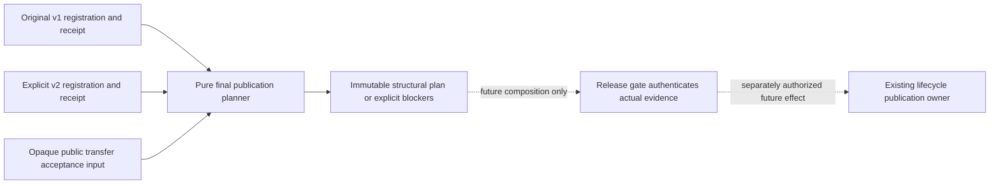

# Launcher publication planner fixtures

These are synthetic, credential-free examples for
[`planLauncherTransition`](../../../tempo-cutover-plan.mjs), not observed
installation identities, a history acceptance receipt schema, or permission to
publish or activate a target. The source contract implements only final
registration/deployment correspondence from the accepted
[launcher specification](../../../../docs/architecture/study-first-reduction-2026-10-21/LAUNCHER-CUTOVER.md)
§§2–4. No current launcher command imports this planner. The existing
[`tempo-cli.mjs`](../../../tempo-cli.mjs) still requires version 1 registration
and retains the legacy default composition; this PR does not make it adopt v2.

Run the focused independent source proof with Node 22.13 or newer:

```sh
node --test scripts/tests/tempo-cutover-plan.test.mjs
```

`publication-input.json` supplies an original v1 pair and explicit candidate v2
pair. `publication-golden.json` fixes the complete structural result, including
the distinct source/target state identities and the original lock identity. The
test inventory covers exact correspondence, unchanged originals, immutable
output, mismatches, absent acceptance, mutable artifacts, legacy service/volume
mixture, unqualified identity changes, secret material and malformed records.
These tests need no Docker, dependency install, database, browser or broad suite.

## Implemented source boundary



The planner reuses the existing public `targetKey` from
[`tempo-deployment.mjs`](../../../tempo-deployment.mjs). It does not import
converter, history, Learning, Content or optional plugin implementation modules.
It owns no lock, files, target, credentials or application lifecycle. All effect
ownership remains outside this pure module. The new shared `cutover` identity
is a launcher input contract; actual field values are mandatory caller inputs.
It records the approved revision/image IDs, database/workspace, Compose/volumes,
ingress, schema and opaque transfer receipt reference in both candidate records.
Matching candidates remain quarantined and confer no traffic authority.

## Required integration contracts

The initial lifecycle intent pins artifacts and original publication bytes
**before** fencing. The final accepted transfer cannot exist at that point.
After the final fenced snapshot/import, a composition adapter may call this
planner through the lifecycle's final-publication capability. It must pass the
history owner's accepted public receipt one way; no converter internals or
parallel migration authority belong here.

There is currently **no accepted real transfer receipt contract/validator**.
Absent input returns `accepted-transfer-contract-pending`. A nonempty opaque
input only permits structural planning: the planner deliberately does not
interpret its fields as historical acceptance. A release adapter must still
authenticate the real public evidence, bind its reference and original/target
identities, verify latest fenced state and pending original-authority work, and
check host, quarantine, restore-verified target backup and user cutover approval.
The fixture acceptance object cannot satisfy those gates. The original Study
and all real history/pending work remain outside this source proof.

`sourceIdentity` and `targetIdentity` use the existing daemon/volume target key.
New target volumes can produce a different state directory.
`lockIdentity === sourceIdentity` retains the original maintenance authority
throughout transition; the planner never selects a new lock or state directory.
Actual publication destinations and any state relocation are required future
composition inputs and remain blocked until real identities are established.

`plan.original` is a copied JSON identity record. The lifecycle must capture and
retain the exact original registration/receipt bytes under its existing lock;
reserializing this JSON does not provide exact prior-state restoration. Recovery
must follow the accepted interruption matrix: no automatic legacy fallback at
or after activation-started, uncertain acceptance or target-only effects.
Neither this planner nor its fixtures implement recovery or rollback effects.
