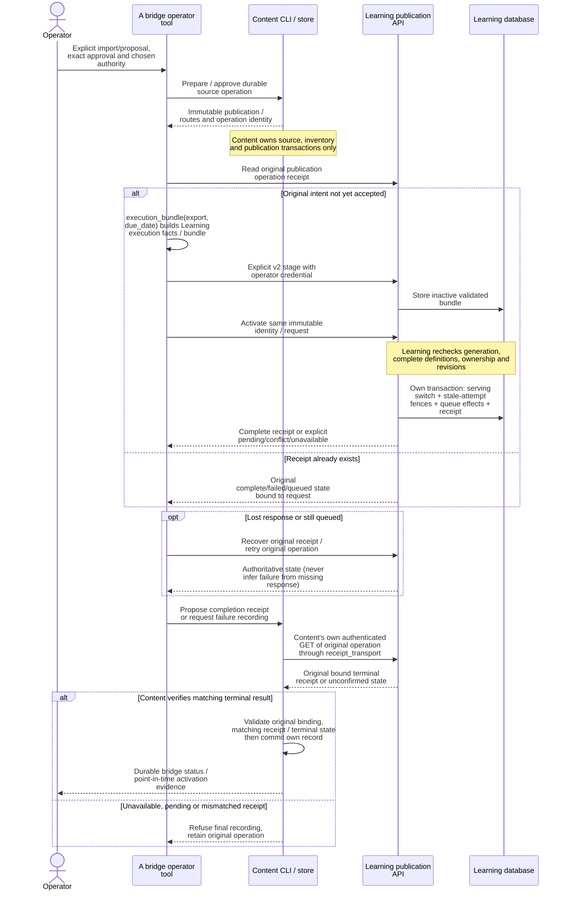

# Independent Content service

The [authoritative bridge operator workflow](../../docs/analysis-restoration/a-bridge.md)
adds durable import/proposal drafts, exact approval, recovery and verified Learning
delivery. Its Learning bundle v2 targets complete opening sources up to 2,048
definitions and 8 MiB; v1 retains its historical 128-fact boundary. Native results
and any unverified limits are recorded in that handoff. Content's independent
shared Publication v1 limit remains 10,000. The historical consumer notes below
describe v1 compatibility rather than permission to rewrite Content identities.

`tempo-content` owns structured authored repertoires and exercises, stable source
identities, complete legal opponent replies, bounded inventory reconciliation,
and immutable Content v1 publications. Its Python namespace is `tempo_content`;
its supported operational boundary is the `tempo-content` command.

Content requires its own PostgreSQL database and credentials. It runs without the
legacy backend, Learning, Game Evidence, Intelligence, Redis, Celery, Stockfish,
or Maia. A publication is an immutable definition set; Learning acceptance and
serving activation remain external operations owned by #193.

## Architecture drawings

These are the canonical drawings for the views below. Edit the blocks here;
peer documents link to them instead of maintaining copies. See the
[diagram index and source/status baseline](../../docs/architecture/diagrams/README.md) and
[maintenance procedure](../../docs/architecture/diagrams/README.md#maintenance-and-review-procedure).

### Content publication and serving activation (MAIN)

The explicit bridge operator talks to owners' public boundaries; it is not part
of an ordinary Study request. Arrows show data/command flow, not shared database
connections or atomic commits across services.



Source anchors: Content [`bridge composition/application`](src/tempo_content/bridge/README.md)
and [`CLI`](src/tempo_content/cli.py), external
[`Operator` receipt/retry workflow and `execution_bundle`](../../tools/analysis-restoration/a_bridge/src/tempo_a_bridge/cli.py),
Learning [publication routes](../learning/runtime/src/tempo_learning_runtime/api.py),
[`publication_bridge`](../learning/runtime/src/tempo_learning_runtime/publication_bridge.py),
[`publications`](../learning/runtime/src/tempo_learning_runtime/publications.py)
and [`gateway`](../learning/runtime/src/tempo_learning_runtime/gateway.py).
Content exports serialized publication/routes; the external bridge constructs
Learning execution facts/bundle. Content's supported CLI then independently calls
[`receipt_transport.authenticated_operation` / `verified_receipt` / `verified_terminal_failure`](src/tempo_content/receipt_transport.py)
before its local `record` / `record_terminal_failure` write. That verification
uses Content's configured original Learning authority and operator credential,
checks the original request binding and terminal state, and for completion checks
that the proposed receipt matches the authenticated response. It is not merely
trusting the bridge's earlier receipt read. Failure/unavailability retains the
operation rather than recording an unverified result. Content's CLI therefore has
this explicit operator-invoked Learning HTTP dependency; it is not startup or
ordinary Study work.
Retirement is a separate command; it locks/fences affected definitions and attempts.
Failed activation must preserve the previous serving generation. Staging or a
Content publication alone supplies no serving authority. An activation receipt is
historical evidence, not proof that its generation remains current forever.
An Analysis response proposal is a draft input to this explicit approval path,
never automatic Content approval or Learning admission.

## Installation

Python `>=3.12,<3.15` is supported. From a repository checkout, install only this
component and its two local package dependencies:

```sh
uv sync --project services/content --locked --no-editable --python 3.12
uv run --project services/content --locked --no-editable tempo-content --help
```

The lock pins third-party dependencies. `tempo-chess-core==0.1.0` and
`tempo-content-publication-contracts==1.0.0` are installed as distributions, with
no repository-root `PYTHONPATH`. Build both a wheel and source distribution with:

```sh
uv run --project services/content --locked --no-editable python -m build --no-isolation services/content
```

A source-free deployment installs the three built distributions plus the locked
third-party requirements. No checkout, test tooling, development dependency,
or other Tempo service is required by the installed runtime. The artifact
qualification below proves that installation on Python 3.12 and 3.14.

## Database and operation

An operator provisions a separate logical Content database, a Content owner
credential, and a restricted Content runtime role. Revoke public database
CONNECT/TEMP and public schema/function access. The migration command uses
`TEMPO_CONTENT_MIGRATION_DATABASE_URL`; runtime commands use
`TEMPO_CONTENT_DATABASE_URL`. Set `TEMPO_CONTENT_WORKSPACE` and
`TEMPO_CONTENT_RUNTIME_ROLE` for the selected database. Do not reuse another
service's database or credentials.

Grant the runtime role CONNECT to Content explicitly after revoking PUBLIC
access; the owner migration then grants Content table permissions. Runtime must
have no membership permitting owner-role assumption and no CREATE/TEMP database
privileges. Readiness rejects privilege drift; reapplying the owner migration
repairs unsupported immutable-table grants.

Migrations are explicit. Runtime readiness checks the exact migration identities
and checksums, workspace binding, and role restrictions. It does not repair or
migrate the database. Existing migration payloads must never be rewritten.

Use `tempo-content --help` and the help for its grouped `source`, `repertoire`,
`inventory`, and `publication` commands for the supported arguments. The
structured sample is [fixtures/source.json](fixtures/source.json). The full
input format and ownership boundary are documented in [INTERFACES.md](INTERFACES.md).

After provisioning credentials, these commands run from `services/content/`:

```sh
export TEMPO_CONTENT_WORKSPACE=content-example
export TEMPO_CONTENT_RUNTIME_ROLE=content_runtime
.venv/bin/tempo-content migrate
.venv/bin/tempo-content readiness
.venv/bin/tempo-content source load fixtures/source.json --expected-revision 0
.venv/bin/tempo-content source show structured-example
.venv/bin/tempo-content repertoire show white-repertoire --source-key structured-example
.venv/bin/tempo-content inventory request structured-example
.venv/bin/tempo-content inventory work --source-key structured-example --max-slices 100
.venv/bin/tempo-content inventory status structured-example
.venv/bin/tempo-content inventory positions structured-example --limit 64
.venv/bin/tempo-content inventory routes structured-example --limit 64
.venv/bin/tempo-content publication build structured-example
.venv/bin/tempo-content publication status structured-example
```

Use the returned publication ID with `publication show PUBLICATION_ID`, optionally
adding `--generation N` to read an older immutable record. Source loading requires
the caller's expected current revision; use the returned revision for the next
structural edit. A conflicting edit fails without silently overwriting it.

Load a complete source snapshot, request inventory reconciliation, advance bounded
work, inspect its status and coverage, then build and read the resulting
publication. Each invocation can exit between slices; durable cursors and leases
allow another process to continue. A source rename, route replacement, membership
removal, or repertoire deletion is represented by another full source snapshot
using the same durable source/entity keys. Repeated semantic input preserves
productive reconciliation progress.

Publication construction requires a complete valid inventory and exercise graph.
An invalid or incomplete successor retains the last complete immutable output.
An empty successor is a retirement request requiring the separate #193 protocol;
it cannot produce the nonempty shared v1 Publication.

## Validation

The local regression inventory is [REGRESSIONS.md](REGRESSIONS.md). The regular
suite uses the installed package and contains no live-service dependency:

```sh
services/content/.venv/bin/python services/content/run_suite.py pure
node tools/component-build/check-components.mjs --component content
node tools/component-build/test-lane.mjs --component content --list
```

The manifest tools require only their own TypeScript dependency; when absent,
install it with `npm ci --prefix tools/component-build --workspaces=false`.
No frontend dependency tree is needed. The Content development lock includes the
JSON-schema validator used by the selected shared-contract dependency suite.

Native and installed-artifact proofs have separate commands:

```sh
services/content/.venv/bin/python services/content/integration/run_postgres.py /private/tmp/content-native-evidence
services/content/.venv/bin/python services/content/integration/qualify_artifacts.py /private/tmp/content-artifact-evidence
```

Add `--benchmark` to the native runner to measure cold installed import, readiness,
source registration, bounded inventory slices, publication, restart/replay,
transaction observations and driver peak memory for 512 authored routes of up to
64 plies and 2,048 exercises. It runs after the complete native suite against the
same owned cluster and preserves `benchmark.json` before cleanup. Generic
component qualification does not start this optional larger workload.

Add `--consumers` to the artifact qualifier to build the actual affected
Learning/Game Evidence dependency closure in a separate environment and run the
standalone consumer probe against exported Content JSON. Content is absent from
that consumer environment, and those service implementations remain absent from
the four Content-only artifact consumers. No consumer database or provider runs.

The native runner requires a reachable Docker daemon and the existing local
`postgres:18.6-trixie` image. It creates one nonce-labeled, CPU/memory-bounded
container and persistent volume with fresh credentials. It accepts no external
database URL and creates foreign guard databases inside that owned cluster. It
verifies ownership labels before teardown and records removal results. The runner
does not start or inspect live Study resources, pull images, or prune Docker.

Both proof tools preserve source hashes, revision, exact commands, logs, and
nonzero passing identities. Skips, deselection, duplicate identities, changed
collection, or failed setup/call/teardown fail qualification. Artifact consumers
have no copied production source, use isolated Python imports, exercise wheel
and sdist installations on Python 3.12/3.14, and test the installed CLI.

Actual tested revisions, counts, timings, cleanup, and limitations belong in
[VALIDATION.md](VALIDATION.md). A focused local pass does not establish hosted
merge qualification, live deployment, or Learning activation.

## Consumer and reconstruction handoff

Content uses the existing `tempo_content_publication_contracts.v1.Publication`.
All five executable kinds are preserved. Consumer proofs add Learning execution
facts at its documented adapter boundary and adapt Content provenance into Game
Evidence's service-local `ComparisonSnapshot`; neither adaptation is a new shared
wire contract. Game Evidence remains unable to treat the publication as active
without a separately accepted activation acknowledgement.

Learning's current `PublicationBundle` allows at most 128 execution facts and
one active owner per opening repertoire. A valid larger Content publication is
retained in full and explicitly reports that compatibility limit. Splitting it
into additive active chunks or truncating it is unsupported.

There is also an opening-specific identity limit: Learning's legacy `opening`
adapter recomputes its historical FEN/moves card hash, whereas Content's durable
authored card ID includes source/exercise identity. The installed probe proves
the supported `study_exercise` adapter preserves the ordinary Content IDs and
separately demonstrates the legacy opening rejection and its narrow hash-based
compatibility fixture. #193 must coordinate the identity bridge and history
mapping before ordinary Content opening publications can activate; this service
does not rewrite durable IDs to bypass that boundary.

For #193, either raise Learning's bounded bundle size after measuring validation
and transaction costs, or introduce a coordinated versioned staging protocol:
upload complete pages into an inactive serving generation, validate the full
definition count/digest and execution facts, then atomically switch one active
generation pointer. Staging must be resumable and idempotent; incomplete generations
must never serve, and replacement must preserve the previous active generation
until the new generation is fully accepted. A coordinated retirement command is
also needed for deletion of the final definition. Content does not implement this
Learning protocol or fabricate activation acknowledgements.

#265 owns PGN/connected-Study import, integrity interpretation, segmentation,
and extraction of durable source/entity keys. This increment accepts validated
structured snapshots. The importer should emit that boundary and retain its
diagnostics and provenance instead of reaching into Content or Learning tables.

## Inventory continuations and actionable errors

Position and route pages identify their source revision/generation and return an
opaque `next_cursor`. Save the exact string from a completed first page and pass
it quoted; for example, with `CONTENT_CURSOR` set to that returned value:

```sh
.venv/bin/tempo-content inventory routes structured-example --limit 1
.venv/bin/tempo-content inventory routes structured-example --limit 1 --after "$CONTENT_CURSOR"
```

The versioned JSON cursor binds workspace, source, reader, revision and generation.
Do not construct or modify it. After `stale_inventory_cursor`, start again without
`--after`. Old position keys/route pairs and malformed tokens return
`invalid_cursor`. Wait for complete reconciliation before collecting a stable
inventory across pages. A single read remains coherent if replacement/collection
occurs while it runs; coverage identifies both available and unavailable generations.

Use `repertoire show KEY --source-key SOURCE` when keys appear in several sources.
Unscoped ambiguity returns `ambiguous_repertoire`, never an arbitrary first source.
CLI failures exit nonzero with structured JSON on stderr and no partial result.

A distinct stale source edit returns `stale_source_revision` before staging input.
Read the current source, reconcile the intended edit, and submit its actual current
revision. Identical current content remains idempotent even with an old expected
revision. Crashed and race-losing writers can still leave resumable input;
[#292](https://github.com/aaweaver-actuary/tempo/issues/292) owns safe reclamation.

Readiness rejects missing required grants, for example `content.input_items INSERT`
or `content.tasks UPDATE`, as well as excessive powers. An authorized operator can
reapply `.venv/bin/tempo-content migrate` using the Content owner credential and
then rerun readiness. Runtime credentials cannot perform that repair. This does
not change migration history or imply a deployment.

For retained regular-suite receipts, add `--evidence DIRECTORY` to
`services/content/run_suite.py pure`. The same strict collection/execution/JUnit
validation runs whether evidence is retained or temporary.

Database implementation, DDL and source-schema charts: [central database owner](../../database/tempo_content_database/README.md).

Existing reconciliation, the complete binding phase and bounded route-window computation live in the [Content worker application](src/tempo_content/worker/README.md); source decisions and inventory-status projection live in [Content source policy](src/tempo_content/policy/README.md), and construction/provenance lives in [publication preparation](src/tempo_content/publication/README.md). The database adapter supplies owner-specific facts and operations. Route/exercise phase and I/O coordination, source staging and publication read/reservation/write sequencing remain extraction work.
