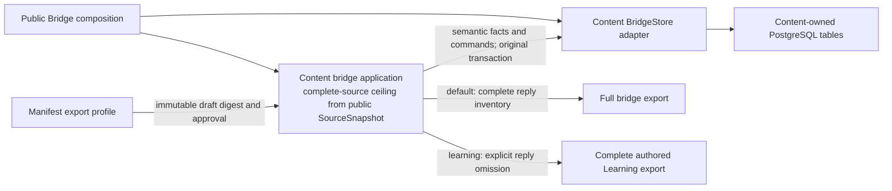

# Content bridge application and composition

**Current source in this unmerged extraction; live deployment unverified.** The supported `tempo_content.bridge.Bridge(service)` entry point remains unchanged. This package separates the existing application decisions from database operations; it introduces no new schema, delivery authority or cross-owner connection.

[application.py](application.py) owns import/proposal validation, immutable draft identities, approval/state decisions, export construction and receipt/checkpoint rules. The [composition entry point](__init__.py) supplies the [database adapter](../../../../../database/tempo_content_database/adapters/bridge.py), which owns the existing complete SQL statements, JSON driver encoding, scope locks and row projections. No generic SQL execution capability is passed to the application.

Complete-source scope and draft guards reuse the existing public
`SourceSnapshot.exercises` ceiling of 10,000. Learning's existing V2 fact bound
likewise derives from its public Publication definition ceiling. These checks do
not truncate, partition or invent definitions. The separate Learning 12 MiB
expanded-bundle limit, Content export-byte bounds and existing 8,192 historical
alias limits remain unchanged; fitting the definition count alone does not prove
that a complete source fits the other bounds or can be activated.

## Approval-bound Learning export profile

An import manifest may explicitly set `"export_profile": "learning"`. When absent
or null, its serialization omits the field, preserving existing manifest/draft
digests and full export bytes. Unsupported values fail closed. The explicit
profile is part of the immutable draft digest and identity, so the inspected
draft requires its own approval. It is not a mutable operation checkpoint or an
export-time flag.

The Learning profile retains the same complete publication, definitions, source
identity/digest, full ordered authored routes, repertoire titles, authority
anchors, learner bindings, historical-alias decisions and provenance. It omits
only the optional derived `legal_replies` collection and its response scopes.
The export states `export_profile: "learning"` and `legal_replies_omitted: true`;
both markers participate in `export_digest`. `complete` still describes the
authored source, not optional reply coverage. The existing 64 MiB export checks
and full-profile inventory guards remain unchanged; nothing is truncated or
silently partitioned. Content still computes and validates its ordinary source
inventory before publication.

The existing external operator constructs the unchanged Learning execution bundle
from publication/source/routes/aliases. Its optional Games snapshot command
rejects a Learning-profile export before HTTP or checkpoint activity, so omitted
reply coverage cannot be presented as a complete Games snapshot. Content has no
Games implementation dependency.

If a prior operation failed before delivery, it remains failed. A corrected
profile manifest needs a new draft and approval against the current requested
source revision. The existing same-source-digest preflight can reuse the current
complete inventory/publication without staging another source revision or
repeating inventory work. These are separate operation identities; no old
failure is revived. Target delivery and byte admission remain external checks.

Focused regressions live in `tests/test_learning_export_profile.py`: absent-field
byte/draft compatibility, exact authored scope, profile-bound approval, skipped
optional reply construction, unsupported profiles, retained export budget and
complete-inventory reuse/terminal failure. The operator's owning tests cover
unchanged execution mapping and the pre-HTTP snapshot refusal.

Application orchestration retains the existing `ContentService._transaction()` section boundaries and order. Adapter mutations borrow that transaction and never open or commit another one; adapter read projections use the same existing `ContentService._one()` owner reads. The source-scope lock still precedes the operation/source checks. `ContentService` now imports the shared scope-lock implementation directly from its database owner, rather than reaching back into this application package.

The CLI's explicit readiness connection lives in [the database readiness owner](../../../../../database/tempo_content_database/ddl/migrate.py); its connection context and readiness checks are unchanged. Its exported database-error alias is the original driver exception class, preserving CLI error classification and diagnostic redaction.

Stored data and enforced relationships remain documented in the [Content database chart/dictionary](../../../../../database/tempo_content_database/schema/README.md). `bridge_drafts` still stores immutable source/manifest/proposal documents; `bridge_operations` still stores durable approval/application state, delivery/checkpoint observations and receipts. No table, field, foreign key, migration or checksum changed. Public package initialization still exports the existing concrete `ContentService`; this split does not claim that importing the entire Content package is driver-free.

Focused proofs: the existing bridge, execution projection and inventory-cursor cases, plus `tests/test_bridge_storage_boundary.py` for semantic approval/lock ordering and CLI readiness composition. Installed package/import/help/migration-resource checks run without services. Native PostgreSQL and external delivery remain separately owned and were not run for this relocation.
