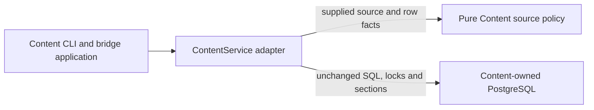

# Content source policy

**Current unmerged source; deployment unverified.** These are existing decisions moved from the Content database adapter. The [public functions](__init__.py) consume supplied source/row facts; their [implementation](source.py) imports no database, driver, transport or sibling-domain implementation.

| Public function | Existing execution point | Decision retained |
| --- | --- | --- |
| `prepare_source` | `load_source_snapshot`, composed by `ContentService.load_source`, before its first read section | Expected-revision input type/range, workspace binding, canonical payload and stable source/publication/stage identities. The original pure digest function is supplied unchanged. |
| `exercise_continuation` | `_exercise_slice`, between `after_read` and `before_commit` hooks | Existing bounded validation step and declared learner-turn rule. |
| `binding_responses` | `_binding_slice`, between the same hooks | Complete route/occurrence, exact learner decision position and accepted/authored response policy. |
| `publication_report` | `publication_status`, after its existing reads | Validation/error response and the existing 128-definition compatibility report. |
| `coverage_reply` | `coverage`, after its existing direct/transposition evidence reads | Direct coverage takes precedence over transposition support in the returned record. |
| `inventory_report` | `_inventory_status`, after the unchanged source/task/manifest and complete-generation count guards | Retirement-required label for a complete empty source, original source/task field precedence and stale/status fields. |

Content application functions and the [adapter](../../../../../database/tempo_content_database/adapters/store.py) call these narrow own-domain functions at their original execution points. Queries, parameters, locks, transaction/snapshot boundaries, fencing, immutable staging guards and cursor advancement remain in the adapter; application hook order and replay decisions remain in their moved workflows. No table, stored field, JSON shape, schema or migration changes. The [database dictionary](../../../../../database/tempo_content_database/schema/README.md) remains authoritative for storage relationships.

`tests/test_source_policy.py` exercises the moved decisions with synthetic facts. Existing storage-boundary and installed import/help/resource checks retain ownership of composition and packaging. Native PostgreSQL and the five unchanged loopback transport cases were not run for this slice. The public Content package still eagerly exports its concrete `ContentService`, so this is not a claim that importing the entire package is driver-free.

Worker dispatch and the complete route/exercise/binding phases live in the [Content worker application](../worker/README.md); publication build/admission and construction/provenance in [publication workflows](../publication/README.md), and source staging/admission sequencing in [source loading](../source/README.md). Native guards, read projections and storage-lifecycle result facts remain explicitly identified in the [store audit](../../../../../database/tempo_content_database/adapters/README.md#store-responsibility-audit).
