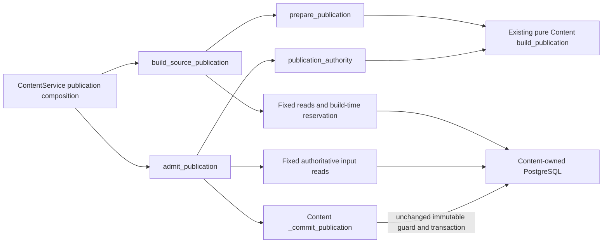

# Content publication workflows and preparation

**Current unmerged source; deployment unverified.** The [public functions](__init__.py)
move existing build/admission sequences and construction/provenance decisions
from the database adapter. The [workflows](application.py) and
[preparation](preparation.py) consume supplied Content facts
and imports only this owner's domain/models and the existing shared publication
contract. It does not read tables, acquire connections or invoke another domain.

| Function | Original call point | Existing behavior retained |
| --- | --- | --- |
| `prepare_publication` | `build_source_publication`, after the build-time reservation transaction and snapshot/revision reads, before `before_commit` | Exact exercise-count guard, shared v1 construction, original serialization/decode pass and provenance fields. |
| `publication_authority` | `admit_publication`, after a non-replay's manifest/revision/snapshot reads, before the write transaction | Reconstruct the authoritative payload and snapshot provenance for the unchanged in-transaction comparison. |

The [root adapter](../../../../../database/tempo_content_database/adapters/store.py)
supplies fixed reads and owns build-time reservation, immutable
identity/provenance comparison, current-generation checks, row locks and writes.
No SQL, query parameters, driver serialization, hook timing, transaction,
publication shape, activation behavior, schema or migration changed. The
[source schema dictionary](../../../../../database/tempo_content_database/schema/README.md)
remains authoritative for stored data and actual constraints.

`tests/test_content_preparation.py` checks exact publication/provenance fields,
pre-construction rejection, the retained serialization/decode pass, and the
original call points using synthetic storage capabilities. Existing selected
domain tests retain publication identity/round-trip/retirement and route
checkpoint invariants. These checks and installed artifact closure do not prove
native locking, leases, deployment or resource isolation; no native PostgreSQL
or previously denied loopback HTTP case ran for this slice.

`build_source_publication` preserves source/task/payload replay order, the original
completion and empty-source preconditions, build-time reservation, snapshot then
revision reads, preparation, hook and persist call. `admit_publication` preserves
model parsing, serialization/decode/hash, replay lookup and non-replay manifest,
revision and snapshot reconstruction before the atomic commit. A replay still
reaches the original immutable conflict guard. The root `_publication_task` and
`_publication_payload` own complete fixed queries; the identical payload SELECT
has one implementation serving both original call sites, without changing
runtime query count/order/parameters. `_reserve_publication_build` and
`_commit_publication` retain the exact original native sections. Existing
`ContentService` public entry points compose those operations directly.

`tests/test_publication_application.py` adds only four missing workflow cases:
early build replay, incomplete/empty precondition ordering and replay admission
still invoking the atomic guard. Existing preparation tests follow the moved
monkeypatch targets with unchanged assertions. There is no new command protocol,
generic SQL capability, schema or activation behavior.

Remaining application/storage coordination is source staging/admission across short transactions.
Atomic identity,
fence, epoch, manifest, provenance and generation checks belong to persistence.
The inventory-status projection lives in [source policy](../policy/README.md).
These splits do not claim the entire root adapter is application-free.
The complete [binding](../worker/README.md#binding-phase),
[route](../worker/README.md#route-phase) and [exercise](../worker/README.md#exercise-phase)
phases live in the worker application;
their concrete reads and atomic commits remain root-owned storage operations.
