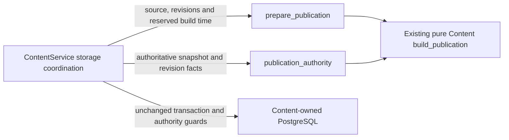

# Content publication preparation

**Current unmerged source; deployment unverified.** The [public functions](__init__.py)
move existing publication construction/provenance decisions from the database
adapter. Their [implementation](preparation.py) consumes supplied Content facts
and imports only this owner's domain/models and the existing shared publication
contract. It does not read tables, acquire connections or invoke another domain.

| Function | Original call point | Existing behavior retained |
| --- | --- | --- |
| `prepare_publication` | `ContentService.publication_build`, after the build-time reservation transaction and snapshot/revision reads, before `before_commit` | Exact exercise-count guard, shared v1 construction, original serialization/decode pass and provenance fields. |
| `publication_authority` | `ContentService.store_publication`, after a non-replay's manifest/revision/snapshot reads, before the write transaction | Reconstruct the authoritative payload and snapshot provenance for the unchanged in-transaction comparison. |

The [root adapter](../../../../../database/tempo_content_database/adapters/store.py)
still owns replay lookup, build-time reservation, input read order, immutable
identity/provenance comparison, current-generation checks, row locks and writes.
No SQL, query parameters, driver serialization, hook timing, transaction,
publication shape, activation behavior, schema or migration changed. The
[source schema dictionary](../../../../../database/tempo_content_database/schema/README.md)
remains authoritative for stored data and actual constraints.

`tests/test_content_preparation.py` checks exact publication/provenance fields,
pre-construction rejection, the retained serialization/decode pass, and the
original call points using synthetic storage capabilities. Existing selected
domain tests retain publication identity/round-trip/retirement and route
checkpoint invariants. These checks and installed artifact closure do not prove
native locking, leases, deployment or resource isolation; no native PostgreSQL
or previously denied loopback HTTP case ran for this slice.

Remaining adapter work is concrete phase and I/O coordination: route/exercise
reads and bounded writes, source staging across short transactions,
and publication replay/build-time/snapshot/write sequencing. Atomic identity,
fence, epoch, manifest, provenance and generation checks belong to persistence.
The inventory-status projection lives in [source policy](../policy/README.md).
These splits do not claim the entire root adapter is application-free.
The complete binding phase lives in the [worker application](../worker/README.md#binding-phase);
its target read and atomic commit remain root-owned storage operations.
