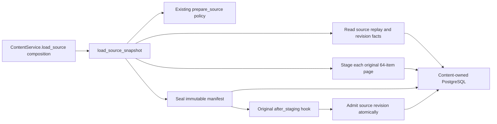

# Content source loading

**Current source; deployment unverified.** The [public function](__init__.py)
[`load_source_snapshot`](application.py) contains the existing preflight,
bounded staging, manifest, hook and admission sequence moved from
`ContentService.load_source`. It uses Content's existing source policy and four
fixed owner operations supplied by the original composition entry point.

The [root adapter](../../../../../database/tempo_content_database/adapters/store.py)
retains the exact native boundaries:

| Operation | Storage responsibility retained |
| --- | --- |
| `_preflight_source` | Original repeatable-read source/revision/task query, integrity checks, replay fact and stale-revision rejection. |
| `_stage_source_page` | Original transaction, inside-transaction slice/enumeration, immutable-page conflict read, insert and JSON driver encoding. |
| `_seal_source_manifest` | Original count check, immutable manifest insert/read and full persisted-field comparison in one transaction. |
| `_admit_source` | Original late bridge scope import, reservation authorization, source/task locks, replay/stale checks, collector ordering and revision/task writes in one transaction. |

The application keeps the original input validation/canonicalization order,
`KINDS` iteration, 64-item pages, header/count preparation and `after_staging`
call between sealing and admission. Native replay/admission facts map to the
same public receipt fields. No query, transaction, hook, lock, clock, exception,
JSON shape, schema or migration changes. The
[source schema dictionary](../../../../../database/tempo_content_database/schema/README.md)
describes stored fields and enforced relationships.

`tests/test_source_application.py` adds four missing boundary cases: preflight
replay skips all later work, ordered multi-page staging/seal/hook/admission,
normal versus admission-replay receipts and hook interruption before admission.
Existing source-policy cases retain input/canonicalization/identity proof.
One-time source comparison reconstructs the complete original workflow and
all four native sections. Installed artifact checks cover packaging and
resource discovery. Native PostgreSQL contracts remain retained and unverified
for this move; the five previously denied loopback cases were not retried.
