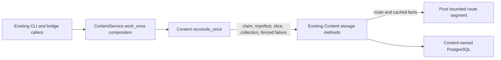

# Content reconciliation worker

**Current unmerged source; deployment unverified.** The public
[`reconcile_once`](__init__.py) function preserves the existing single-delivery
orchestration from `ContentService.work_once`. Its [implementation](application.py)
uses only the supplied Content-owned semantic operations and `ContentError`.

The [database adapter](../../../../../database/tempo_content_database/adapters/store.py)
wires its existing bound methods directly. Claim occurs first; an idle claim
falls back to collection without a manifest read. Manifest lookup remains outside
the phase-dispatch exception handler. Route, exercise and binding phases invoke
the original slice unchanged. A stale delivery returns without a failure write;
another validation failure uses the original fenced transaction before returning
the existing failure record. Other exceptions propagate.

`_fail_task` owns that original transaction, fence and failed-task update. Error
text is still produced after fencing, and then again for the response after the
transaction ends. No SQL, parameters, hooks, locks, lease timing, JSON shapes,
staging, replay, schema or migration changed. The [database dictionary](../../../../../database/tempo_content_database/schema/README.md)
describes stored data and relationships.

`tests/test_worker_application.py` checks ordered synthetic operations and the
failure-write boundary without a database. Installed artifact checks cover
package/import/resource closure. Native PostgreSQL and the five unchanged,
previously denied loopback HTTP cases are unverified for this slice. The public
Content package still eagerly exports its concrete `ContentService`.

[`route_segment`](routes.py) also holds the existing four-statement traversal
preparation: choose at most 16 plies, determine terminality and reuse a completed
artifact without invoking chess traversal. `_route_slice` calls it after
`after_read` and before `before_commit`, without a pool lease. Cache identity,
registration validation, epoch/fence guards, membership/occurrence writes and
cursor advancement remain in the original adapter sections.

`tests/test_content_preparation.py` checks full-versus-sliced route inventory,
completed-cache reuse and the computation/hook/transaction order. Pure
[publication preparation](../publication/README.md) is also outside the adapter.
Route/exercise/binding phase and I/O sequencing, source staging and publication
read/reservation/write coordination remain mixed extraction work. These bounded
moves do not claim those methods are application-free or make them a permanent
exception.
