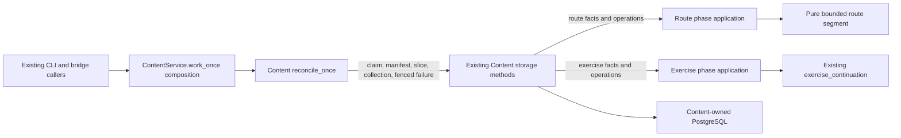
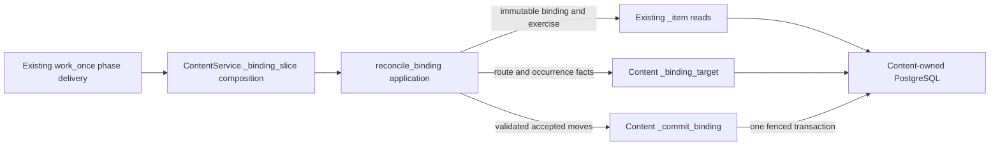
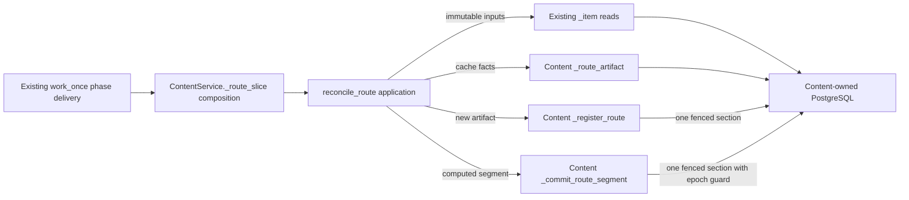

# Content reconciliation worker

**Current unmerged source; deployment unverified.** The public
[`reconcile_once`](__init__.py) function preserves the existing single-delivery
orchestration from `ContentService.work_once`. Its [implementation](application.py)
uses only the supplied Content-owned semantic operations and `ContentError`.

The [database adapter](../../../../../database/tempo_content_database/adapters/store.py)
wires its existing bound methods directly. Claim occurs first; an idle claim
falls back to collection without a manifest read. Manifest lookup remains outside
the phase-dispatch exception handler. Route, exercise and binding phases invoke
the original slice unchanged. A stale delivery returns without a failure write;
another validation failure uses the original fenced transaction before returning
the existing failure record. Other exceptions propagate.

`_fail_task` owns that original transaction, fence and failed-task update. Error
text is still produced after fencing, and then again for the response after the
transaction ends. No SQL, parameters, hooks, locks, lease timing, JSON shapes,
staging, replay, schema or migration changed. The [database dictionary](../../../../../database/tempo_content_database/schema/README.md)
describes stored data and relationships.

`tests/test_worker_application.py` checks ordered synthetic operations and the
failure-write boundary without a database. Installed artifact checks cover
package/import/resource closure. Native PostgreSQL and the five unchanged,
previously denied loopback HTTP cases are unverified for this slice. The public
Content package still eagerly exports its concrete `ContentService`.

[`route_segment`](routes.py) holds the existing four-statement traversal
preparation: choose at most 16 plies, determine terminality and reuse a completed
artifact without invoking chess traversal. The route application calls it after
`after_read` and before `before_commit`, without a pool lease. Cache identity,
registration validation, epoch/fence guards, membership/occurrence writes and
cursor advancement remain in the original adapter sections.

`tests/test_content_preparation.py` checks full-versus-sliced route inventory,
completed-cache reuse and the computation/hook/transaction order. Pure
[publication preparation](../publication/README.md) is also outside the adapter.
Source staging/admission lives in [source loading](../source/README.md), and
publication build/admission in its [application module](../publication/README.md).
Native guards, consistent read projections and storage lifecycle remain in the
[root adapter audit](../../../../../database/tempo_content_database/adapters/README.md#store-responsibility-audit).

## Binding phase

[`reconcile_binding`](bindings.py) owns the complete existing binding phase:
finish an exhausted phase, read the binding/target/exercise in their original
order, invoke the existing `binding_responses` policy between the original
hooks, request the atomic write and return its existing processing result.

The [root adapter](../../../../../database/tempo_content_database/adapters/store.py)
composes its existing `_transition`, `_item` and `_hook` with two concrete
storage operations. `_binding_target` owns the original complete route/artifact
and occurrence queries, their parameters and the missing-route short circuit;
each retains the original `_one` connection boundary. `_commit_binding` owns
the original transaction, fence, response insert, task advance and
`after_writes` hook. SQL and driver JSON encoding stay there.

An absent/incomplete target still permits the original exercise read and
`after_read` hook before policy rejection. A missing exercise fails before that
hook. A stale fence or exception from `after_writes` aborts the same write
section. Exhaustion uses the original transition without reading another
binding. `tests/test_binding_application.py` checks these boundaries with
synthetic owner operations; existing policy tests retain response rules.
Installed package checks retain the component's independent artifact closure.
Native PostgreSQL locking, leases and rollback remain unverified for this move;
the native contracts are retained and the previously denied loopback cases were
not retried.

## Route phase

[`reconcile_route`](routes.py) owns the complete existing route phase:
exhaustion/transition, ordered membership/route/repertoire reads, cache lookup,
new-artifact validation/registration, existing bounded segment preparation,
the original read/commit hooks and exact processing responses.

The [root adapter](../../../../../database/tempo_content_database/adapters/store.py)
supplies three fixed storage operations. `_route_artifact` owns the unchanged
versioned cache-key serialization and single `_one` read. `_register_route`
owns the original fence, artifact insert, artifact row lock, registration hook,
membership attachment, task advance and after-write hook. `_commit_route_segment`
owns the original fence, artifact lock and epoch/cursor guard, attachment,
occurrence save, artifact/task advancement and hooks. Its boolean outcome maps
the original artifact-advanced versus successful response in the application.
The existing segment tuple is passed directly; no schema or command protocol is
introduced.

Chess validation and traversal remain after `after_read` and before
`before_commit`, outside a pool lease. Both write sections retain their original
SQL, parameters, ordering and transaction authority. The existing occurrence
batching, sorted position locks, legal-universe checks and response data are
unchanged. `tests/test_route_application.py` adds four missing boundary cases:
phase exhaustion, valid/invalid new registration and an epoch-race result.
Existing selected preparation/domain checks retain traversal, cache reuse and
hook/transaction order. One-time source comparison verifies the full moved body
and atomic blocks. Native PostgreSQL contracts remain unverified for this move;
the previously denied loopback cases were not retried.

## Exercise phase

[`reconcile_exercise`](exercises.py) owns the full existing exercise phase:
exhaustion/transition, payload read and model validation, dependent policy and
repertoire reads, existing bounded `exercise_continuation`, the original hooks
and continuation/completion response. The overview above shows its own-domain
policy dependency and supplied storage operations.

The [root adapter](../../../../../database/tempo_content_database/adapters/store.py)
composes existing `_transition`, `_item` and `_hook` with `_commit_exercise`.
That operation retains the original complete fenced transaction: continuation
checkpoint/advance, immutable identity/predecessor checks, version digest/read,
identity/version/generation inserts, cursor advance and after-write hooks. Its
boolean outcome supplies the original pending-validation versus validated fact;
the application returns the original record. All six fixed SQL operations,
parameters, identity rules and query/transaction/hook order are unchanged.

`tests/test_exercise_application.py` adds only four missing moved-boundary cases:
exhaustion, payload parsing before dependent reads, and continuation/completion
order/result mapping (including a non-`None` empty checkpoint). Existing selected
policy/domain checks retain learner-turn, 16-ply JSON checkpoint/resume and
exercise-legality proof. One-time source comparison covers the full moved body
and original atomic section. Native identity, predecessor, fence and rollback
contracts remain retained/unverified for this move; the previously denied
loopback cases were not retried.
