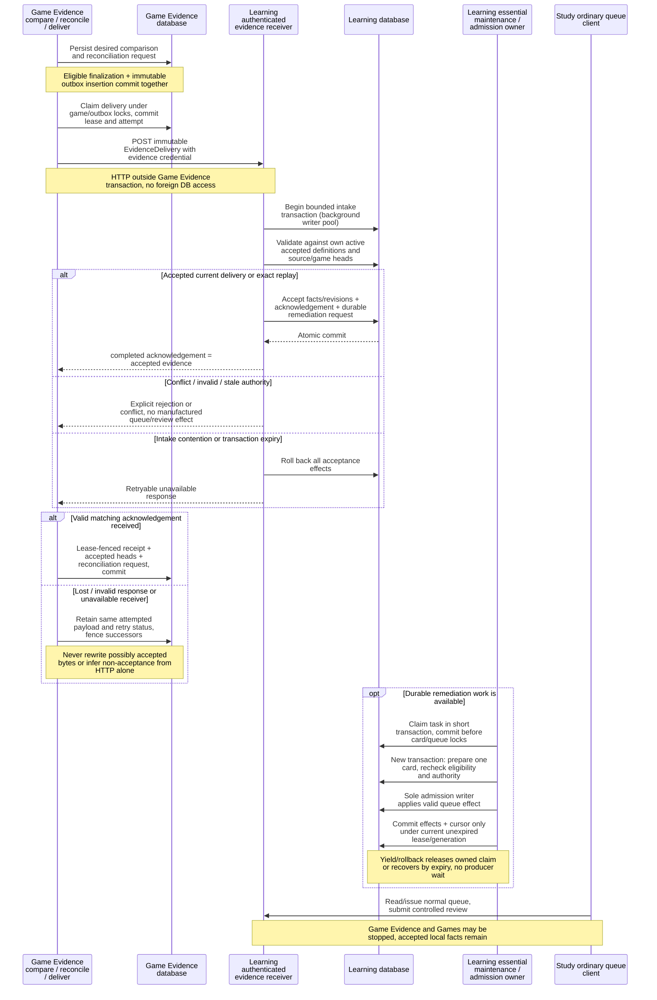
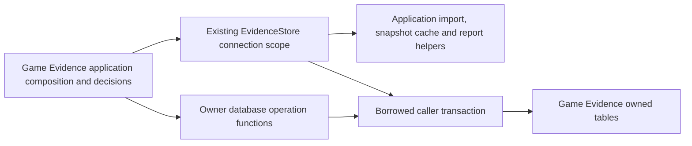

# Game Evidence 0.1.0

The [A bridge](../../docs/analysis-restoration/a-bridge.md) adds service-local
snapshot v2 and immutable analysis-input v1. V1 snapshots and evidence delivery
wire v1/v2 remain supported. V2 pins actual Content source/route/reply output and
separates historical activation from observed current serving status.

`analysis-export create --workspace W --output DIRECTORY` freezes up to 100 exact
current game comparisons; repeat `--game-id ID` to select an explicit scope.
`analysis-export page INPUT --workspace W --kind KIND --after CURSOR` reads pinned
64-item pages. `analysis-export schema` and `analysis-export verify DIRECTORY`
work without a database. The manifest and hashed pages can be consumed while all
producer services are stopped. Output files are exclusive and atomically linked;
the manifest is written last. A partial directory can resume from the retained
database export without replacing accepted bytes.

Every game position retains actual FEN/move and game/source/comparison lineage.
Established opponent decisions additionally include positive route/policy/color
context for both covered replies and deviations, supporting distinct-game
denominators. Legal reply records contain complete policy/prefix-conditioned
response inventories, including explicit uncovered, ambiguous and unknown states.
Re-entry traces identify the actual authorizing binding; FEN coincidence alone
does not establish route context. Exports remain observations, never admission or
content-approval authority. Bounds are 8 MiB per page and 64 MiB per export.

Explicit Content/Learning route bindings can identify learner decisions inside
an unchanged physical executable with `exercise_ply` and `decision_id`. Game
Evidence independently validates the projected legal position and alternatives;
the physical card and publication remain unchanged. This does not authorize
transposition re-entry or historical aliases. Prior bindings omit these fields.

`LegacyComparisonSnapshot` is a separate read-only observed-graph input for the
legacy-authority bridge checkpoint. It retains original physical execution and
explicit interior decisions without creating a Content publication/activation.
It shares comparison/projection logic and rejects incoherent authority. The
publication loader, store and v1/v2 delivery wire do not accept it. See the
[checkpoint and pending backend seams](../../docs/analysis-restoration/legacy-game-study-checkpoint.md).

`LegacyScopedComparisonSnapshot` is explicit legacy-local schema2. Its bounded
candidate list is backed by complete owner traversal manifests and prefix policy
context, not a globally complete selected-only catalogue. It shares the existing
comparison/physical projection and accepts only the named game/time/decisions;
introduction chronology remains an applicability guard. Activated-publication
v1/v2 remain unchanged. See the [scoped checkpoint](../../docs/analysis-restoration/legacy-game-study-scoped-checkpoint.md).

`legacy-preview --observation FILE --output NEW_FILE` is the offline initial-v3
producer over that same scoped comparison. It opens no GE store, performs no
delivery and preserves unknown/no-miss without an envelope. The explicit
[one-game operating procedure](../../docs/analysis-restoration/legacy-game-study-one-game.md)
keeps backend capture, A projection, GE production and HTTP command writes under
their existing owners. It supports one physical miss target and no inferred
correction/activation lineage; v2 payload construction remains unchanged.

Independently installed repertoire review, source/index storage, read API and durable
Learning delivery intent. A repertoire miss is an authored move not played; it is
not an engine judgment. This increment supports completed standard/from-position
PGNs and bounded public Lichess/Chess.com account imports. It does not enable live
sync, connect the legacy UI or implement engines, tactical cards or Intelligence.
It imports no backend or Learning implementation. Existing Learning 0.1.0 and
scheduling 0.2.0 remain downstream owners; this component never schedules reviews.

## Architecture drawings

These are the canonical drawings for the views below. Edit the blocks here;
peer documents link to them instead of maintaining copies. See the
[diagram index and source/status baseline](../../docs/architecture/diagrams/README.md) and
[maintenance procedure](../../docs/architecture/diagrams/README.md#maintenance-and-review-procedure).

### Observed game evidence to Learning (MAIN)

Scope: independent Game Evidence v1/v2 delivery into independent Learning. This is
distinct from the [legacy-local receiver](../../backend/README.md#legacy-assembly-and-existing-coupling).
The Games viewer is not the evidence producer, and reading a game does not trigger
this sequence.



[`Store._compare`](../../database/tempo_game_evidence_database/adapters/store.py)
and [`reconciliation`](src/tempo_game_evidence/reconciliation.py)
own desired results/outbox/accepted-head projection.
[`deliver_one`](src/tempo_game_evidence/delivery.py)
owns the attempt, external HTTP, immutable retry and local receipt lease fence.
[`EvidenceDelivery` contracts](../../contracts/game-evidence/README.md) express
observed facts and obligations, not permission to schedule or invent controlled
study evidence. Learning's
[HTTP intake](../learning/runtime/src/tempo_learning_runtime/api.py)
uses `connection(background=True, intake=True)`;
[`receivers.receive`](../learning/runtime/src/tempo_learning_runtime/receivers.py)
and [`remediation_adapter.receive`](../learning/runtime/src/tempo_learning_runtime/remediation_adapter.py)
validate/store inside it. The
[installed remediation repository](../../database/tempo_remediation_database/adapters/repository.py)
owns Learning-local obligation persistence. [`maintenance`](../learning/runtime/src/tempo_learning_runtime/maintenance.py),
[`durable_tasks`](../learning/runtime/src/tempo_learning_runtime/durable_tasks.py)
and [`admission.admit`](../learning/runtime/src/tempo_learning_runtime/admission.py)
own claims, short slices and canonical queue writing.

Acceptance is bounded to at most 128 wire items in the 1000 ms intake transaction;
ordinary maintenance retains its 250 ms transaction bound and size-1 pool.
`completed` acknowledges durable acceptance, not completed studying or synchronous
admission. A miss may retain a documented allowance/progression exception, but
cannot bypass burial, retirement, invalidity, deletion or revision validation.
Controlled review settlement stays in the
[Learning review transaction](../learning/runtime/README.md#review-commit-and-recovery-main).

Delivery `401` is retained retryable with a minimum 60-second backoff; replacing
the producer's private token file requires producer restart/reload, not Study
restart. Unverifiable terminal/conflict/stale outcomes can block reconciliation
with diagnostics. See [delivery/auth recovery](README.md#authentication-recovery).
No command here grants a producer cross-component database writes.

## Install and local commands

From the repository root:

```sh
uv sync --project services/game-evidence --locked --no-editable --python 3.12
```

Set `TEMPO_GAME_EVIDENCE_DATABASE_URL` to a separately provisioned Game Evidence
runtime role/database and `TEMPO_GAME_EVIDENCE_MIGRATION_URL` to its owner URL.
There is no fallback to legacy database variables. Revoke PUBLIC database/schema
access and runtime DDL/role/database creation and foreign-domain connections.
Grant runtime CONNECT, schema USAGE and table SELECT/INSERT/UPDATE/DELETE,
excluding writes to `evidence_schema_migrations`. The immutable
`analysis_exports` and `analysis_export_pages` tables receive SELECT/INSERT only.
The disposable native runner
demonstrates provisioning; production provisioning remains separate.

Use the full installed path below, or add its directory to PATH:

```sh
services/game-evidence/.venv/bin/tempo-game-evidence migrate
services/game-evidence/.venv/bin/tempo-game-evidence load-snapshot services/game-evidence/fixtures/snapshot.json
services/game-evidence/.venv/bin/tempo-game-evidence import-pgn services/game-evidence/fixtures/miss.pgn --workspace fixture --player Learner --source-id example-miss
services/game-evidence/.venv/bin/tempo-game-evidence work --max-jobs 64
services/game-evidence/.venv/bin/tempo-game-evidence report <returned-game-id> --workspace fixture
services/game-evidence/.venv/bin/tempo-game-evidence serve
```

Only `migrate` uses owner credentials; startup never migrates. Migrations are
owned here and do not reuse legacy numbers. `work --once` performs at most one
slice of each work kind. `--max-jobs` bounds total progressed slices; `--poll`
waits until interrupted or the bound is reached. Invoke again or use a supervisor
to continue. SIGINT/SIGTERM stop between operations. No optional workers start.

The loopback read API offers `/healthz`, `/v1/games?workspace_id=...&after=...&limit=64`
and `/v1/games/{id}/comparison?workspace_id=...`. Workspace filtering is not
authentication; an authenticated gateway is required before broader exposure.
Reports distinguish comparison readiness from Learning delivery status.
`import-status <id> --workspace <workspace>` and
`GET /v1/imports/{id}?workspace_id=...` expose durable cursor, failure and retry state.

## Snapshot and replay semantics

`fixtures/snapshot.json` is **service-local input schema 1**, not an extension
of a shared wire contract. It contains an immutable Content Publication, a matching
activated acknowledgement, and explicit repertoire routes/card bindings. Each
binding names a ply on a legal route. `reentry: true` authorizes that route node
after divergence. Missing or ambiguous route/policy/acceptance evidence stays
unknown. Only reference-graded move-line decisions are supported.
`complete: true` explicitly identifies a complete comparison scope. Missing or
false completeness never authorizes withdrawal of previously delivered facts.

The adapter validates legal routes, binding positions/colors and publication
lineage. It trusts the explicitly supplied activation receipt; it does not
authenticate it with Learning. Contract examples do not establish production
adoption. Snapshots are immutable by workspace/identity/revision and retain
digests. B keeps shared protocol ownership; native Content extraction remains #108.

Ply zero is the first move from the actual starting FEN, including black starts
and custom fullmove counters. Raw keys use chess-core 0.1.0 and preserve castling
and en-passant fields. A separate comparison key ignores an en-passant marker
only when no legal capture exists; genuine en-passant/castling differences remain
distinct. Source bytes and every source revision are retained. Date-only PGNs
have unknown game time.

Donor #125's index-reuse invariant now belongs here: input digest, algorithm
version, full position count and completeness must agree. Missing/incompatible
receipts rebuild conservatively. Snapshot-only review reuses verified positions.
Every snapshot update durably schedules all workspace games through 64-game
rescope slices. A newer snapshot restarts traversal; imported games request their
own current comparison. Verified indexes remain reusable without PGN replay.

## Bounded account import

`import-account config.json` queues an explicit configuration:

```json
{"workspace_id":"fixture","provider":"lichess","account":"EXPLICIT_ACCOUNT",
 "since":"2026-10-01T00:00:00Z","until":"2026-10-02T00:00:00Z",
 "page_size":100,"rated_only":false}
```

Use provider `chess.com` for monthly archives. No account or history is inferred.
Timezone-aware endpoints are canonicalized to UTC before identity, cursor and
window calculations. Equivalent instants produce identical import IDs. Windows
are half-open `[since, until)` and at most 366 days. Lichess uses bounded chronological
NDJSON with PGN, provider IDs and timestamps; inclusive boundaries are revisited
with ID deduplication. A saturated timestamp boundary becomes visibly blocked,
never silently advanced. A larger explicitly configured page can be queued.
Chess.com saves each month response and processes at most 64 entries per slice.

Durable provider leases serialize requests across workers. Separate persistent
cooldown deadlines survive lease release and restart, cover all accounts/windows
of that provider, and leave other providers eligible. HTTP 429 extends the deadline
without shortening an existing later limit. Cooling jobs do not count attempts.

Captured pages carry unvalidated/valid/invalid state and diagnostics. The entire
bounded page structure is validated before reuse, including later monthly slices.
Invalid pages can be refetched; valid pages survive restart. Source legality errors
remain individual unknown games. Expired owners cannot replace checkpoints.
Validated source bodies precede atomic game/cursor commits. Limits: 8 MiB response/source, 45-second
stream deadline plus bounded read timeout, Lichess pages up to 1,000 games,
Chess.com months up to 10,000 entries. HTTP 429 honors Retry-After, including HTTP
dates, with a minimum 60-second delay. Permanent errors/oversized responses block.
`cancel-import <id>` prevents further game/cursor commits. Tests never use accounts.

Provider references: [Lichess guidance](https://lichess.org/page/api-tips),
[game-export specification](https://github.com/lichess-org/api/blob/master/doc/specs/tags/games/api-games-user-username.yaml),
[Chess.com PubAPI](https://support.chess.com/en/articles/9650547-what-is-the-pubapi-and-how-do-i-use-it).

## Delivery boundary and remaining scope

Set `TEMPO_GAME_EVIDENCE_LEARNING_ENDPOINT` or `work --learning-endpoint URL` to Learning's `/internal/evidence` receiver. Set `TEMPO_GAME_EVIDENCE_LEARNING_TOKEN_FILE` (or `--learning-token-file`) to a private credential file readable only by its owner, containing Learning's distinct workspace evidence token (at least 32 characters). The credential is separate from the durable outbox lease identity. Redirects remain disabled and HTTP runs outside database transactions; credentials never enter persisted payloads, command output or error messages.

The independent Learning runtime now provides the authenticated v1/v2 receiver and adopts B's remediation module against its own accepted definitions. Native Game Evidence tests retain their strict receiver and test-only installed repository fixture. The Learning runtime's owning native suite separately proves actual installed producer-to-HTTP delivery, lost acknowledgement/restart, restricted database boundaries and studying after the producer stops. Neither proves live provider import, live deployment, legacy Games UI adoption or historical data conversion. Reports/fixtures remain usable without starting this service.

Desired comparisons and durable reconciliation requests commit together. When
eligible, finalization and immutable outbox insertion share that transaction.
Reconciliation is independent of comparison-input deduplication, so an
acknowledgement alone can unblock progress, including when no successor row exists.

Only validated, durably stored `completed` receipts establish accepted obligation
heads. A private projection retains active revisions and accepted withdrawal
effects. Version 1 history is recovered in ordered pages of at most 64 rows; invalid
history blocks explicitly. Owner-only ordered migration 002 preserves migration
001 and existing attempted payloads. Startup never runs migrations.

A source/snapshot change persists the latest desired result. Unknown outcomes
(including lost responses and accepted_pending) replay the same immutable delivery
and fence successors game-wide. Once resolved, reconciliation uses the newest
comparison and established accepted heads. An ordinary validated terminal rejection
adds no effects; a rejected replacement cannot change a withdrawal's target, and
a rejected withdrawal cannot erase an active head. Conflicts/stale revisions or
unverifiable terminal HTTP outcomes block with diagnostics. No payload that may
have reached Learning is rewritten.

Evidence uses stable 64-ply scopes. Evidence revision allocation is independent of
comparison revisions, and each delivery references its durable comparison. Exact
withdrawals affect only the accepted revision in that source/scope; omission is
additive. Incomplete scope and ambiguous unchanged observations block withdrawal.
Reports expose waiting/blocked reconciliation even without a finalized outbox row.
Receiver receipt recording, accepted-head updates and reconciliation requests are
atomic; HTTP runs outside transactions. Lease fencing preserves later receipts
against late responses from expired workers. Completed means durable acceptance,
not study settlement. Learning alone owns that decision.

The three source-bound `fixtures/*-report.json` documents and `corpus.json` are
offline UI fixtures. Their synthetic imported-at timestamp is fixed; the regular
suite verifies source/report digests and recomputes findings from the actual PGNs.

## Checks

```sh
services/game-evidence/.venv/bin/python -m pytest services/game-evidence/tests -q
services/game-evidence/.venv/bin/python database/tempo_game_evidence_database/tooling/run_postgres.py
services/game-evidence/.venv/bin/python services/game-evidence/integration/qualify_artifacts.py
node tools/component-build/check-components.mjs --component game-evidence
```

Native checks require Docker/loopback and the existing postgres:18.6-trixie image.
They create a fresh labelled container/volume, isolated owner/runtime roles and
random fixed loopback port; restart the database; then verify owned teardown.
The runner accepts no caller database URL and never restarts Docker or prunes.
Artifact checks install wheel/sdist in clean Python 3.12/3.14 consumers. Evidence
records commands, source/artifact hashes, case counts and cleanup outcomes.
These focused checks do not establish whole-product or hosted qualification.

Native database tooling and contracts now live in the [single root database owner](../../database/tempo_game_evidence_database/tooling/README.md), with [pure source-fingerprint checks](../../database/tempo_game_evidence_database/tests/README.md). Their SQL and native test bodies are unchanged; fixtures stay with this service. The full owner is included in sdists, while database `tooling/` and `tests/` are excluded from runtime wheels. The artifact qualifier remains service build orchestration and fingerprints the root owner that it copies. The installed-import guard stays in the service suite; the former source-inspection regression runs from the root database test category. Relocation source/build checks do not imply native execution.

## Authentication recovery

With a Learning endpoint, `work` requires a configured usable private token file
before imports, comparisons, reconciliation or delivery claims. Configuration
failure exits nonzero without attempts, leases or blocked rows. Direct delivery
also validates its token before claiming. Producer-only `work` without a Learning
endpoint remains available without a token.

Learning HTTP 401 maps locally to `retryable_failure` / `remote_rejected_401`, with
no acknowledgement. Durable exponential retry timing has a 60-second authentication
minimum and the existing 900-second exponential cap. HTTP stays outside transactions;
there is no sleep under database locks or retry loop within a single HTTP call.
Replace the private token file and restart the producer to reload it. Once due,
the original ID and payload retry. 403, 404, redirects, bounds, 429/5xx and existing
acknowledgement/predecessor fences retain their behavior.

For an original delivery blocked by the previous HTTP-401 classification:

```sh
tempo-game-evidence retry-auth-delivery --workspace WORKSPACE --delivery-id DELIVERY_ID
```

Use the same database configuration, `TEMPO_GAME_EVIDENCE_LEARNING_ENDPOINT` and
`TEMPO_GAME_EVIDENCE_LEARNING_TOKEN_FILE` as `work`; the command also accepts
`--learning-endpoint` and `--learning-token-file`. It requires both locally valid
endpoint/token configuration and locks the owning game before the outbox row.
Only attempted, acknowledgement-free `blocked` rows with exactly
`remote_rejected_401` and no live lease become immediately due `retryable_failure`.
The command preserves payload, IDs, revisions, attempts and accepted history, and
clears only eligible stale lease state. It sends no HTTP. Repeating on the eligible
already-requeued row is a successful no-op; completed, acknowledged, active-lease,
wrong-workspace and unrelated terminal/conflict/stale rows are refused unchanged.
Refusals contain fixed sanitized reasons. There is no bulk recovery at startup.

Local validation does not prove that Learning accepts the credential, nor prove
previous non-acceptance. The next attempt retries the same immutable delivery;
Learning's matching completed receipt remains the acceptance authority. Recovery
never advances accepted history or permits a correction to overtake that receipt.

### Generation-aware operator snapshots

The A operator's snapshot identity hashes the workspace, publication and represented generation; revision remains the observed serving activation revision. Historical activation and current-serving observation remain distinct. The store keeps immutable documents and rejects promotion of older publication generations. An offline observation is point-in-time evidence, not authorization for future Learning effects.

## Independent ingestion and authored comparison owners

The pure PGN parser/legal replay and ordered route frontier are extracted behind
[shared game values](../../packages/game-review-contracts/README.md),
[game ingestion](../../packages/game-ingestion/README.md) and
[repertoire comparison](../../packages/repertoire-comparison/README.md). Game
Evidence retains its storage, revision/receipt, historical applicability, mapping,
reconciliation and delivery authority. Its compatibility facades consume those
public pure owners; the independent components never import this service.

The new supplied-current-snapshot comparer is read-only authored membership, not
a replacement for Game Evidence's historical remediation eligibility guards. The
canonical four-boundary drawing lives in the shared values README. No worker or
live adoption is implied by extraction.

Database implementation, DDL and source-schema charts: [central database owner](../../database/tempo_game_evidence_database/README.md).

## Database operation location

**Implemented in this unmerged mechanical extraction; deployment unverified.** Existing SQL from `analysis_export.py`, `api.py`, `delivery.py`, `providers.py` and `reconciliation.py` now lives in the single root [Game Evidence database owner](../../database/tempo_game_evidence_database/adapters/README.md). There is one implementation of each moved operation; no shared runtime database or generic SQL-dispatch interface is introduced.



The outer composition retains existing transaction boundaries and operation order. Chess/deviation traversal, page packing, immutable-export and cursor validation, receipt/lease decisions, provider requests and HTTP error translation remain in the application. The [category adapters](../../database/tempo_game_evidence_database/adapters/README.md) own complete bound SQL queries, `Jsonb` adaptation, cursor batches, row locks and the accepted-history savepoint. Readiness delegates the original query to `EvidenceStore.check_schema_access`; it retains the original behavior rather than adding a new schema qualification rule.

The existing `EvidenceStore` methods also invoke these application helpers at their original call points:

| Store method | Application owner | Preserved ordering/state |
| --- | --- | --- |
| `import_pgn` | [`source.prepare_import_identity` and `prepare_import_document`](src/tempo_game_evidence/source.py) | Cheap identity checks precede the replay read; an unchanged replay returns before PGN normalization. Normalization remains after that read closes and before opening the writer. |
| `_import` metadata/player | [`source.stamp_import_document` and `normalized_import_player`](src/tempo_game_evidence/source.py) | Metadata stamping/clock access stays after the locked replay guard and revision selection; player normalization stays at its original write-argument point before `Jsonb`. The adapter retains revision/history/queue authority. |
| `comparison_snapshot` | [`snapshot.validated_snapshot_cache`](src/tempo_game_evidence/snapshot.py) | The same private tuple remains on one store/worker instance. Digest or document-byte changes trigger validation; failed validation leaves the prior tuple intact. |
| `load_snapshot` | [`snapshot.prepare_snapshot` and `snapshot_changed_positions`](src/tempo_game_evidence/snapshot.py) | Preparation stays before connection acquisition. Staleness and affected-position computation stay after the prior-document read under the existing workspace lock; prior v2 documents retain both original parses. Immutable identity conflict and write/epoch/queue authority remain in the store. |
| `process_one` | [`worker.process_comparison_job`](src/tempo_game_evidence/worker.py) | The existing claim/no-work/kind/exception control flow retains the same job and callback objects. Work exceptions invoke `record_job_failure` at the original point; claim errors and cancellation remain outside that write path. |
| `report` | [`reporting.comparison_report_response`](src/tempo_game_evidence/reporting.py) | Read/delivery inspection closes before response shaping; source-revision mismatch retains precedence over snapshot mismatch. Existing response object identities and fields are retained. |
| `import_status` | [`reporting.import_status_response`](src/tempo_game_evidence/reporting.py) | Missing-result handling and timestamp presentation stay after the read scope closes; the existing result object is retained. |
| `_compare` report construction | [`reporting.build_comparison_report`](src/tempo_game_evidence/reporting.py) | Construction stays after the callback, locked workspace/game/job reads, current-input fences and absent-comparison check, immediately before the existing writes. |
| `_compare` preparation/receipt | [`comparison.prepare_game_comparison` and `comparison_index_receipt`](src/tempo_game_evidence/comparison.py) | Captured-row reuse/replay, snapshot lookup, findings, token and callback retain their order between read and write scopes. Receipt construction stays at its existing `Jsonb` argument point after positions adaptation. |
| `_compare` reconciliation | [`reconciliation.reconcile_comparison`](src/tempo_game_evidence/reconciliation.py) | The existing request/finalize pair borrows the same transaction after comparison/index writes; snapshot-loader lookup stays between those calls. |
| `list_games` | [`reporting.validate_game_page_limit`](src/tempo_game_evidence/reporting.py) | The original page bound is checked before connection acquisition. |
| Failure retry intervals | [`worker.process_comparison_job`](src/tempo_game_evidence/worker.py) and [`providers.import_one`](src/tempo_game_evidence/providers.py) | Applications invoke the existing named failure operations; root SQL retains the original fixed 5-second comparison and 60-second unavailable-source server-time literals and fence parameters. Claim/retry/finally timing is unchanged. |

The inventoried import/snapshot/worker/comparison/report/list computation and retry decisions are now outside the database tree. The store retains transaction scopes, row/revision/epoch/lease and idempotency guards, bounded rescope checkpoint writes, and persistence adaptation. The private per-worker snapshot tuple remains on the compatibility store instance, with its decisions in the application helper and its existing lifetime preserved. Persistence leases/resource limits and the atomic bounded rescope mechanism are unchanged. This mechanical separation does not claim complete domain-interface adoption or redesign the compatibility store's lifecycle.

No schema, table/field relationship, migration, public wire contract, credential handling or grants change. Existing [schema diagrams and data dictionaries](../../database/tempo_game_evidence_database/schema/README.md) therefore remain authoritative for the same source schema. Application composition still wires the existing component-owned store; this move does not claim complete domain-interface adoption or live resource/failure isolation, and gives Study no new Game Evidence dependency.
