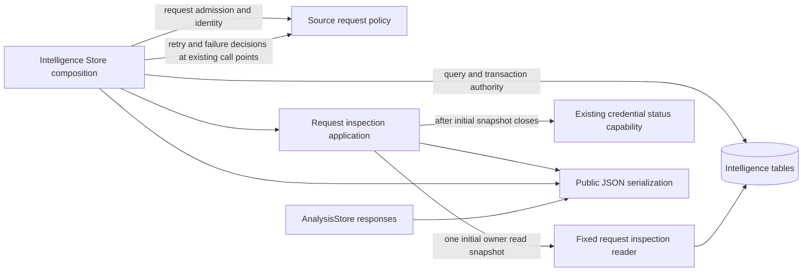

# Independent Intelligence source evidence

`tempo-intelligence==0.1.0` owns Explorer access, private provider registrations,
source-native caches, immutable accepted evidence, bounded refresh/recovery and
acceptance of externally produced Maia wire-v1 results for [#109](https://github.com/aaweaver-actuary/tempo/issues/109).
Its public Python composition exports are `Configuration` and `create_app`;
`tempo-intelligence` provides the local CLI. Python metadata supports
`>=3.12,<3.15`; artifact qualification targets CPython 3.12 and 3.14.

The runtime needs its own PostgreSQL database and restricted credentials. Learning,
Content, Game Evidence, Maia, Stockfish, Redis and Celery need not be installed or
running. Provider registration and model profiles are optional at startup. Missing
Explorer credentials do not block evidence reads or Maia acceptance; missing Maia
results do not block Explorer work. Intelligence has no Learning queue/review
client, cross-domain SQL or model-execution dependency.

See [INTERFACES.md](INTERFACES.md) for exact input, lifecycle, cache and credential
semantics, and [REGRESSIONS.md](REGRESSIONS.md) for owning tests.

## Request and cache policy boundary

**Implemented source in this unmerged extraction; deployment unverified.**
[`source_requests.py`](src/tempo_intelligence/source_requests.py) owns existing
request/revision admission, snapshot preparation, source descriptor/cache identity,
captured-source inspection and retry/failure decisions.
[`serialization.py`](src/tempo_intelligence/serialization.py) owns nested public
JSON value conversion. The pure decisions use existing request/configuration
facts. The complete `inspect_request` application workflow consumes the fixed
owner read-transaction and credential-status capabilities supplied by Store;
application code has no driver/query API, provider call or worker dependency.



The centralized Store still prepares descriptors, initializes bindings, sorts,
then locks/processes each cache and appends its binding in the existing order.
Provider-origin lookup remains inside the existing descriptor loop and retry
short-circuit predicate. Source inspection and failure decisions receive the
existing clock/retry callbacks; freshness still calls the clock only with accepted
evidence, then retry evaluation uses its own clock observation. Provider-supplied
deadlines, waiting/cancellation and exhausted attempts retain their original
deadline/clock behavior. SQL, transactions, locks, clock calls, command receipts
and public wire shapes are unchanged. Analysis responses and the retained native
fixture import serialization directly from this application module.
The [fixed inspection projection](../../database/tempo_intelligence_database/adapters/request_inspection.py)
contains the existing cache/evidence/provider-control SELECTs and delegates the
existing request-head and credential-row reads. It never opens or commits a
transaction. Store supplies its existing `read_only=True` snapshot, and the
application retains per-source read/clock/credential order, serialization inside
that snapshot and the existing credential refresh after it closes. That final
capability retains its own existing read/I/O lifecycle; this is not a claim of
only one transaction for a provider-containing request.
`tests/test_source_requests.py` owns the pure policy/serialization cases.
Its two complete inspection cases also exercise the actual projection and
transaction composition with a fake driver; no private credential or native
database is accessed.
The [adapter inventory](../../database/tempo_intelligence_database/adapters/README.md)
still names the mixed workflows awaiting later extraction; this bounded move
does not establish complete separation or live resource isolation.

## Install and run

Install only this component and its declared package dependencies:

```sh
UV_CACHE_DIR=/private/tmp/tempo-intelligence-109-uv-cache uv sync --project services/intelligence --locked --no-editable --python 3.12
services/intelligence/.venv/bin/tempo-intelligence --help
```

After changing package source, request a rebuild with `--reinstall-package
tempo-intelligence`. With all locked dependencies already present, an offline
rebuild may use `--offline --no-build-isolation`; this requires the declared build
dependencies to be installed, and is not permission to omit them from artifacts.

Provision an Intelligence-only database and distinct migration-owner/runtime
roles. Revoke PUBLIC database access, schema creation and temporary-table
privileges; grant the runtime CONNECT only to its own database. The component's
migration operation creates its schema/tables and, when requested, grants the
runtime's table privileges. It does not provision deployment roles or change
foreign database permissions:

```sh
services/intelligence/.venv/bin/tempo-intelligence migrate --owner-url-file /absolute/private/owner-url --workspace WORKSPACE --runtime-role intelligence_runtime
```

Owner connection material is read from an owner-only file. Normal runtime
configuration must use a separate restricted connection file. Startup checks
migration identities/checksums, the database's immutable workspace binding and
runtime-role restrictions; it never applies migrations automatically.

Required environment variables are:

| Variable, prefixed `TEMPO_INTELLIGENCE_` | Meaning |
|---|---|
| `WORKSPACE` | Explicit workspace bound to this database |
| `DATABASE_URL_FILE` | Absolute owner-only file containing the runtime PostgreSQL DSN |
| `CALLER_TOKEN_FILE` | Absolute owner-only file containing a caller bearer secret |
| `OPERATOR_TOKEN_FILE` | Separate secret for provider registration management |
| `WORKER_TOKEN_FILE` | Separate secret for Maia result/status delivery |

The three bearer secrets must be distinct strings of at least 32 characters.
Optional variables are `CREDENTIAL_FILE`, `MODEL_PROFILES_FILE`,
`PROVIDER_BASE_URL`, `POOL_SIZE` (default 4), `BACKGROUND_POOL_SIZE` (default 1),
`POLL_INTERVAL` (default 1 second), `WORKER_ENABLED` (`0` or `1`, default `1`) and
`HOSTS` (comma-separated exact hosts). The default provider origin is
`https://explorer.lichess.org`; HTTP overrides are restricted to loopback.
Scheme, host and default ports are normalized. Explorer descriptors and cache
identities include that origin: changing it cannot reuse a different source's
evidence. Retained records from an old origin remain readable, but their pending
work is not claimed by a runtime configured for another origin.

```sh
services/intelligence/.venv/bin/tempo-intelligence serve --host 127.0.0.1 --port 8049
services/intelligence/.venv/bin/tempo-intelligence request --file services/intelligence/fixtures/request-v1.json
services/intelligence/.venv/bin/tempo-intelligence inspect fixture-request
services/intelligence/.venv/bin/tempo-intelligence work --once
```

The supplied request fixture uses workspace `fixture` and a synthetic Maia
profile. Configure that fixture's exact model ID/version/artifact/rating before
submitting it, or submit a request containing only the desired Explorer source.
No real credential is included. `work --once` performs at most one eligible
Explorer request; `serve` runs these bounded slices in its background loop.
Local CLI operations use configured database access directly; HTTP bearer scopes
are enforced by the API, not by the local CLI.

Retry accepts the command even when only some sources, or none, are eligible.
Inspect per-source status afterward. A delayed or nonretryable Explorer source
does not block Maia retry; provider cooldowns and pacing remain authoritative.

Background database calls run on one owned thread with a five-second client I/O
deadline. Shutdown drains in-flight calls and best-effort cancellation cleanup
before closing pools. Cleanup failure preserves cancellation and leaves lease
expiration available for recovery. Allow time for both the current operation and
cleanup, plus pool/HTTP closure, when configuring a service shutdown grace period.

New Maia work requests 1024 MiB and 5000 ms, matching the independent worker's
qualified one CPU / 1 GiB cgroup / zero-swap envelope after readiness. Historical
job constraints remain immutable across execution retries; refresh after a failed
old job establishes a new generation using the current budget. Existing legacy
768 MiB Compose settings do not provision this standalone worker. Deployment
provisioning remains a separate, unverified integration step; see INTERFACES.md.

## Provider subset and evidence

The current supported endpoints are `/lichess` and `/masters`. Their verified
official specifications declare OAuth2 authentication with no specific scopes:
[Lichess endpoint](https://raw.githubusercontent.com/lichess-org/api/master/doc/specs/tags/openingexplorer/lichess.yaml),
[Masters endpoint](https://raw.githubusercontent.com/lichess-org/api/master/doc/specs/tags/openingexplorer/masters.yaml).
The service uses a shared, explicitly registered private bearer credential and
does not implement OAuth login flows.

Lichess supports the provider's exact rating buckets
`0,1000,1200,1400,1600,1800,2000,2200,2500`, and speeds
`ultraBullet,bullet,blitz,rapid,classical,correspondence`. Defaults select every
supported bucket/speed. This service supports monthly bounds `1952-01` through
`3000-12`, inclusive. Masters supports yearly bounds 1952 through 3000 and has no
rating/speed conditioning. Default dates span those ranges. The upper Masters
date comes from the provider's [date implementation](https://raw.githubusercontent.com/lichess-org/lila-openingexplorer/master/src/model/date.rs).
Only standard chess position queries are supported; player-game Explorer,
pagination, game detail retrieval and arbitrary provider parameters are outside
this interface.

Accepted Explorer evidence retains root and per-move white/draw/black counts,
the total sample, returned sample, unallocated sample, complete legal inventory,
per-move observations, exact query parameters, retrieval identity/time, digests
and limitations. Requesting every legal move does not prove the provider returned
every move. Unreported mass remains explicit; an empty sample remains unknown.
These counts are not fused probabilities, repertoire coverage or study priority.
Checkmate, stalemate, intrinsic insufficient material and automatic 75-move draws
are terminal inputs and do not enqueue source distributions. Their complete legal
move inventories remain intact, including legal moves in drawn positions. The
75-move rule uses the original full FEN before clock normalization; its terminal
variant has a distinct cache identity. Repetition cannot be inferred from a
single FEN and is outside this input's available history.

Provider calls use a 5-second connection timeout, a 20-second overall timeout and
a 1 MiB decoded-response limit. PostgreSQL stores a single shared provider permit,
one-second pacing and durable 429 retry deadlines across both endpoint families.
Ordinary retryable failures have at most three attempts per recovery cycle;
provider delays, unavailable credentials and cancellation do not consume those
ordinary failure attempts. No HTTP call holds a pool connection or transaction.

## Credentials and model trust

Provider secrets live only in a configured private file outside Git worktrees.
The final parent directory must be owned by the runtime user with mode `0700`;
the single-link regular file must be owned by that user with mode `0400` or
`0600`. Symlink files/directories, oversize files and duplicate JSON fields are
rejected. Use resolved absolute paths, such as `/private/tmp/...` on macOS.

Every material or expiry replacement requires a fresh UUID-v4 registration ID,
atomic file replacement, and explicit generation-checked reload. Registration
metadata and retirement history are durable; tokens and token fingerprints are
not stored in PostgreSQL. Consequently immutable registration IDs are a trusted
operator rule: the service cannot detect changed token bytes under the same ID
across restart. See the [credential trust contract](INTERFACES.md#credential-trust-contract).

Maia model profiles bind an ID/version to one configured artifact SHA-256 and
supported single-rating values. That binding cannot be rewritten by the runtime.
The worker must use a distinct model version when replacing an artifact. Wire v1
does not return its actual artifact digest or ordered rating pair: acceptance
checks the persisted registered job, configured binding and authenticated worker
response, rather than claiming independent artifact attestation.

## Validation and handoffs

The normal suites use deterministic provider fixtures and local HTTP fakes; they
require no Internet access or real provider credentials. The native runner creates
only a uniquely labelled disposable PostgreSQL container and volume, uses random
credentials/loopback ports, refuses arbitrary database URLs and verifies owned
cleanup. Missing Docker/image/database capability fails the selected proof.

Run from the repository root:

```sh
services/intelligence/.venv/bin/python -m pytest services/intelligence/tests -q
services/intelligence/.venv/bin/python services/intelligence/integration/run_postgres.py /absolute/evidence/native
services/intelligence/.venv/bin/python services/intelligence/integration/qualify_artifacts.py /absolute/evidence/artifacts
node tools/component-build/check-components.mjs --component intelligence
node tools/component-build/test-lane.mjs --component intelligence --list
TEMPO_COMPONENT_PYTHON="$PWD/services/intelligence/.venv/bin/python" node tools/component-build/test-lane.mjs --component intelligence
git diff --check
```

These are check instructions, not execution claims. Preserve the runners' exact
revision, source/artifact hashes, commands, case identities/results and cleanup
reports for the candidate being reviewed. Source-free qualification installs both
wheel and sdist in CPython 3.12/3.14 consumers, removes copied build sources, runs
the regular suites and invokes installed native runtime proofs for selected
consumers. A focused pass does not certify whole-product or hosted merge checks.

[#108](https://github.com/aaweaver-actuary/tempo/issues/108) owns future Content
position/publication production; this component currently validates explicit local
schema-1 immutable fixtures. [#110](https://github.com/aaweaver-actuary/tempo/issues/110)
owns model execution and future worker-contract extensions. Intelligence supplies
jobs and accepts results without importing either service implementation.
[#156](https://github.com/aaweaver-actuary/tempo/issues/156) owns probability/fusion
mathematics; [#4](https://github.com/aaweaver-actuary/tempo/issues/4) owns advisory
publication/rankings. No advice, Learning admission, UI, live deployment, legacy
database migration or live-provider smoke result is established here. A real
provider smoke test requires separate authorization and separate external
validation evidence.

## Source-backed Analysis (C)

The new analysis-v1 report path accepts explicit immutable game/repertoire inputs
and owns durable bounded engine intent, result acceptance, findings and dismissal.
See INTERFACES.md and `docs/analysis-restoration/c-findings.md`. Existing provider
source APIs remain independent. C has no Content/Game Evidence/Stockfish runtime
installation dependency for serving an already accepted report. The external
`tools/analysis-restoration/c_pilot` tool consumes A's serialized export and B's
public installed client; it never imports their service implementations.

PR295 corrections retain component-local schema 1 and existing migrations. See
INTERFACES.md for global ranking, nullable unscoped engine lineage, digest-bound
receipts, historical generation compatibility and explicit engine-profile recovery.

## Read-only Games viewing

`TEMPO_INTELLIGENCE_READ_ONLY=1` selects an enforced viewing mode. Workers default
to disabled in this mode; explicitly enabling them is rejected. Model-profile
startup registration and injected workers/mutable stores are also rejected.
Only caller/read configuration and workspace binding are required in this mode;
this feature neither provisions credentials nor changes database grants.

Every Store transaction is forced PostgreSQL READ ONLY, including internal calls
that omit the read flag. The authenticated API permits only GET/HEAD/OPTIONS;
mutation requests are rejected before validation or store dispatch. Bootstrap
advertises `games-readonly-v1`, which the Workbench uses to open its Games-only
surface. Changing this setting requires a separately authorized service startup;
these instructions are not deployment approval.

The viewer consumes an **already accepted immutable input through an existing
run identity**. It does not import, create/continue analysis, query providers,
execute engines, admit Study work, or refresh comparison on read. An incomplete
engine run remains browsable. Frozen input comparison is not today's live
repertoire and does not prove repertoire availability or prior study at game time.

A future current-repertoire comparison is a separate explicit producer operation:
select game/repertoire and current authority, capture using the existing bounded
source owner, normalize/compare through the existing A/GE interfaces, and accept
a new immutable input identity. It must not mutate an old snapshot or be triggered
by viewing. No such operation is implemented or exposed by this viewing slice.

### Games failure boundary

Games-only startup registers only bootstrap, game-scope and game-page readers,
not provider, mutation or analysis-progress routes. Its owning projection reads
`analysis_heads`, `analysis_runs`, `analysis_inputs` and `analysis_pages`, plus
startup metadata. It neither queries engine positions/results nor owns an import,
queue or worker. It needs no operator/worker token files or provider credentials.
A SELECT-only role with schema usage, connection permission and SELECT on those
four tables plus `instance`/`migration_history` can start. This PR does not create
or change any live role, token or grant.

The connection/transaction owner remains Intelligence's Store; Games is a narrow
read adapter over its own schema, not access to Learning tables. Scope listing is
one query capped at 100. Each game read shares one read-only transaction for its
scope/input/page and returns at most 11 game rows (10 plus cursor lookahead);
complete input pages are never materialized in the server process. Existing
statement/lock/transaction and pool bounds still apply. The accepted manifest
bounds identity metadata to 1000 games. Database work may scan accepted pages,
under the timeout; this is not a new precomputed comparison or engine operation.

The [reader/storage source map](src/tempo_intelligence/analysis/README.md#games-reader-storage-boundary)
shows the existing transaction composition and cursor policy. Its complete SELECT
queries now live under the single root Intelligence database directory; stored
data, wire responses and transaction ownership are unchanged.

Study does not import/call/wait for this adapter and never participates in its
shutdown. The optional producer may be unavailable while Study consumes its
normal Learning-owned queue. Any future practice influence must use that owner's
semantic command interface, never cross-component queue SQL. Separate deployment
and host/database resource allocation remain necessary before claiming operational
failure isolation; no such live rollout is performed by this change.

Database implementation, DDL and source-schema charts: [central database owner](../../database/tempo_intelligence_database/README.md).
