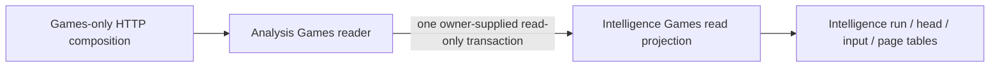

# Intelligence analysis

## Games reader storage boundary

**Implemented source in this unmerged extraction; deployment unverified.** The [Games reader](games_reader.py) retains limit checks, cursor decoding/identity validation, accepted-input decisions and response envelopes. Its existing owner-supplied `read_only=True` transaction is explicit composition: run identity, accepted-input identity and the selected game page still share one owning read snapshot.

The [centralized projection](../../../../../database/tempo_intelligence_database/adapters/games_read_projection.py) owns all four complete, parameter-bound SELECT queries and row extraction. It borrows the existing transaction and never opens or commits one. Run listing remains bounded to 100 identities; game reads request at most 11 payloads, including the existing one-row lookahead. Cursor handling, request bounds, query text/parameters and transaction timing are unchanged. The projection accesses Intelligence-owned `analysis_runs`, `analysis_heads`, `analysis_inputs` and `analysis_pages`; it has no access to another owner's database or tables.

This split adds no public wire operation or new runtime framework. Existing HTTP composition and the installed service continue to supply the owning Store. It does not create a Study dependency, start a worker/provider/engine, change grants or establish live resource isolation. [Schema relationships and fields](../../../../../database/tempo_intelligence_database/schema/README.md) remain source-only PostgreSQL documentation; no DDL or migrations changed.

Focused proofs: `services/intelligence/tests/test_game_browser.py` preserves cursor fences and limits and verifies bounded query parameters in one owner read transaction; `test_games_readonly.py` retains fake-store server denial and lifecycle tests. Existing native proof `services/intelligence/integration/test_games_readonly_postgres.py` remains the real PostgreSQL/grant boundary and was not run for this extraction.
