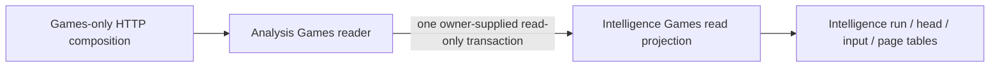
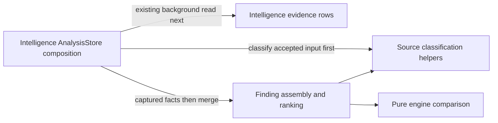
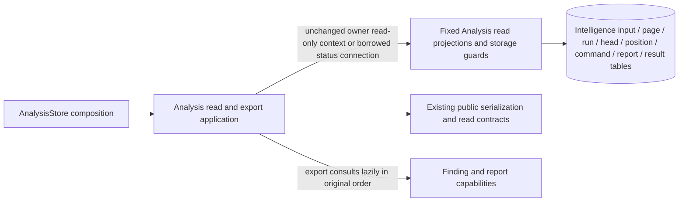

# Intelligence analysis

## Games reader storage boundary

**Implemented source in this unmerged extraction; deployment unverified.** The [Games reader](games_reader.py) retains limit checks, cursor decoding/identity validation, accepted-input decisions and response envelopes. Its existing owner-supplied `read_only=True` transaction is explicit composition: run identity, accepted-input identity and the selected game page still share one owning read snapshot.

The [centralized projection](../../../../../database/tempo_intelligence_database/adapters/games_read_projection.py) owns all four complete, parameter-bound SELECT queries and row extraction. It borrows the existing transaction and never opens or commits one. Run listing remains bounded to 100 identities; game reads request at most 11 payloads, including the existing one-row lookahead. Cursor handling, request bounds, query text/parameters and transaction timing are unchanged. The projection accesses Intelligence-owned `analysis_runs`, `analysis_heads`, `analysis_inputs` and `analysis_pages`; it has no access to another owner's database or tables.

This split adds no public wire operation or new runtime framework. Existing HTTP composition and the installed service continue to supply the owning Store. It does not create a Study dependency, start a worker/provider/engine, change grants or establish live resource isolation. [Schema relationships and fields](../../../../../database/tempo_intelligence_database/schema/README.md) remain source-only PostgreSQL documentation; no DDL or migrations changed.

Focused proofs: `services/intelligence/tests/test_game_browser.py` preserves cursor fences and limits and verifies bounded query parameters in one owner read transaction; `test_games_readonly.py` retains fake-store server denial and lifecycle tests. Existing native proof `services/intelligence/integration/test_games_readonly_postgres.py` remains the real PostgreSQL/grant boundary and was not run for this extraction.

## Finding assembly

**Implemented source in this unmerged extraction; deployment unverified.**
[`findings.py`](findings.py) owns the existing source-advice merge, engine evidence
enrichment, draft response-proposal assembly, uncertain engine-profile handling
and final ranking. It receives already captured facts and mutates the same finding
lists as before; it has no connection, query, transaction or worker capability.

The centralized `AnalysisStore._derive_evidence` remains the composition owner:
source classification precedes its existing background evidence read, which
precedes this database-free merge. No query, lock, transaction boundary, report
publication order, public wire contract or cross-owner dependency changes.
`tests/test_findings.py` uses synthetic accepted facts to check advice identity,
proposal enrichment, ranking, unknown repertoire association and incompatible
engine identity, plus fake composition to preserve that operation order.
Existing native Analysis report and publication proofs remain unexecuted here.

## Read, cursor and export boundary

**Implemented source in this unmerged extraction; deployment unverified.**
[`read_work.py`](read_work.py) owns existing workspace admission, input/status/run/
receipt/report/finding/result responses, input-page flattening, cursor policy and
context/proposal export. Public wire models, canonical JSON/cursor encoding and
nested ReportPage import remain unchanged. It has no database driver, cursor or
query API.

The [fixed reader](../../../../../database/tempo_intelligence_database/adapters/analysis_reads.py)
retains full bound SQL, row/count extraction, missing-record and visible-generation
guards and existing one-row lookahead. The original state-count cursor iteration
is preserved inside this projection. `AnalysisStore.read_transaction` lends the
same `owner.transaction(read_only=True)` context; `_status` borrows its caller's
connection and never opens another one. Input flattening, input-list/result/
input-status envelopes, report cursor encoding and ReportPage validation retain
their original post-read points; pending reports and receipt/run-list responses
retain their original in-read points. Cursor scope/revision/history filters,
malformed/stale rejection timing, row limits/order and lazy workspace/finding/
report lookups are unchanged. Proposal export returns the original proposal
object; this move grants no publishing, activation or Learning authority.

`tests/test_analysis_reads.py` uses actual fixed reads/Store composition with
synthetic rows to prove these boundaries, historical paging/cursor bytes and
lookahead, borrowed run-status reads, visible-generation rejection and export
lookup order. Existing packaged schemas and legacy report contracts remain
selected owning checks. No DDL, foreign key, write workflow, deadline, provider,
engine, private credential or live resource behavior is changed or exercised.
The [complete method inventory](../../../../../database/tempo_intelligence_database/adapters/README.md#complete-analysisstore-source-audit)
continues to identify 15 mixed Analysis methods; this is a bounded read slice,
not completion of the whole owner.
