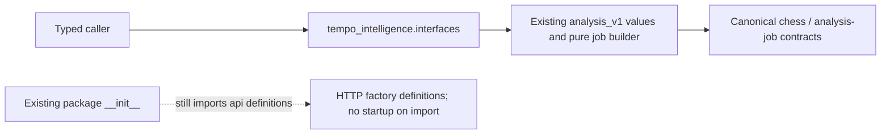

# Retained Intelligence analysis interface

Owner: retained Intelligence analysis/proposal contracts (this interface batch
#494). [__init__.py](__init__.py) names the already public
[`analysis_v1`](../analysis_v1.py) values `Manifest`, `Page`, `RunRequest`,
`Command`, `Finding`, `ReportPage` and pure `make_stockfish_job`. These are the
same classes/function, not copies of the newer product-v0.2 proposal contracts.

Inputs/outputs: existing validated analysis-v1 requests, commands, findings and
report/page serialization; bounded job construction returns the canonical shared
Stockfish job value. Job construction does not dispatch an engine. Validation
errors and unsupported input behavior are unchanged. Dependencies: Pydantic,
python-chess, canonical chess-core and analysis-jobs wire values.

No provider client, Store, worker, HTTP application factory, engine execution or
service startup is exported. No state or transaction is owned by this surface.
Explicit retained runtime entry points keep their existing owners and are not
activated or relocated by this restructuring.

Exact residual: Python first executes `tempo_intelligence/__init__.py`, which
imports `config`, `api` definitions and `analysis_v1`. That existing eager
framework import remains visible; this lease does not include the package root.
#501 owns the follow-up root/packaging routing and must keep its current public
identities before removing that compatibility edge. The cold-import check proves
no connection/provider/process/thread/application startup, not absence of the
existing framework definition dependency or complete component independence.

Exact storage edges remain in
[`analysis_store.py`](../../../../../database/tempo_intelligence_database/adapters/analysis_store.py)
(private classify/engine/read/input/run/publication work),
[`store.py`](../../../../../database/tempo_intelligence_database/adapters/store.py)
(identity, source/provider/credential/Maia work and runtime), and
[`background_connection.py`](../../../../../database/tempo_intelligence_database/adapters/background_connection.py)
(runtime deadline). Other adapters also import the existing private `errors`
module. #501 owns these storage callers; #482 owns any exact temporary guard
exception. Removal requires owner-approved semantic operations and caller
migration, not re-exporting their execution helpers through this DTO surface.
These existing edges are not certified or hidden here. Named checks live in
`backend/tests/test_public_surface_proposals.py`; installation, process lifecycle,
native storage and live adoption remain separately owned and unverified here.
