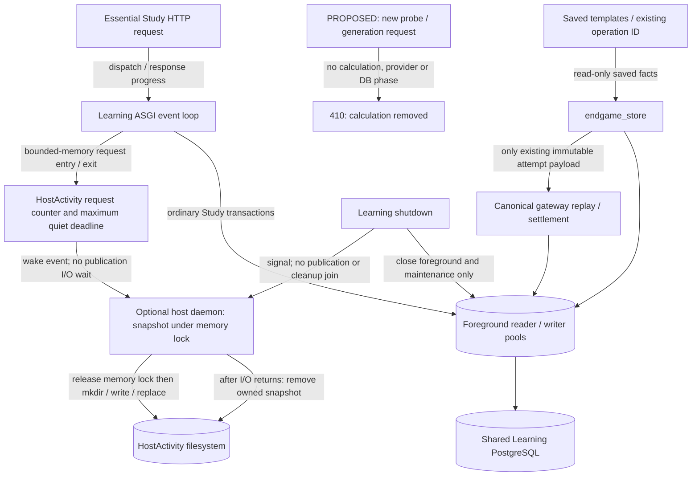
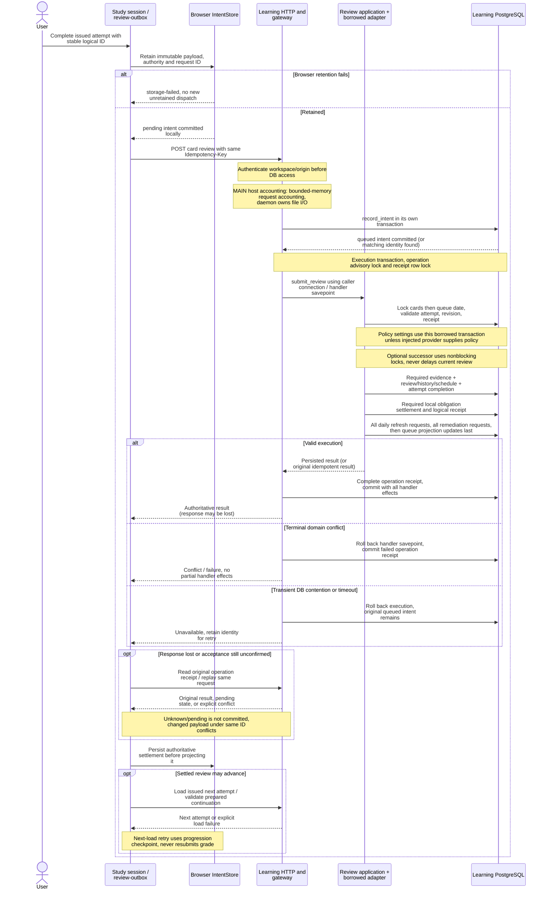

# Independent Learning runtime

`tempo-learning-runtime` 0.1.0 serves Learning from one dedicated PostgreSQL 18 database and one configured workspace. Its installed closure contains Learning review and remediation 0.1.0, scheduling 0.2.0, chess-core 0.1.0 and the Content/Game Evidence contract packages. Redis, Celery, engines, model runtimes and the legacy backend are absent. No live database import, deployment, installer change or cutover is provided here.

## Architecture drawings

These are the canonical drawings for the views below. Edit the blocks here;
peer documents link to them instead of maintaining copies. See the
[diagram index and source/status baseline](../../../docs/architecture/diagrams/README.md) and
[maintenance procedure](../../../docs/architecture/diagrams/README.md#maintenance-and-review-procedure).

### Shared Learning request execution gaps (MAIN)

**MAIN baseline:** `04361d35` includes the earlier HostActivity, endgame
isolation, borrowed policy and queue persistence repairs. **PROPOSED REMOVAL:**
[`d62b9d91`](https://github.com/aaweaver-actuary/tempo/commit/d62b9d91)
removes on-demand endgame calculation and its worker/pools rather than extending
that optional service. HostActivity and ordinary Study ownership remain as below.
The historical [integration receipt](../../../docs/architecture/study-isolation-integration-2026-10-20.md)
qualifies its dated inputs; it does not qualify this removal or a deployment.



| Interface / lifecycle owner | Actual assembled source and limit |
| --- | --- |
| Essential request memory accounting | [`HostActivity.request`](src/tempo_learning_runtime/host_activity.py) updates a counter and maximum quiet deadline. At most 1,024 browser sessions bound shared snapshot memory work. [`request_activity`](src/tempo_learning_runtime/api.py) has no filesystem or daemon-result await, including cancellation. This is bounded-memory synchronization, not hard real-time, lock-free progress or a scheduler latency guarantee. |
| Optional publication and cleanup | `HostActivity.start` starts its daemon without initial file I/O. The daemon releases the memory lock before publishing; `close` signals without joining publication or cleanup. An optional activity 200 acknowledges memory submission against the last healthy lease; missing/known-failed/stale publication or browser capacity returns 503. |
| Explicit admission tradeoff and deployment prerequisite | The unchanged [native reader](../../../scripts/host-study-activity.mjs) can retain an idle snapshot until its 15-second producer lease expires. A new essential request may overlap admitted managed work during that remaining lease; asynchronous publication provides no immediate foreground exclusion. Present stale evidence is unavailable. Missing/startup/removed-source denial requires configuring protected workspace identities in the managed runners' `TEMPO_STUDY_ACTIVITY_EXPECTED_SOURCES` before deployment; default `[]` accepts absence as idle. No live configuration or lease protocol changed. |
| Removed calculation boundary (PROPOSED) | Probe and fresh anonymous attempt requests return 410 before DB/provider access. A supplied operation key permits only a saved receipt lookup; unknown keys return 410. The route can replay an already-recorded immutable FEN/payload through the unchanged canonical gateway. No position generation, cache lookup, provider fallback, optional daemon or optional pool remains. Legacy probe/template-generation/new-attempt triggers are likewise disabled. |
| Saved state and connection ownership | [`endgame_store`](../../../database/tempo_learning_database/adapters/endgame_store.py) retains saved template/receipt reads; cards, attempts, history and caches are not migrated, rewritten or deleted. Ordinary [`Database`](../../../database/tempo_learning_database/connections.py) foreground reader/writer pools plus maintenance remain; total maximum returns to `2 * pool_size + 1`. Study/review/receipt transactions retain their existing owners. |

**Evidence and limits:** the owning removal regressions cover actual ASGI
410/no-database behavior, immutable receipt recovery and legacy thin-trigger
removal without importing its host dependency closure. Browser unit coverage
includes the actual queue mapping → Home move handler → ordinary review caller,
and checks that material-only
cards expose their saved position and Bury, without fabricated grading.
The native saved-attempt/review and deterministic browser contracts are updated;
they have not been run for this change. Historical worker/provider/cache-isolation
proofs describe retired behavior, not current serving requirements. No schema,
stored data, live service, deployment or security setting is changed.

### Review commit and recovery (MAIN)

The MAIN durable commit/replay protocol includes merged HostActivity accounting,
borrowed review-policy settings (PR327) and queue projection/refresh ownership
(PR329). The integration receipt qualifies selected combined behavior; source
and selected passes do not imply deployment.

Scope: Learning-connected aggregate review through the installed review
application. Typed Study/tactics/defense attempts retain their own handlers and
identity rules; they are not silently folded into `cards.review`.



Source owners: [`review-outbox`](../../../app/lib/review-outbox.ts) retains immutable
aggregate intent and adapts receipts;
[`createStudySession`](../../../packages/study-session/src/index.ts) claims delivery,
persists settlement, fences presentation generations and bounds next acquisition;
[`IntentStore`](../../../database/browser-intents/src/index.ts) owns browser
transactions. [`learningFetch`](../../../app/lib/study-connection.ts) restricts
authority; the [HTTP review handler](src/tempo_learning_runtime/api.py)
dispatches to [`gateway`](src/tempo_learning_runtime/gateway.py).
[`submit_review`](../application/src/tempo_learning_review/application.py)
uses [`ReviewSubmissionStore`](../application/src/tempo_learning_review/ports.py),
implemented by [`LearningReviewAdapter`](src/tempo_learning_runtime/review_adapter.py).
[Scheduling/review effects](src/tempo_learning_runtime/review_service.py)
and [required settlement](src/tempo_learning_runtime/remediation_adapter.py)
remain Learning-local under the borrowed transaction. The
[`Database`](../../../database/tempo_learning_database/connections.py)
context commits/rolls back, not the application port.

Transport idempotency and logical attempt identity are separate protections.
Reconciliation may use a new transport operation while retaining the original
logical attempt. A rejected/discarded attempt must not advance as a successful
review. Browser disposal preserves retained work; a late response may settle its
original record but cannot overwrite a newer session snapshot. Auth rejection,
storage failure, pending save and failed next load remain different states.

Ordinary queue reads are not necessarily side-effect free: the
[queue payload handler](src/tempo_learning_runtime/api.py)
dispatches `queue.ensure_current`, runs at most two foreground maintenance assists,
and [queue command handlers](src/tempo_learning_runtime/queue_commands.py)
own attempt issuance. None of those operations calls the game producer.

## Install and run

From the repository root:

```sh
uv sync --project services/learning/runtime --locked --no-editable
npm ci --prefix services/learning/runtime/browser --workspaces=false --ignore-scripts
```

The JavaScript dependencies are qualification-only. Normal service startup needs only the installed Python environment and PostgreSQL. The native runner also installs the separate Game Evidence producer in its own component environment for the real HTTP integration proofs; it is absent from the Learning image and production dependency closure. Use separate database-owner, reader and restricted writer roles. `migrate.provision` deliberately accepts only explicitly disposable `learning_*` database names; the owning test runner provisions these itself. Live provisioning is outside this change. Migrations never run implicitly at server startup.

```sh
services/learning/runtime/.venv/bin/tempo-learning migrate \
  --owner-url-file /secure/disposable-owner-url --workspace workspace-a
```

After applying the ordered manifest, call `migrate.grant_runtime(owner_url, writer_role, reader_role)` using the migration owner. Reapply grants after adding module migrations. Keep owner/admin credentials outside normal service configuration. Runtime and reader roles may read Learning tables; only the runtime role may modify application rows. Neither can create schema objects or modify workspace/migration metadata. Startup readiness rejects privileged credentials.

Configure these variables explicitly; store bearer credentials in permission-restricted files containing at least 32 random characters:

| Variable | Meaning |
| --- | --- |
| `TEMPO_LEARNING_WORKSPACE` | Immutable database workspace identity |
| `TEMPO_LEARNING_DATABASE_URL` | Restricted writer DSN |
| `TEMPO_LEARNING_READER_URL` | Separate reader DSN |
| `TEMPO_LEARNING_TOKEN_FILE` | Workspace study credential |
| `TEMPO_LEARNING_ORIGINS` | Comma-separated exact browser origins, including scheme and port |
| `TEMPO_LEARNING_HOSTS` | Exact hosts; defaults `localhost,127.0.0.1` |
| `TEMPO_LEARNING_TIMEZONE` | Study-day zone; default `America/New_York` |
| `TEMPO_LEARNING_POOL_SIZE` | Each foreground pool maximum, 1–16; default 4 |
| `TEMPO_LEARNING_MAINTENANCE` | `1` enables lifecycle-managed essential maintenance; default 1 |
| `TEMPO_LEARNING_OPERATOR_TOKEN_FILE` | Optional, distinct publication credential; omitted disables publication HTTP commands |
| `TEMPO_LEARNING_EVIDENCE_TOKEN_FILE` | Optional, distinct evidence receiver credential; omitted disables delivery HTTP command |

```sh
services/learning/runtime/.venv/bin/tempo-learning serve --port 8001
services/learning/runtime/.venv/bin/tempo-learning maintain --once
```

### Runtime image and readiness contract (consumed by #359-D)

- Image entrypoint is fixed to `python -I -m tempo_learning_runtime.cli`; default command is `serve --host 0.0.0.0 --port 8001`.
- The service exposes only HTTP port `8001`; no broker, worker scheduler, legacy backend, Games producer, engine runtime or Workbench sidecar is required.
- Owner migration is an explicit prerequisite (`tempo-learning migrate` + `migrate.grant_runtime(...)`). HTTP startup never creates schema objects or runs migrations.
- `/health/live` proves process liveness only.
- `/health/ready` returns:
  - `200 {"status":"ready","workspace_id":"..."}` only after sequential metadata checks through both pools (reader probe first, then writer), with restricted roles, workspace/timezone binding and migration state all valid.
  - `503 {"status":"unavailable","domain":"database","reason":"connection_unavailable"|"query_failed"}` for connection/query failures.
  - `503 {"status":"unavailable","domain":"schema","reason":"migration_state_unavailable"|"migration_history_outdated"}` when schema objects are missing or checksums differ.
  - `503 {"status":"unavailable","domain":"credentials","reason":"restricted_role_required"|"workspace_binding_mismatch"|"insufficient_privileges"}` when runtime credentials or workspace binding are invalid.
- The readiness path performs only these metadata reads and does not issue review/queue/publication commands or write migration/application data.
- On shutdown, HTTP accepts no new requests, signals optional maintenance, closes host-activity reporting and then closes runtime-owned pools. No external queue/broker drain is required.

Every queue read that issues an attempt authenticates before database access. Browser Origin and configured Host checks apply to reads and writes. Non-browser callers may omit Origin; `X-Tempo-Workspace`, when supplied, must match configuration.

A command first durably accepts its immutable intent, then executes its handler directly. The gateway owns commit/rollback and nested handler savepoints. Borrowed application transactions cannot commit. Exact transport retries return the recorded response; a different request under the same identity conflicts. Logical review, Study, tactical and defense identities retain their family-specific bindings. Reconciliation has its own savepoint, and optional successor locks use nonblocking acquisition.

Essential queue work and cursors live in PostgreSQL. Maintenance commits one admission/cursor slice at a time and yields between sections. Its pool maximum is 1. Foreground acquisition/lock/statement/transaction budgets are 250/250/1500/2500 ms; maintenance uses 100/25/200/250 ms. Evidence intake uses the same background pool and 25 ms lock budget with a 1,000 ms transaction bound for an atomic maximum-128-item wire delivery; ordinary maintenance keeps its 250 ms bound. Intake transaction expiry returns 503/Retry-After with all acceptance effects rolled back. Transient failures retain the original intent for retry; a contended command backs off so queue maintenance can progress.

On-demand endgame calculation is removed. The former provider URL environment
setting is ignored; the optional constructor field `tablebase_url` remains an
unused compatibility input. No provider/cache/calculation path is started or
used. The configured connection maximum is `2 * TEMPO_LEARNING_POOL_SIZE + 1`
(foreground reader/writer plus maintenance); the endgame daemon and both optional
pools have been deleted.

Saved templates, immutable attempt receipts, cards, reviews and histories remain
stored. Supplying an existing attempt operation ID may recover its original
saved payload/result through the canonical gateway. New positions return 410.
Ordinary practice uses an authored/persisted legal FEN and nonempty legal line;
a material-only card has no saved solution, so it shows its saved position and
an explicit unavailable notice with Bury. No calculated continuation or success
is invented. See the [browser boundary](../../../app/README.md#saved-endgame-practice-after-calculation-removal).

## Daily presentation

The shared Learning `queue_ordering` owner presents only admitted rows. Policy
`queue-presentation-v3` retains the persisted daily seed and policy fingerprint,
spreads new/review cohorts proportionately and spreads content families within
each cohort. Frozen selection and new-opening relative rank remain authoritative;
opening slots can move across other categories. This policy also runs in legacy
Study-only refresh, without enabling optional analysis or admission providers.

Issued attempts, teaching/presentation checkpoints, unavailable rows, explicit
entries and positioned repeats keep their physical positions. Mandatory real-game
misses retain priority among the remaining movable slots. Existing failed
remediation repeats and first-success reinforcement retain their positioned
behavior; a fresh urgent admission after an earlier completed cycle can still
move into priority. A receipt carries across a controlled completion, burial or
positioned insertion only if the pre-mutation membership and frozen activation
matched that receipt. Unmixed admissions and replacement ranks remain dirty.
Reloads and refreshes reuse the saved order; legacy prepared publication
rejects changed membership, issuance, revision, eligibility or positions before
writing. No scheduler formula, due date, quota, admission rule or offline protocol
changes here. Soft failed-retry cooldowns require a separate policy adoption.

Legacy background preparation pages at most 16 queue entries per read section,
looks up review history separately, and evaluates eligibility only for that page.
The owning native large-queue regression runs with a 50 ms transaction limit;
this is a bounded fixture proof, not a host latency guarantee.

## Accepted definitions and integration

See [INTERFACES.md](INTERFACES.md) and [fixtures/legacy-protocol.json](fixtures/legacy-protocol.json). These are legacy API fixtures, not a claim that the example Learning wire-v1 contracts have been adopted.

Publication JSON includes the existing Content `Publication` plus versioned Learning execution facts: family definitions, memberships, route prerequisites, integrity state, provenance and optional frozen ranks. The first adapter bounds each immutable publication to 128 definitions and 100 memberships per definition. Stage, activate and retire are separate authenticated commands. Activation rechecks completeness, latest generation, workspace, immutable identity, executable revisions and frozen fingerprints. Retirement locks affected cards before fencing stale attempts. Frozen ranks are accepted inputs; Learning never runs their score producers.

Memberships must be unique. Opening route orders must be unique within each repertoire, and every accepted opening line must finish on the trained learner's move. Activation verifies the exact graph steps and executable payloads for every accepted membership. Activation and retirement serialize repertoire ownership with sorted transaction advisory locks, including removed memberships, before acquiring sorted card locks and applying queue effects. A competing owner is a terminal conflict. Malformed previously staged bundles are revalidated and produce terminal operation receipts; transient database contention retains retryable intent.

An explicitly identified V2 route binding must match its accepted exercise's
legal position: piece placement, turn, castling and the existing normalized
legal-en-passant field. Halfmove/fullmove clocks may differ between the recorded
route occurrence and definition. This comparison never establishes card identity
from FEN; explicit card/decision/path/color checks remain required. Full supplied
FEN strings are retained unchanged, and immutable bundle/route digests still bind
those raw strings, including clocks.

One opening repertoire has one active publication owner. V1 retains its
128-definition limit. The Content bridge v2 accepts at most 10,000 definitions in
one complete 12 MiB bundle; independently active chunks cannot replace it. A
replacement generation is not an append operation: omitted definitions stop serving.

Full historical alias activation locks both physical and Content card identities
in the existing sorted card-edit protocol. The 6,524-alias real-data rehearsal
exhausted a disposable PostgreSQL cluster configured with
`max_locks_per_transaction=64` and `max_connections=48`. That leaves the exact
activation intent queued and rolls back its effects; it is not a successful
activation. Provision shared lock capacity for the actual complete source and
other cluster work. The invocation-owned native qualifier uses startup setting
`max_locks_per_transaction=512` and records the actual configuration while
retaining its CPU/memory and transaction-time limits. Runtime never changes that
setting. PostgreSQL documents this as shared lock-table capacity, not a per-review
row limit: [PostgreSQL 18 lock management](https://www.postgresql.org/docs/18/runtime-config-locks.html).

Endgame probes read the persistent cache first. A cache miss with no configured provider is an explicit 503. Provider failure is an explicit 503. Defense grading uses validated accepted engine reports; an uncovered legal move creates durable `needs_analysis` intent without a grade or scheduling event.

Tablebase keys use `tb-fen-v2:` plus the complete normalized FEN, including the halfmove clock. Historical four-field entries remain stored but are not read under the new semantics.

The default receiver now adopts the installed remediation library for both Game Evidence v1 and v2. Authenticated source deliveries are validated against Learning's own active accepted definitions, complete alternatives and immutable exercise revisions. Producers supply observed-game facts; their publication/activation claims do not authorize Learning state. The evidence credential is scoped to the configured workspace. Historical source revisions are fenced by Learning's durable source/game heads; intake never queries a provider or source-game database.

Acceptance, semantic revisions, the acknowledgement and a durable remediation sweep request commit together. `completed` means accepted evidence, not completed studying or synchronous queue admission. The existing essential maintenance executor scans one card per transaction through the module's bounded preparation interface and invokes the sole admission writer. Ordinary queue work shares fair short slices. Claims commit before card/queue/module lock acquisition; the application effects and cursor commit only with the same current, unexpired lease/generation. A yielded slice releases only its own lease after rollback, retaining crash recovery by expiry.

Real-game misses retain the existing cap/progression exception, including zero allowance. They cannot bypass invalidity, burial, retirement, deletion, content revision or frozen-definition validation. Movable ordinary work retains its order; issued/protected positions and accepted frozen rank inputs remain unchanged. No model ordering is recomputed.

An attempt frontier binds only at first authoritative queue-head issuance, including an accepted prepared continuation. Its server-owned queue-entry/revision identity, issuance timestamp and frontier survive reload. An old issued attempt cannot settle a later accepted miss, even when the game time is historical or unknown. The required settlement effect uses the actual review identity/outcome and retained attempt authority, including canonical and reconciled review paths. Unaided correct valid study settles only compatible work within that frontier. History, schedule, required opening evidence, remediation, receipts and queue effects remain in the same Learning transaction/savepoint. Existing scheduling, including same-day reinforcement, remains authoritative.

The append-only manifest now registers `learning.remediation/0001` after `learning.runtime/0002`, loading the library's installed `001_remediation.sql` resource. Existing migration checksums are unchanged; reapply restricted grants after owner-only migration. Startup never migrates. Historical v1 transport receipts replay exactly; new delivery IDs at an unconverted historical frontier conflict, and older revisions remain stale. Their old obligation rows are retained without fabricated provenance, but historical v1 obligation conversion is explicitly separate #224 cutover work. The retired default writer and broad timestamp settlement no longer run alongside remediation. This is an integration into the independent runtime, not a live-data conversion or deployment.

The Game Evidence worker targets `/internal/evidence` with `TEMPO_GAME_EVIDENCE_LEARNING_ENDPOINT` and a private `TEMPO_GAME_EVIDENCE_LEARNING_TOKEN_FILE` containing this runtime's distinct evidence credential. HTTP occurs outside the producer's transactions. Its immutable outbox, completed-receipt validation, leases and acknowledgement-aware correction protocol remain the delivery authority.

## Build and qualification

```sh
uv run --project services/learning/runtime --locked --no-editable python \
  services/learning/runtime/qualify.py /absolute/evidence/installed
services/learning/runtime/.venv/bin/python \
  database/tempo_learning_database/tooling/run_postgres.py /absolute/evidence/native
# Existing component runner also selects the declared producer suites:
TEMPO_COMPONENT_PYTHON="$PWD/services/learning/runtime/.venv/bin/python" \
  node tools/component-build/test-lane.mjs --component learning
# Minimal container, repository-root context restricted by Dockerfile.dockerignore:
docker build -f services/learning/runtime/Dockerfile -t tempo-learning:task .
```

The native runner creates and removes only labeled invocation-owned PostgreSQL containers and volumes. It refuses externally supplied databases. It records exact collected/executed identities and rejects missing, skipped, deselected or zero required tests using the existing qualification machinery. Installed qualification copies only declared package inputs, builds wheels/sdists, removes producer source, and tests consumers as wheel and sdist consumers on Python 3.12 and 3.14. Native Chromium uses the existing review outbox and strict queue schemas against the real HTTP service; it proves the focused client/API seam, not the complete Study UI or shared browser matrix. Install Chromium with the component-local Playwright CLI if its matching browser is unavailable.

[REGRESSIONS.md](REGRESSIONS.md) maps the owning checks. [VALIDATION.md](VALIDATION.md) records this change's exact results and limits. A local focused pass does not establish hosted merge qualification or close #224/#194 by itself.

## Recovery repairs

Same-day remediation refreshes preserve the active one-card sweep and request a
durable follow-up pass. New arrivals behind its cursor are discovered on that
pass. Finalization reads the current rescan marker under the actual lease and
generation; day changes fence prior workers and delayed old requests are ignored.
The finite-sweep proof concerns refreshes preserving productive progress; it is
not a latency bound under unbounded arrivals. Daily-queue replacement is unchanged.

Stale v1 and historical-frontier transport acknowledgements are now persisted by
the remediation repository before return. Exact replay survives restart; changed
contents under the same ID conflict. V2 semantic replay and historical receipt
compatibility remain as documented in [INTERFACES.md](INTERFACES.md). Receipt
persistence does not accept evidence, increment authority or request queue work.
Review task requests flush after prepared issuance inside the owning transaction,
using daily-before-remediation ordering and projections last.

The producer validates its private credential before processing work when a
Learning endpoint is configured. HTTP 401 schedules the same immutable delivery
for retry after at least 60 seconds. See the [producer recovery command](../../game-evidence/README.md#authentication-recovery)
for narrowly recovering rows blocked by the previous classification.

## Run the production Study client

Install root frontend dependencies only when building or qualifying Study, then
run `npm run build:study`. Serve the resulting static assets at `/` with the
existing service-worker headers; the connection screen asks for the exact Learning
origin, workspace and distinct Study credential. Allow that frontend origin in
`TEMPO_LEARNING_ORIGINS`. `TEMPO_WORKBENCH_URL` is an optional build-time link to
a separately launched Workbench. It receives no credential or mutable Study state.
The demo and legacy build targets retain their existing configuration.

The client validates authenticated bootstrap before acquiring a queue, routes all
essential calls through its explicit Learning client, and keeps credentials only
in session storage until disconnect. Retained records bind origin and workspace;
unresolved foreign/ambiguous work blocks switching and can be inspected/exported
for recovery through its original service. Do not clear browser stores to change
authority. Independent offline Study can retain an answer only for an already
issued attempt, with no local successor authorization before Learning confirms it.

The registered full application acceptance command is:

```sh
services/learning/runtime/.venv/bin/python \
  services/learning/runtime/integration/run_study.py \
  /absolute/task-owned/evidence/full-study
```

It builds production assets, refreshes the installed runtime, activates accepted
fixtures and reuses the native runner's owned disposable PostgreSQL, restricted
roles, exact nonzero inventory and cleanup. It requires Docker, root/frontend
and component-local browser dependencies. It never takes an external database
URL or converts a live profile. The minimal Learning runtime qualification remains
separate and does not require frontend installation. See the
[F2 acceptance map](../../../docs/validation/f2-study-learning.md).

Database implementation, DDL and source-schema charts: [central database owner](../../../database/tempo_learning_database/README.md).
