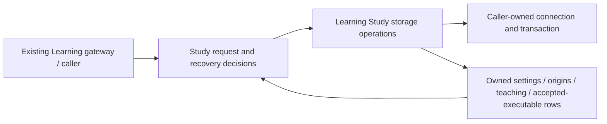

# Study command decisions and database composition

**Current unmerged source; live deployment unverified.** Study is daily practice, separate from authored/imported Studies. The existing Learning command modules retain request validation, recovery/authority conflicts, settings field mapping, chess decisions and response translation outside the database tree. Their complete queries, existing locks and writes now live in Learning's owner-specific root database adapters. This is a move/function split, not a new transaction owner or framework.

| Application / composition | Database operations and retained behavior |
| --- | --- |
| [Queue-attempt recovery](../queue_attempt_origins.py) | [Origin storage](../../../../../../database/tempo_learning_database/adapters/queue_attempt_origins.py) reads retained origin/current-definition facts and records the existing recovered completion. Missing/ambiguous identities and changed/retired definitions still raise the original application conflicts, at the original read boundaries. |
| [Study settings/bootstrap](../study_bootstrap.py) | [Settings/executable storage](../../../../../../database/tempo_learning_database/adapters/study_bootstrap.py) reads settings/progress/accepted-route rows and retains the settings row lock and bound writes. The application supplies validated column/value pairs using its original field mapping, keeps boolean encoding and decides essential queue refresh. Chess/accepted-line verification remains in the application. |
| [Teaching commands](../teaching_commands.py) | [Teaching storage](../../../../../../database/tempo_learning_database/adapters/teaching_states.py) retains card advisory/row lock order and idempotent teaching INSERT/read. Revision, accepted-definition and learner-turn validation remain in the command before writing; timestamp generation and response mapping remain application-owned. |

Adapters neither open nor commit a connection. All effects stay in the gateway/caller transaction; there is no second queue writer or cross-owner table access. Existing request signatures, SQL literals, bound values, lock/query order, stored fields/types, constraints and migrations are unchanged. The database [schema index](../../../../../../database/tempo_learning_database/schema/README.md) remains the source dictionary for actual owned rows and enforced versus logical relationships; no live schema was queried. [Frozen preference](frozen_order/README.md) has its own bounded policy/fact view.

`tests/test_study_command_storage_separation.py` exercises the recovery fences, original settings aliases/enqueue ordering, accepted move verification and teaching learner-turn rejection using semantic fake operations or synthetic in-memory SQLite. The owning native bootstrap/teaching and transaction suites remain separate unexecuted PostgreSQL proofs. Other runtime command/API SQL and existing legacy composition still require extraction; this view does not certify whole-runtime strict domain isolation.
