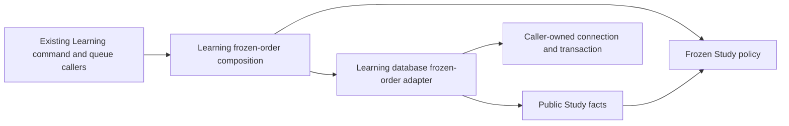

# Frozen Study preference

**Implemented source in this unmerged extraction; live deployment unverified.** This Learning-owned folder contains the existing frozen-definition validity, legacy protection and relative slot-order decisions. It uses only its own public [facts/capabilities](interfaces.py) and standard-library types. It does not import the backend, Games or concrete persistence. This owner retains its independent implementation and artifact.

The [existing composition entry point](../../frozen_opening_order.py) keeps caller signatures and lazy miss lookup. The [database adapter](../../../../../../../database/tempo_learning_database/adapters/frozen_order.py) owns complete bounded queries, dialect checks, row locks and persisted activation/exposure facts on the caller's connection. [Policy functions](policy.py) consume activation tokens, captured/current definitions, memberships and blocked/legacy identities; composition supplies the existing fingerprint and semantic card predicates. No generic SQL execution port, connection acquisition or new commit authority is added. Fingerprint formats, reader version, query sequence, transaction boundaries and PostgreSQL migrations remain unchanged.

Storage remains in the Learning namespace: [frozen-order/evidence fields and keys](../../../../../../../database/tempo_learning_database/schema/opening-evidence/README.md) and [card/queue/deletion fields and keys](../../../../../../../database/tempo_learning_database/schema/study-queue-review-1/README.md). These diagrams describe current source schema, not a verified live database. The moved [deletion fact](../../../../../../../database/tempo_learning_database/adapters/card_deletion.py) and [real-game miss projection](../../../../../../../database/tempo_learning_database/adapters/real_game_miss_projection.py) also borrow the existing caller transaction. Their existing application guard/label exports remain outside the database tree; the miss projection still uses remediation's public predicate for Learning-owned accepted facts.

This closes three mixed source files' SQL extraction, not all Learning runtime coupling. Existing caller composition and the remaining command/API modules still need the coordinated domain/storage moves. A compatibility entry point is not permission for sibling-domain implementation imports and does not prove whole-runtime isolation or live resource independence.

Focused evidence: `tests/test_frozen_order_policy.py` covers pure fact decisions, stale/miss capabilities, protected slots and caller rollback using only synthetic facts/in-memory SQLite. Existing `test_queue_ordering.py` retains presentation behavior. Installed deferred-import/authentication checks and source-free artifact builds cover package discovery. Native PostgreSQL and full-system execution are separate, unperformed checks for this file split.
