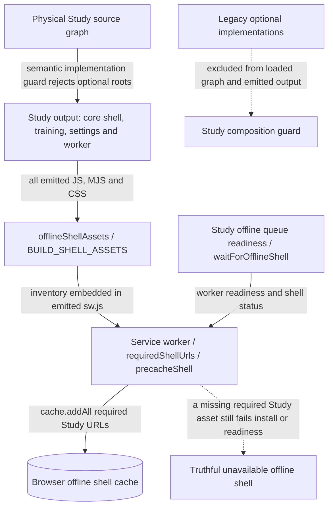

# Static browser build

The static build is the clearly marked GitHub Pages practice demo. It uses
browser storage and packaged/sample data where supported; Docker Tempo remains
the full local product and SQLite authority.

Build with `npm run build:static`, verify with `npm run verify:static`, and
preview with `npm run preview:static`. Do not open `static/index.html` directly.

## Architecture drawings

These are the canonical drawings for the views below. Edit the blocks here;
peer documents link to them instead of maintaining copies. See the
[diagram index and source/status baseline](../docs/architecture/diagrams/README.md) and
[maintenance procedure](../docs/architecture/diagrams/README.md#maintenance-and-review-procedure).

### Conditional Study build and offline assets (MAIN)

**MAIN IMPLEMENTED SOURCE AND REVIEWED PR324 BUILD:** the all-emitted-assets
inventory rule remains intact. The physical Study composition merged in main `588cea54574c2b56799f0a22f8235976171c4fba` removes optional
implementations before emission. This changes the former conditional dependency;
it does not filter required assets out of the worker to conceal coupling.

| Edge / owner | Concrete source and effect |
| --- | --- |
| Composition → actual output | [`studyComposition`](../scripts/study-composition.ts) emits `study-composition.json`, recording loaded application modules and each emitted chunk's modules. PR324's actual bounded Study build passed the expanded implementation guard. It emitted seven JS/CSS assets, including the Study worker, and no named optional implementations. |
| Output → inventory | [Vite config](../vite.static.config.ts) installs [`offlineShellAssets`](../scripts/offline-shell-assets.ts). Its `writeBundle` inventories every emitted `.js`, `.mjs` and `.css` key and replaces `BUILD_SHELL_ASSETS` in `sw.js`. The actual emitted inventory equals that output set. |
| Inventory → install/cache | [`public/sw.js`](../public/sw.js): `requiredShellUrls` combines base shell, HTML references and build inventory. `precacheShell` uses `cache.addAll`; installation waits for that promise before `skipWaiting`. Required fetch failures still reject new-shell installation. |
| Cache → offline readiness | Worker `tempo:offline-shell-status` checks all required URLs. [`waitForOfflineShell`](../app/lib/offline-shell.ts) verifies worker version and readiness. [Queue preparation/fallback](../app/views/fetchAndInitializeQueue.tsx) calls it before claiming offline readiness. [`renderApplication`](src/render-application.tsx) registers the production worker. |

**Verification status:** actual emitted modules, chunks and offline inventory were
inspected for PR324
[`30191b9c`](https://github.com/aaweaver-actuary/tempo/commit/30191b9c026f27f3d816304c47e5b72e0ec390b0): 157 application modules and seven emitted JS/CSS assets.
One native Chromium context served the actual artifact and worker from a disposable
loopback host with canonical synthetic Learning bootstrap/settings/queue/teaching
fixtures. Optional asset URLs returned 404; worker status was ready before and after
offline reload, the prepared opening queue remained usable, and browser appearance
preferences persisted across settings/training navigation. Unknown API, external
network and page-error counts were zero; the context, Chromium process and host
were closed. The PR evidence retains the exact fixture script, screenshots and
initial fixture/oracle failures. No live service, data, deployment, PostgreSQL
behavior or whole-host resource independence is certified by this frontend proof.
