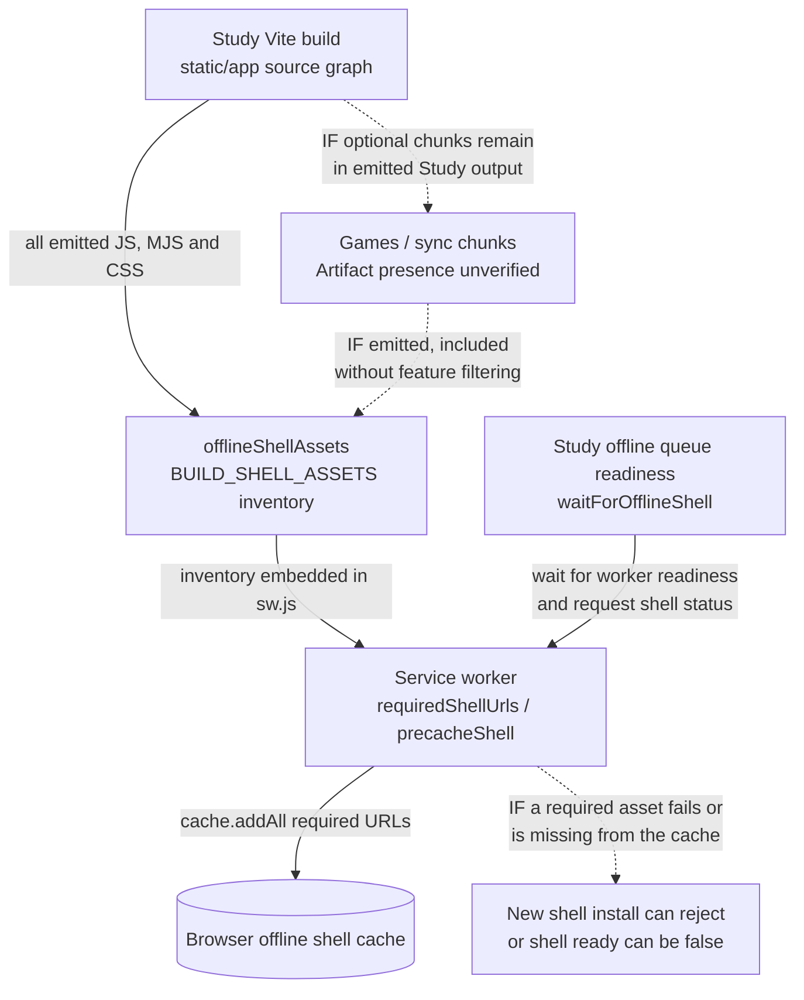

# Static browser build

The static build is the clearly marked GitHub Pages practice demo. It uses
browser storage and packaged/sample data where supported; Docker Tempo remains
the full local product and SQLite authority.

Build with `npm run build:static`, verify with `npm run verify:static`, and
preview with `npm run preview:static`. Do not open `static/index.html` directly.

## Architecture drawings

These are the canonical drawings for the views below. Edit the blocks here;
peer documents link to them instead of maintaining copies. See the
[diagram index and source/status baseline](../docs/architecture/diagrams/README.md) and
[maintenance procedure](../docs/architecture/diagrams/README.md#maintenance-and-review-procedure).

### Conditional Study build and offline assets (MAIN)

**MAIN source checked; emitted-artifact verification pending.** The Study build
uses the shared offline-shell inventory plugin. This is an asset-availability
boundary beyond whether a lazy component executes. Arrows below label build data
flow and readiness waits; dotted edges are explicitly conditional.

| Edge / owner | Concrete source and effect |
| --- | --- |
| Build composition → inventory | [Vite config](../vite.static.config.ts) installs [`offlineShellAssets`](../scripts/offline-shell-assets.ts). Its `writeBundle` inventories **all** emitted `.js`, `.mjs` and `.css` bundle keys, not only initial HTML references or a Study-only feature list, then replaces `BUILD_SHELL_ASSETS` in emitted `sw.js`. |
| Inventory → install/cache | [`public/sw.js`](../public/sw.js): `requiredShellUrls` combines the base shell, HTML-referenced assets and build inventory. `precacheShell` uses `cache.addAll`; the install event waits for that promise before `skipWaiting`. A required fetch failure can reject installation of the new shell. This does not establish failure of an already active older shell. |
| Cache → offline readiness | The same worker's `tempo:offline-shell-status` handler sets `ready` only when every required URL is cached. [`waitForOfflineShell`](../app/lib/offline-shell.ts) waits for service-worker readiness/control and validates the version/status reply. [Queue preparation and cached fallback](../app/views/fetchAndInitializeQueue.tsx) call it before reporting phone readiness or accepting that cached fallback. [Static startup](src/main.tsx) registers the worker in production. |

**Conditional consequence:** if Games/sync chunks remain in the emitted Study
output, they enter this required inventory even without Games/sync execution.
Unavailable optional assets can then affect Study's new offline-shell installation
or offline-readiness check. The asset set is served from the Study build's own
origin; this is not evidence of an API call or readiness wait on the independent
Games service.

**Verification status:** the inventory, install and status paths above were read
in source. No Study build was produced; emitted chunks and the built inventory
were not inspected. No asset-loss scenario was executed or live/offline failure
observed here.
Whether this conditional edge exists in a particular artifact remains unverified.
The target is a Study composition/artifact whose required offline assets exclude
optional feature implementations. A separate composition repair is in progress
on another branch; it is not incorporated or claimed complete by this view.
Its owning change must inspect the actual output/inventory and verify the affected
offline boundary before claiming the gap removed. This documentation correction
does not require a full-stack suite or change runtime source.
