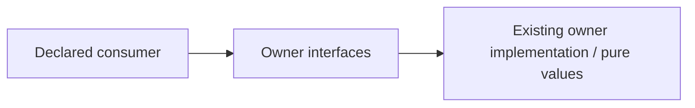

# Neutral native Rust chess interface

Restructuring owner: #497 (allocation revision 2). Existing functional ownership
and algorithms are unchanged. Explicit named exports preserve object identities.

Operations: canonical_fen_key_native; card_id_native; position_distance_native; prefix_native; validate_uci_line_native; LineDiagnostic; ValidatedLine.

Dependencies: Existing crate chess functions/types only. Scheduling-only fsrs_core_available and wasm bindings are not re-exported.

Effects/transactions: none on import. This surface grants no learning/content
mutation authority; caller-owned capabilities retain their existing lifetime.

Implemented source seam only; consumer adoption and deployed independence are
not established by the directory. This new module is not yet registered by lib.rs. #501 must add pub mod interfaces and route callers in its root window. Rust wiring/type compilation is explicitly unverified here; only declared source exports are checked. No Cargo build/download or algorithm change.

Focused proof: `backend/tests/test_public_surface_chess.py` covers identity, cold import and the changed neutral
semantic boundary. #501 owns central registration/root routing and #482 owns
whole-declared-graph cycle/private-import/export-bypass negative controls.
