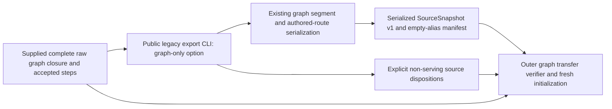

# Authored-source operator bridge

The existing public `tempo-a-legacy-export` command translates supplied files into
Content's serialized `SourceSnapshot` v1, import manifest and translation report.
It imports no Content, Learning or legacy database implementation. Its default
historical projection and `--preserve-physical-execution` behavior remain
available; `--graph-only` adds an explicit fresh authored-source projection.

## Fresh graph projection

```sh
tempo-a-legacy-export --capture capture.json --graphs accepted-steps.json --graph-only \
  --workspace fresh-workspace --source-key retained-opening-graph \
  --repertoire-id explicitly-selected-repertoire --output new-output
```

The input is the graph closure owner's supplied `capture.json`: `tables` contains
the full authored catalogue plus its raw graph closure. The outer composition
selects the exact captured publication generation and supplies its complete
14-field graph-step rows through `--graphs accepted-steps.json`. An already
composed `{tables, graphs}` document is also accepted. Missing selected published
graph scope fails before output; the command never rebuilds it from depth defaults.
The original modes still require `--graphs`.

The full catalogue participates in same-color/prefix policy distinction even
when only an explicit repertoire subset is selected. The projection preserves
selected repertoire IDs/titles/colors, full ordered route IDs/start FEN/moves,
route memberships and the **captured graph segment executable**. Fresh keys are
scoped to source policy and graph-card identity, without historical aliases.
First/last learner indices, decision FEN keys and exact ordered route paths define
binding coverage. Each segment keeps its accepted move line, opponent prelude and
interior `exercise_ply` projections through existing serialization. Unserved
learner decisions stay unbound, even when the full browseable source route
contains them. Captured split/depth realization is preserved rather than rebuilt
from current defaults. Ordered prefixes remain distinct; no transposition re-entry
is granted.

Graph-only mode emits:

- `source.json`: the existing `SourceSnapshot` v1, with fresh authored definitions.
- `import-manifest.json`: the existing import manifest with `legacy_aliases: {}`
  and `historical_mapping_unknown: []`. No review, schedule, receipt, pending work
  or historical-card alias is adopted or required.
- `identity-mapping.json`: the existing report filename, with mode
  `graph_only_fresh_start`, explicit serving repertoires/routes and
  `non_serving_source_entities` table/key/field dispositions, exact
  `source_graph_bindings`, and `excluded_graph_occurrences` for tombstoned nodes.

Old card revision and unrelated historical-card eligibility do not gate this
fresh source. Captured graph steps remain authoritative source facts: a NULL
physical card color may use the recorded explicit graph color only when its exact
same-repertoire authored line agrees. This matches the pinned legacy serving
reader's `COALESCE(c.trained_color,step.trained_color)` behavior
(`86d11afe`, `backend/app/services/postgres_queue_refresh.py`, route occurrence and
bounded occurrence readers); raw NULL remains untouched. A non-NULL physical
color disagreement fails. If the present card body disagrees on executable or is
archived, pending validation
or superseded, the command refuses to newly accept that disagreement. It does not
reset schedules to hide unavailable source capability. Captured `deleted_cards`
identities are excluded and reported; their decisions are never recreated from
the full route. A segment exceeding the existing 40-move execution contract fails
explicitly instead of being silently split into a different graph.

Canonical cards can themselves be authored sources. The legacy effective-source
rule selects opening, unarchived canonical cards through canonical membership or
owner fallback; an explicit owner membership with `canonical_route_source=0`
suppresses that fallback. Every such retained source requires an explicit
accepted occurrence on a known same-repertoire source line. No line association
is invented from FEN alone. Unknown generation, learner range, path, key, color,
availability or overlapping coverage raises a fixed `graph_only_*` diagnostic
before output creation. Historical revision/alias adoption is irrelevant.
Empty selected repertoires/lines remain in the raw recovery copy with an explicit
non-serving disposition; they receive no invented learner color. A selected
scope with no nonempty authored route fails with
`graph_only_nonempty_authored_route_required`. Mixed-color ownership retains the
existing explicit refusal rather than guessing a policy.

## Raw preservation and ownership

`SourceSnapshot` v1 cannot encode legacy line names/timestamps, repertoire editor
metadata, depth limits, canonical preview/source certificates, splits, tombstones
or accepted graph-generation fields. The report lists these non-serving source
facts and requires the original raw graph recovery copy. It does not erase,
rewrite or silently declare them represented by the serving projection. The
closure validator and transfer verifier retain the complete original graph and
necessary repertoire definitions separately; their explicit checks decide
whether the selected serving projection preserves the required scope.



The bridge owns file parsing/projection and immutable output files only. The
outer caller owns capture completeness, selected scope, recovery-copy verification
and subsequent public Content/initialization commands. No browser/database read,
live capture, import, reset, deletion or cutover occurs here. The graph-only path
is independent of old history migration or background-work restoration.

The regular owning suite is `tests/test_legacy.py`; its synthetic cases prove
fresh graph projection, preservation/disposition, explicit scope failures,
immutable repeat CLI output and unchanged existing translation behavior. They do
not certify actual graph capture completeness or authorize runtime activation.
