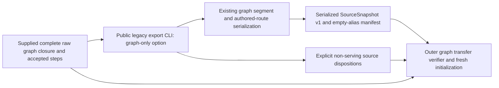

# Authored-source operator bridge

Content import manifests may explicitly approve `export_profile: "learning"`.
This retains the complete authored Learning execution input and marks optional
derived legal-reply inventory as omitted. The existing operator apply/reconcile
path consumes the same publication/source/routes/aliases; it has no export-time
profile override. The optional `snapshot` command rejects that profile before
HTTP or checkpoint activity because it cannot claim complete Games coverage.
Default full exports and snapshots retain their existing behavior. See the
[Content profile contract](../../../services/content/src/tempo_content/bridge/README.md#approval-bound-learning-export-profile).

The existing public `tempo-a-legacy-export` command translates supplied files into
Content's serialized `SourceSnapshot` v1, import manifest and translation report.
It imports no Content, Learning or legacy database implementation. Its default
historical projection and `--preserve-physical-execution` behavior remain
available; `--graph-only` adds an explicit fresh authored-source projection.

## Public commands and ownership

[`pyproject.toml`](pyproject.toml) declares four installed entry points:
`tempo-a-bridge` → [`cli.main`](src/tempo_a_bridge/cli.py),
`tempo-a-legacy-export` → [`legacy.main`](src/tempo_a_bridge/legacy.py),
`tempo-a-legacy-observe` → [`legacy_observation.main`](src/tempo_a_bridge/legacy_observation.py),
and `tempo-a-legacy-study` → [`legacy_study.main`](src/tempo_a_bridge/legacy_study.py).
Their presence is not a requirement to run legacy observation/history workflows
for a fresh graph.

`tempo-a-bridge ... apply <approved-operation-id>` is the public serialized
delivery boundary: it invokes an explicitly selected Content CLI, constructs the
existing V2 bundle, sends Learning stage/activate requests and recovers authoritative
operation results. It forwards optional `repertoire_title`; the
[Learning title-activation owner](../../../database/tempo_learning_database/adapters/publication-execution/README.md#optional-repertoire-display-title)
owns the locked metadata/graph/receipt transaction. A title-capable bridge needs
a compatible runtime; source support does not establish the installed version.

Unlike the file-only exporter below, the operator performs process/HTTP work.
Outer composition owns target/credentials, runtime availability, authorization and
resource lifetime. Consumers use the installed CLI and serialized contracts, not
private `execution_bundle` imports; Learning never depends on this operator
remaining online after acceptance.

## Fresh graph projection

```sh
tempo-a-legacy-export --capture capture.json --graphs accepted-steps.json --graph-only \
  --workspace fresh-workspace --source-key retained-opening-graph \
  --repertoire-id explicitly-selected-repertoire --output new-output
```

The input is the graph closure owner's supplied `capture.json`: `tables` contains
the full authored catalogue plus its raw graph closure. The outer composition
selects the exact captured publication generation and supplies its complete
14-field graph-step rows through `--graphs accepted-steps.json`. An already
composed `{tables, graphs}` document is also accepted. Missing selected published
graph scope fails before output; the command never rebuilds it from depth defaults.
The original modes still require `--graphs`.

The full catalogue participates in same-color/prefix policy distinction even
when only an explicit repertoire subset is selected. The projection preserves
selected repertoire IDs/titles/colors, full ordered route IDs/start FEN/moves,
route memberships and the **captured graph segment executable**. Fresh keys are
scoped to source policy and graph-card identity, without historical aliases.
First/last learner indices, decision FEN keys and exact ordered route paths define
binding coverage. Each segment keeps its accepted move line, opponent prelude and
interior `exercise_ply` projections through existing serialization. Unserved
learner decisions stay unbound, even when the full browseable source route
contains them. Captured split/depth realization is preserved rather than rebuilt
from current defaults. Ordered prefixes remain distinct; no transposition re-entry
is granted.

Graph-only mode emits:

- `source.json`: the existing `SourceSnapshot` v1, with fresh authored definitions.
- `import-manifest.json`: the existing import manifest with `legacy_aliases: {}`
  and `historical_mapping_unknown: []`. No review, schedule, receipt, pending work
  or historical-card alias is adopted or required.
- `identity-mapping.json`: the existing report filename, with mode
  `graph_only_fresh_start`, explicit serving repertoires/routes and
  `non_serving_source_entities` table/key/field dispositions, exact
  `source_graph_bindings`, tombstone exclusions, derived-card availability
  resets, and explicit authored-archive exclusions with their occurrence and
  learner-binding counts. Any known split continuation represented only by an
  archived raw original is recorded as non-serving authoring source coverage.

Old card revision and unrelated historical-card eligibility do not gate this
fresh source. Captured graph steps remain authoritative source facts: a NULL
physical card color may use the recorded explicit graph color only when its exact
same-repertoire authored line agrees. This matches the pinned legacy serving
reader's `COALESCE(c.trained_color,step.trained_color)` behavior
(`86d11afe`, `backend/app/services/postgres_queue_refresh.py`, route occurrence and
bounded occurrence readers); raw NULL remains untouched. A non-NULL physical
color disagreement fails. A present body disagreement on moves or legal chess
state fails. Clock-only FEN differences use the exact source-card FEN after the
explicit card/graph association is established; raw captured FENs are retained.

The exporter [compatibility predicate](src/tempo_a_bridge/graph_fen_compatibility.py)
compares the first four **raw supplied** FEN fields after legal validation.
Learning's [explicit-binding validation](../../../services/learning/runtime/src/tempo_learning_runtime/publication_bridge.py)
instead compares the first four **normalized legal-en-passant** fields. These
are separate owner-local checks, not a shared cross-service helper; neither
infers a card/route association from FEN alone.

For newly keyed definitions, generated (`canonical_route_source=0`) archive,
pending-validation and supersession fields are derived legacy availability
state. Exact ready-publication/path checks still apply, and the report preserves
these fields as explicit fresh-policy resets. This does not claim unchanged
legacy queue eligibility. Authored canonical cards retain their exclusions:
archived definitions and all their learner-range bindings are excluded from
serving, with exact counts and source identities in the report. Active authored
pending or supersession conflicts still fail. Captured `deleted_cards` identities
are excluded and reported; their decisions are never recreated from the full
route. A segment exceeding the existing 40-move execution contract fails
explicitly instead of being silently split into a different graph.

Canonical cards can themselves be authored sources. The legacy effective-source
rule selects opening, unarchived canonical cards through canonical membership or
owner fallback; an explicit owner membership with `canonical_route_source=0`
suppresses that fallback. Every such retained source requires an explicit
accepted occurrence on a known same-repertoire source line. A known continuation
can instead remain non-serving when a unique captured versioned split proves
its exact ordered suffix in archived raw original occurrences: this adds no
exercise or binding and does not restore the archived original. Derived split
boundaries use the pinned legal-en-passant serialization; raw source/graph FEN
comparison remains strict apart from clocks. No line or card association is
invented from FEN alone. Unknown generation, learner range, path, key, color,
authored-source conflict or overlapping coverage raises a fixed `graph_only_*`
diagnostic before output creation. Historical revision/alias adoption is
irrelevant.
Empty selected repertoires/lines remain in the raw recovery copy with an explicit
non-serving disposition; they receive no invented learner color. A selected
scope with no nonempty authored route fails with
`graph_only_nonempty_authored_route_required`. Mixed-color ownership retains the
existing explicit refusal rather than guessing a policy.

## Raw preservation and ownership

`SourceSnapshot` v1 cannot encode legacy line names/timestamps, repertoire editor
metadata, depth limits, canonical preview/source certificates, splits, tombstones
or accepted graph-generation fields. The report lists these non-serving source
facts and requires the original raw graph recovery copy. It does not erase,
rewrite or silently declare them represented by the serving projection. The
closure validator and transfer verifier retain the complete original graph and
necessary repertoire definitions separately; their explicit checks decide
whether the selected serving projection preserves the required scope.



The graph-only exporter owns file parsing/projection and immutable output files only. The
outer caller owns capture completeness, selected scope, recovery-copy verification
and subsequent public Content/initialization commands. No browser/database read,
live capture, import, reset, deletion or cutover occurs here. The graph-only path
is independent of old history migration or background-work restoration.

The regular owning suite is `tests/test_legacy.py`; its synthetic cases prove
fresh graph projection, preservation/disposition, explicit scope failures,
immutable repeat CLI output and unchanged existing translation behavior. They do
not certify actual graph capture completeness or authorize runtime activation.
