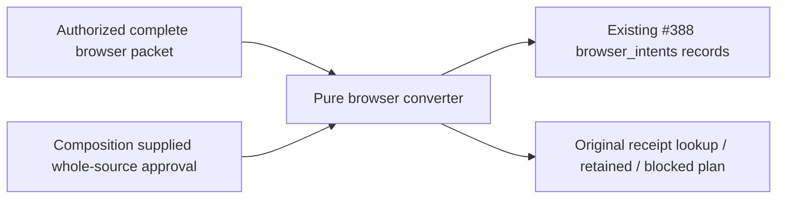

# Browser history preparation for #267

This pure leaf prepares the `browser_intents` group of the existing
[#388 normalized snapshot contract](../../database/tooling/study_snapshot_compare.py).
It imports no application, database adapter, sibling converter, or authority
implementation. It does not capture a browser, open storage, perform network
requests, import into a target, settle an operation, or approve cutover.

`convertBrowserIntents(source, {approval})` returns exactly
`{browser_intents: [{key, data}]}`. The synchronous injected capability must return
literal `true` for the **complete source packet**, including every original value
and reviewer-supplied key. The composition root owns authority qualification.
There is no default approval, credential, guessed identity, or target authority.
A synthetic `() => true` is only a local test double, not the #389 release gate.

The source packet is versioned and complete for one original storage workspace:

```js
{
  schema_version: 1,
  unresolved: [],
  authority: {}, // opaque non-secret evidence, retained unchanged
  storageWorkspace: 'original origin-bound storage identity',
  recordKeys: {}, // exact source coordinate -> independently approved normalized key
  intentDatabase: {
    name: 'tempo-study-intents', version: 1,
    intents: [], metadata: [], teaching: []
  },
  localStorage: [
    {key: 'tempo-learning-authorities-v1', value: null},
    {key: 'tempo-study-intents-cutover-v1', value: null}
  ],
  offlineDatabases: []
}
```

Every collection must be supplied, including empty collections. `null` in
`localStorage` means independently observed absence; omitted is not absence.
The authority registry and cutover acknowledgement must each have an explicit
value or observed absence. Acknowledgement bytes are cold evidence, never
permission. Retained legacy local-storage values remain raw strings, including
malformed/unrecognized JSON. Unknown storage keys/schema versions fail closed
for a reviewed disposition. Session connection credentials are rejected.

`recordKeys` is a one-to-one reviewed mapping; this leaf does not mint normalized
identities. Its map keys are JSON-encoded exact physical source coordinate
arrays, with no coercion or move/FEN matching:

| Source | Coordinate |
| --- | --- |
| Empty/original authority evidence | `["browser-authority", storageWorkspace]` |
| Intent, metadata, teaching | `["indexeddb", "tempo-study-intents", store, originalWorkspace, originalKey]` |
| Raw local storage | `["localStorage", storageWorkspace, originalKey]` |
| Offline database version/observed emptiness | `["indexeddb", originalDatabaseName, "schema"]` |
| Prepared queue | `["indexeddb", originalDatabaseName, "training", observedOutOfLineKey]` |
| Opening journal | `["indexeddb", originalDatabaseName, "opening_attempts", originalAttemptId]` |
| Opening event | `["indexeddb", originalDatabaseName, "opening_events", originalAttemptId, originalSequence]` |

Each `data` retains the opaque authority and complete original row under
`intent`, `metadata`, `teaching`, `cold`, `training`, `openingAttempt`, or
`openingEvent`. Optional and unknown row fields remain intact. Different device
captures need independently approved distinct normalized keys even if they
share an origin/workspace. Duplicate source coordinates or destination keys,
unresolved mappings, absent reviewed rows, foreign workspaces, invalid JSON and
incomplete required identities reject the whole preparation without output.
Browser teaching remains here; it is not converted into a server introduction.

An offline database is `{name, version: 2, training, opening_attempts,
opening_events}`. All three lists are required. `training` entries are
`{key: 'prepared-daily-queue', value: originalPreparedTraining}` because that
store uses **out-of-line keys**. The retained-data inspector's current `getAll()`
values do not establish those keys; this leaf fails closed until authorized
capture/independent evidence supplies them. Entire prepared card transports,
answers, assessments, temporary/string identities, acknowledgements, frozen
journal deliveries, gaps, retained quota fallbacks and event order survive.
Gaps are retained, never filled with invented events. This parser checks the
fixed source boundary; independent approval must establish complete installed
schema/row correspondence and expected golden output.

`planOriginalAuthorityReplay(source, {approval})` returns instructions retaining
the original opaque authority and immutable envelope. Pending intent instructions
are `lookup_original_receipt`, including original request/attempt IDs. Claims,
local success, stored receipt-like values and HTTP 202 never produce settlement
or a send instruction. Committed/discarded tombstones remain terminal; conflicted
intents and adapter time sentinels remain blocked. Raw legacy and offline replay
without an approved owner receipt contract is explicitly blocked while its
source remains retained. The caller must not interpret a lookup instruction as
permission to send. No endpoint, revision, answer, time or storage workspace is
rewritten. Real replay/receipt resolution and interruption recovery remain
mandatory independent disposable qualification after implementation.



The converter owns only parsing, preservation and preparation. The composition
root owns approval. Original browser/server authorities own delivery and
settlement; neither this converter nor the drawing implies deployed wiring.
Source field provenance is the merged
[MIGRATION-MAP §8](../../docs/architecture/study-first-reduction-2026-10-21/MIGRATION-MAP.md),
[IntentRecord](../../database/browser-intents/src/index.ts),
[retained-data inspector](../../database/browser/study-connection-storage.ts),
[offline stores](../../database/browser/offline-training-storage.ts), and
[journal storage](../../database/browser/opening-evidence-journal-storage.ts).

Run `node --test tools/study-history/browser-intents.test.mjs` from the repository
root. The standard-library Node tests exercise synthetic facts only; they do not
claim installed-version mapping approval, a real snapshot, import idempotency,
real browser replay or final acceptance. No dependencies or build artifacts are
needed. Heavy execution on the shared Mac must hold the existing advisory
`/tmp/tempo-mac-validation-20261025.lock`, opened without truncating or unlinking.

The retained [synthetic source](fixtures/browser-source-synthetic.json) and
[expected group](fixtures/browser-expected-synthetic.json) are local preparation
fixtures consumed by the owning test and the disposable synthetic composition.
They contain invented `.invalid` authority/identities only. The expected group
records this converter's supplied-fact output; it is **not** an independently
approved #389 actual-history golden, complete browser inventory, or a release
receipt. The source fixture remains pending at its original authority.
