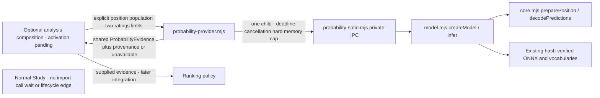
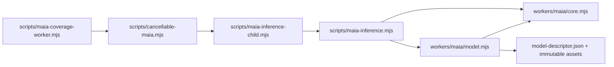

# Maia inference core

## Product probability capability (#498, unmerged source)

The small [probability boundary](PROBABILITY.md) reuses this model behind shared
ProbabilityEvidence 0.2.0. Composition owns later activation; this diagram does
not claim product adoption or deployment qualification.



The adapter owns child admission/termination and no durable state. The model
owns inference and ordered tensor inputs; shared contracts own evidence shape.
Ranking/Study effects remain outside Maia. Native macOS has no supported hard
memory cap and returns unavailable; deployed isolation remains unverified.

This package retains offline model computation used by the root `Dockerfile.maia`
and `scripts/maia-inference.mjs`. The unused standalone `MaiaWorker` supervisor,
JSON-lines CLI, child process, resource admission and container qualification are
retired. This does not remove the root Maia coverage worker or change its runtime
configuration. Study, Learning, model assets and legacy coverage remain unchanged.

`index.mjs` exports the pure position/probability functions and `createModel` /
`inspectModel`. Importing them starts no process or polling loop. These low-level
APIs do not provide supervisor deadlines, cancellation, resource admission or
process-local receipts. Existing callers own their process lifecycle.

## Build and test

Requires Node 26.10.0. Install only this component with
`npm ci --ignore-scripts --workspaces=false`, then run:

```sh
node test.mjs pure
node test.mjs model
node build.mjs --out dist
node qualify.mjs restricted --report dist/installed.json --artifacts dist/artifacts
```

`build-inputs.json` verifies immutable model parts, vocabulary and shared schema
bytes. Packaging reconstructs the existing model locally, without downloading it.
The restricted qualifier checks the installed public computation API and its
immutable inputs. No standalone executable or container is produced. The test
runner rejects empty selections and reports executed identities. See
[REGRESSIONS.md](REGRESSIONS.md) for retained coverage.

## Retained inference boundary



The root [Dockerfile.maia](../../Dockerfile.maia) copies the retained implementation
and package manifests directly. The adapter preserves same-rating legacy inputs
and the complete legal move universe. Root scripts retain cancellation and process
ownership; this change makes no deployment or resource-isolation claim.

## Model capabilities and probability meaning

`model-descriptor.json` binds model/vocabulary hashes, computational schema, runtime/chess versions, tensor shapes, ratings, limitations and unknown provenance. Model SHA-256 is `405bf76c15727dad8728b352c06a8f3c1b80fb2760e8d666b32485c63d75b856` (45,683,686 bytes). Move/reverse vocabulary hashes are `e3351a233174e99d9ddca981681b65a444d191e8a6b474e27bd8fad8514af8d7` and `bb9542b706d3011aa8c0bb067dd33b50bbd7313414cfb50052b0c92aaa9833ee`. Descriptor-derived model version changes with computational descriptor inputs. The implementation identity binds core/model/error/descriptor source hashes and actual runtime context; it does not include supervisor source. Original upstream checkpoint/export revision remains unknown.

Runtime: ONNX Runtime Web WASM 1.23.0 and chess.js 1.4.0. Float32 inputs are `tokens [1,64,12]`, `elo_self [1]`, `elo_oppo [1]`; outputs are `logits_move [1,4352]` and `logits_value [1,3]`. Supported ratings are 1100–1900 in steps of 100. **MaiaJob v1 has one rating, supplied to both ordered model rating inputs.** Distinct player ratings and time-control conditioning are unavailable in v1. Unsupported ratings are rejected without rounding.

Requested UCI moves must be distinct, legal, and exactly representable in the vocabulary. Local position coherence, castling and en-passant consistency are checked; this does not prove retrograde reachability. Black-side color/rank normalization restores original move orientation and preserves promotion suffixes. Missing or duplicated vocabulary decoding fails.

Stable binary64 softmax normalizes actual logits over **exactly the requested legal set**. A subset yields conditional probabilities; omitted legal mass is not zero. Supply every legal move for a whole-position distribution. Nonfinite logits, wrong tensor shapes, missing/extra moves and invalid mass fail. Legitimate exponential underflow stays explicit numeric zero. Terminal positions return nonretryable `terminal_position` error because the inference API has no valid empty successful result. Predictions are model outputs, not observed game frequencies or Learning utility.

Legacy frozen-helper and coverage-client regressions remain in the root unit
suite. The retired standalone protocol's replay/cancellation guarantees are not
claims made by the computation API. No browser inference is restored.
