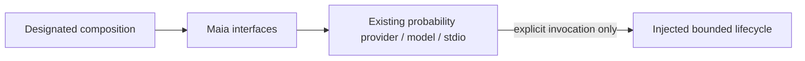

# Maia probability public interface

Restructuring owner #497, revision 2; functional Maia ownership remains #498.
This surface preserves the published #524 callable/error/constants identities.
No model, inference algorithm, vocabulary, process or memory policy changes.

`createProbabilityProvider({createExecution?,now?})` exposes existing `evidence`,
conditional `diagnostic` and `close` operations over a typed injected lifecycle.
`createProcessExecution` is the existing concrete model-process adapter, selected
only by designated composition. `probabilityStdio` is explicit one-shot transport.
`resolveRatingInputs`, `SUPPORTED_RATINGS`, `MaiaError` retain existing semantics.
Imports and factory construction read no model asset and start no inference.

ProbabilityEvidence, legal move inventory and population reuse #482's canonical
wire values. Request/provenance/lifecycle types describe the existing adapter,
not a duplicate probability model. Its current shared TypeScript contract path
is an explicit #482-owned transitional edge. Existing model identity stays opaque
apart from its required provenance identifiers. Default execution still requires
its existing bounded Linux cgroup; this seam neither probes nor modifies it.

Caller/provider retain original lifecycle and cancellation authority. No database,
Study, queue or content effects are exposed. Existing root wildcard exports,
private model/core/provider imports and explicit CLI launch paths remain legacy
compatibility edges, not complete decoupling. #501 routes exact callers and
packaging; #482 supplies graph/private-import/export-bypass negative controls.
Do not remove legacy aliases before those consumers migrate.

`node --test workers/maia/tests/interfaces.test.mjs` checks identity, no-startup
cold import, validation before execution and strict TypeScript caller negatives.
Existing fake-model semantic evidence is reusable when implementation hashes
match. Real models/engines/providers are not run for this mechanical change.
