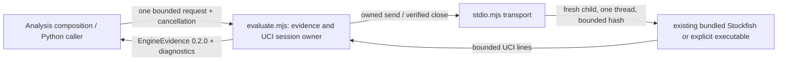

# Bounded repertoire Stockfish adapter (#497)

Implemented source, unmerged; installed product integration and host isolation
are unverified. This optional capability produces #482 interface `0.2.0`
[EngineEvidence](../../backend/app/contracts/product_v02/analysis.py) only.
#499 owns the 30 CP rule and proposals; #501 owns worker launch/composition.
There is no database, Study hook, HTTP endpoint, polling or process singleton.

## Public operations and ownership

`createEvaluator({launch, startupTimeoutMs?, searchTimeoutMs?, totalTimeoutMs?})`
exports asynchronous `evaluate(request, {signal?})`. `launch` is an injected,
synchronous owned UCI transport factory receiving `{onLine,onError}` and
returning `{send(command), close(): Promise<void>}`. `close` must verify exit or
reject; successful cleanup cannot mean merely sending a kill signal.

`createStockfishEvaluator({executable?, ...timeouts})` in [stdio.mjs](stdio.mjs)
wires that API to a fresh owned process per request. With no executable it
reuses [stockfish-child.mjs](../../scripts/stockfish-child.mjs) and the already
tracked bundled assets. An explicitly configured absolute native executable is
also supported; no discovery, installation or download occurs. Native execution
uses no shell. Nothing shares the foreground engine's process or callbacks.

The existing `createStockfishProcess` was inspected but left unchanged: its
fixed 30-second startup and fire-and-forget terminate cannot establish this
adapter's short startup/cancellation/verified-exit contract. The small transport
reuses its child and assets while exposing bounded close. `engine-search.mjs`
was inspected for UCI/results; its foreground network polling/leases, White
perspective, fixed depth/top-five behavior are unnecessary here and not imported.

Each evaluator accepts one active request. Another call fails `busy` immediately;
the integration owner serializes/retries outside the worker. Input is detached
before the first await and output is deeply frozen. Request identity is 1–100
ASCII letters/digits/`._:-`; evidence_id equals request_id. No durable state is
owned here. Version, full FEN/history, budgets and candidate order remain visible.



## Request and response

The adapter-local envelope holds the shared EngineContext and explicit candidate
list; it does not introduce another EngineEvidence DTO. All context fields are
required, including null search bounds. Only standard chess is supported.
`target_fen` must equal legal replay of `starting_fen + history_uci`, including
clocks, castling and en passant. Illegal history/candidates fail before launch.
The engine receives that original starting FEN and ordered moves on every search.

```json
{"request_id":"repair-1","context":{"starting_fen":"rnbqkbnr/pppppppp/8/8/8/8/PPPPPPPP/RNBQKBNR w KQkq - 0 1","history_uci":[],"target_fen":"rnbqkbnr/pppppppp/8/8/8/8/PPPPPPPP/RNBQKBNR w KQkq - 0 1","variant":"standard","learner_color":"white","engine_version":"Stockfish 19","max_depth":8,"max_nodes":1000,"max_time_ms":100,"threads":1,"hash_mb":16},"candidates":["e2e4","a2a3"]}
```

Success is `{request_id,status:"ok",evidence,diagnostics}`. `evidence` parses with
the published EngineEvidenceSchema/Python EngineEvidence. Status `inconclusive`
retains evidence with specific unavailable reasons. Timeout, cancellation and
engine/protocol failures after the engine identifies itself return `unavailable`
or `cancelled`, every candidate explicitly unavailable, and `error:{code}`.
Validation/startup failure before a version is known throws `EvaluationError`
with a stable `code`; the stdio adapter emits
`{request_id,status:"error",error:{code}}` with null identity when invalid.

All scores are converted from root side-to-move to learner perspective. Mate
remains `{kind:"mate",value}`. Because the frozen contract has no bound field,
lower/upper bounds use null score and `score_lowerbound`/`score_upperbound`
(transposed when the learner sign flips); they can never pass a CP policy.

An unrestricted baseline and **every** explicit candidate use identical root
context, search ceilings, MultiPV=1, Threads/Hash, fresh game and cleared hash.
Actual depth/nodes are reported. Unequal achieved depths are
`comparison_depth_mismatch`. A candidate outperforming a shallow unrestricted
baseline is `baseline_inconsistent`, never a hidden negative-loss acceptance.
Version mismatch invalidates scores and records the observed engine version.
Neither failure nor timeout adjusts the consumer's 30 CP threshold.

## Bounds and lifecycle

Hard request limits: 16 unique candidates, 512 history plies, 32 KiB JSON,
standard variant, depth ≤32, nodes ≤1,000,000, time ≤1,000ms per search, Threads=1,
Hash ≤64 MiB. At least one depth/node/time bound is required; supplied bounds
are sent together. These are engineering ceilings, not acceptability policy.

Default startup/readiness timeout is 2s, each search wall timeout 1.5s, total
request wall timeout 15s. Custom timeouts are positive integers ≤15s. Every
completion/failure/cancellation closes only its owned process; stop/quit gets
75ms grace, then SIGKILL and up to 500ms for verified close. Missing exit is
`cleanup_unverified` and cannot publish evidence; the evaluator is quarantined
and refuses new work. Raw inconsistent candidate scores are retained only in
`diagnostics.inconsistent_candidates`, with their shared evidence score withheld
so a consumer cannot accidentally accept them. UCI output ≤1 MiB total,
16 KiB per line; response ≤32 KiB. No endless search, retry or output buffer.
Host scheduling/CPU priority and ordinary-product availability proof remain
integration #501 responsibilities; this source check alone is not that proof.

## Python/stdin boundary and checks

`node workers/repertoire-stockfish/stdio.mjs` reads one JSON document until EOF,
with a 2s input deadline, emits one bounded correlated JSON document, then exits.
Set `TEMPO_STOCKFISH_EXECUTABLE` to an existing absolute executable to use native
Stockfish. No executable path is accepted in untrusted request JSON. SIGINT and
SIGTERM cancel the owned request and await cleanup.

```python
result = subprocess.run(
    ["node", "workers/repertoire-stockfish/stdio.mjs"],
    input=json.dumps(request), text=True, capture_output=True, timeout=20,
)
response = json.loads(result.stdout)
assert response["request_id"] == request["request_id"]
# Apply EngineEvidence.model_validate(response["evidence"]) when supplied.
```

```sh
node --test tests/runner/product-stockfish.test.mjs
TEMPO_STOCKFISH_SMOKE_EXECUTABLE=/absolute/existing/stockfish TEMPO_STOCKFISH_SMOKE_VERSION="Stockfish 19" node --test tests/runner/product-stockfish-smoke.test.mjs
```

Fake tests check every issue-named boundary plus caller isolation/serialization
and owned termination. They validate outputs through the unchanged TypeScript
shared schema and seven-candidate fixture; no live engine proof is implied.
Smoke is explicitly configured, uses three tiny legal positions with identical
small budgets, and asserts legality/provenance/cleanup rather than unstable CP.
No binary configuration means smoke is skipped/unverified, not passed.

Central test registration/dependency wiring belongs to #501. Register these
exact two runner files (smoke explicit only) without broad suites or lock edits.
