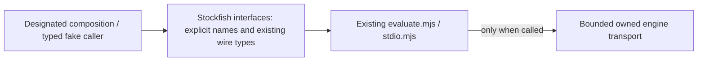

# Stockfish public interface

Owner: #497. The Stockfish source and interface form one bounded component; caller migration,
whole-graph guard integration, packaging and installed isolation remain separate.
Existing evaluation/search/lifecycle behavior is unchanged.

Use [`index.mjs`](index.mjs) for runtime imports and [`index.d.ts`](index.d.ts)
for types. Explicit typed aliases retain the original function, error class and
limits object identities. No wrapper, DTO copy or algorithm is introduced.
The repository's existing `allowJs` mode follows the declaration annotations for
`.mjs` consumers; package export maps remain #501's responsibility.

- `createEvaluator({launch, ...timeouts})` receives an owned typed transport.
  `evaluate(request, {signal?})` returns shared learner-oriented EngineEvidence.
- `createStockfishEvaluator({executable?, ...timeouts})` and
  `createOwnedLauncher(options?)` are concrete transport factories for designated
  composition only. Factory construction/import starts no engine. Evaluation
  owns the process, resource limits, cancellation, verified close and quarantine.
- `runStdio(options?)` is the explicit one-shot JSON adapter. Importing this
  surface neither reads stdin nor launches the CLI. The existing direct CLI
  path remains `workers/repertoire-stockfish/stdio.mjs` until #501 changes wiring.
- `EvaluationError` and immutable `LIMITS` retain their original values.
  Validation and UCI parsing helpers are private, not public exports.

`EvaluationRequest` is only the adapter-local request envelope. `EngineEvidence`,
context, candidate scores and mate values reuse #482's existing shared TypeScript
contract. Its current import path, `app/features/product-api/contracts.ts`, is an
explicit transitional shared-value edge owned by #482; replace it only when that
owner publishes its designated replacement. No evidence or acceptability policy
lives here. #499 owns the 30 CP rule; Study/Repertoire retain all state mutations
and transaction authority. This adapter has no database or content authority.

The [owning lifecycle drawing and protocol](../README.md) remain canonical for
engine behavior and budgets. This drawing describes the new source seam only;
it does not certify consumer adoption or deployed process/resource independence.

## Remaining private edges and migration handoff

This readiness change contains only the Stockfish evaluator, owned transport,
public facade, documentation and focused tests. There are no existing internal
callers of the new surface to migrate within that lease. Preserve these exact
compatibility paths until #501 owns the caller edit/registration window and
#482's graph/export-bypass negative controls pass:

| Current edge | Owner / removal condition |
| --- | --- |
| `stdio.mjs` imports `./evaluate.mjs` | Same-component implementation dependency; remains private. |
| `product-stockfish.test.mjs` and `product-stockfish-smoke.test.mjs` import evaluator/stdio directly | #501 integrates exact test import substitutions to `interfaces/index.mjs`; preserve existing semantic tests and explicit-only real smoke. |
| `backend/app/analysis/jobs/stockfish.py::StockfishBridge` invokes the explicitly configured one-shot script in the published D/E branch | #501 owns worker composition; retain CLI compatibility until its explicit launch change and affected fake process proof. |
| Evaluator JSDoc and this declaration reference existing shared wire types | #482 owns canonical shared values; no duplicate DTO or private sibling implementation is exported. |
| Legacy `scripts/stockfish-process.mjs` / `stockfish-child.mjs` / older workers | No new consumer adoption claimed. The legacy execution wrapper and new adapter remain distinct; no automatic move or engine run. |

Boundary proof: `node --test tests/runner/public-surface-stockfish.test.mjs`
checks exact export identities/omitted helpers, cold import and factory creation
with engine/network startup denied, a typed fake-UCI semantic call, and focused
TypeScript positive/negative caller cases. The existing
`node --test tests/runner/product-stockfish.test.mjs` is the affected fake-process
semantic suite. Do not run real engines or models for this mechanical change.
#501 registers the new exact runner file; #482 supplies whole-declared-graph
private-import/cycle/export-bypass controls. These local checks cannot stand in
for those remaining controls or complete decoupling.
